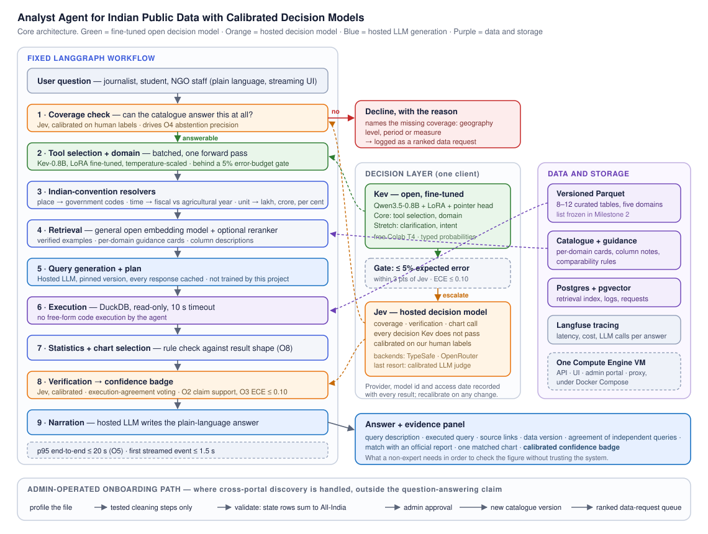

# Analyst Agent for Indian Public Data with Calibrated Decision Models

DS & AI Lab course project, Generative AI track. Group 4.

*Title not final.*

## Project overview

A trustworthy natural-language interface to a curated set of Indian public
statistics. The agent shows its evidence, reports a calibrated confidence, and
declines when the catalogue cannot support an answer.

- **Milestone 1 report:** [docs/Milestone1_Report.md](docs/Milestone1_Report.md)
- **Contributing, branches and working agreements:** [CONTRIBUTING.md](CONTRIBUTING.md)
- **Worklog (individual contributions, updated weekly):** [WORKLOG.md](WORKLOG.md)

## Problem statement

Indian public data from data.gov.in, MoSPI and the PLFS, the RBI, the IMD, the
agriculture ministry, NFHS and the Census is open but hard to use: messy
formats (years as columns, footnotes, lakh and crore, Orissa and Odisha),
domain conventions (usual against weekly status, agricultural against fiscal
year) and no way to verify a figure a chatbot produces. The goal is a correct,
explained and verifiable answer for a non-expert in about 30 seconds.

Primary users are journalists and fact-checkers. Secondary users are students
and researchers, NGO staff and local administrators. The admin team operates
the system and is not a user.

Cross-portal dataset discovery is out of scope for the question-answering
claim: the agent works over an admin-curated catalogue of 8–12 tables, and new
tables enter through a separate, admin-approved onboarding path. The full
problem statement, stakeholder analysis, scope table and literature review are
in the [Milestone 1 report](docs/Milestone1_Report.md).

## Features

Core features (target: 26 November, per the scope table in the Milestone 1
report); none are implemented yet — see [Status](#status).

- Natural-language questions answered over a fixed catalogue of Indian public
  tables, with place, time and unit resolvers for government geography codes,
  fiscal-versus-agricultural years, and lakh/crore normalisation.
- Read-only, checked SQL execution (sqlglot, DuckDB over versioned Parquet, a
  10-second timeout) with an evidence panel showing the executed query, its
  sources and the data version.
- A calibrated confidence badge on every answer, and a decision to decline
  with the reason when the catalogue cannot cover the question.
- A decision-model control layer (Kev, Jev) in place of per-step LLM calls,
  for lower latency and cost.
- A frozen 200-question evaluation suite tracked across six versions (v0–v6).

## Architecture

A fixed LangGraph workflow, not an open-ended ReAct loop. Decision models make
the agent's control decisions; a hosted LLM is used only where text must be
generated, namely queries, plans, narration and clarifying questions. SQL is
the execution layer, not the research contribution.

| Layer | Component |
| --- | --- |
| Query generation | Hosted LLM, chosen by a dev-set comparison, with retrieval, verified-example memory and prompt optimisation (DSPy, GEPA) |
| Control decisions | A fine-tuned open decision model (Kev) behind accuracy and calibration gates, with uncertain calls escalating to a hosted decision model (Jev); Jev takes coverage and every decision Kev does not pass |
| Verification | Jev zero-shot, calibrated on the team's human labels, producing the claim-support check and the confidence badge |
| Execution | sqlglot check, read-only DuckDB over versioned Parquet, 10-second timeout |
| Abstention | A coverage check: the agent declines and logs a data request when the catalogue cannot answer |

The retraining and recalibration procedure is human-approved; an admin
approves each run. The project makes no self-improvement claim.



*Figure 1. Core architecture, reproduced from the Milestone 1 report. The
admin-operated onboarding path (foot of the diagram) is outside the
question-answering claim.*

### Version ladder

| Version | Change |
| --- | --- |
| v0 | Baseline: fixed workflow, a hosted LLM writes queries and makes every decision, generic prompts |
| v1 | Catalogue descriptions, domain guidance cards, retrieval with reranking |
| v2 | Retrieved verified examples |
| v3 | Optimised prompts (run manually) |
| v4 | Fine-tuned Kev replaces the LLM calls for its gated decisions |
| v5 | Calibrated verification by Jev and the confidence badge |
| v6 | Retraining and recalibration after drift |

## Dataset details

The initial catalogue is 8–12 core tables across labour, agriculture,
rainfall, prices/economy and health, drawn from data.gov.in, MoSPI/PLFS/CPI/WPI
(eSankhyiki), the IMD, the agriculture ministry (DES), the RBI (DBIE) and NFHS
(IIPS). Specific tables are not named yet: candidates are profiled and the
list is frozen in Milestone 2 (29 October 2026). See
[data/README.md](data/README.md) for the directory layout and tracking rules,
and section 10 of the [Milestone 1 report](docs/Milestone1_Report.md) for
sourcing, licensing and the full data plan.

| Material | Planned size |
| --- | --- |
| Question–reference-query pairs | 1,000+ execution-verified pairs |
| Routing examples per Kev decision | 1,000–2,000 (core: tool selection, domain) |
| Verification calibration set | 150–200 human-labelled instances |
| Evaluation sets | Frozen test (200, 20+ unanswerable), dev (150) |

No dataset or model file is committed to this repository; `data/sample`
carries small tracked extracts only.

## Model(s) used

| Model | Role |
| --- | --- |
| A hosted LLM (chosen by a dev-set comparison, E2) | Writes SQL queries, plans and narration; the only generation step |
| Kev-0.8B (open, fine-tuned; Kev-4B as a stretch comparison) | Core decision model: tool selection and domain, behind an accuracy/calibration gate |
| Jev (hosted decision model, TypeSafe AI) | Coverage, verification and every decision Kev does not pass; calibrated on human labels |

No model is fine-tuned to write SQL; query generation is bought from a hosted
LLM rather than trained. See section 5.1 and section 8 of the
[Milestone 1 report](docs/Milestone1_Report.md) for the reasoning.

## Objectives

Targets are initial; the execution-accuracy target is fixed after v0 is
measured.

| | Objective | Target |
| --- | --- | --- |
| O1 | Execution accuracy on a frozen 200-question test set | Exceed v0, paired difference with a 95% interval |
| O2 | Claim support | At least 0.95 |
| O3 | ECE of the confidence badge | At most 0.10 |
| O4 | Abstention precision | At least 0.85 |
| O5 | Time to first streamed event; p95 end to end | At most 1.5 s; at most 20 s |
| O6 | Cost per answered question | Below v0 |
| O7 | Improvement across versions | Measurable |
| O8 | Chart appropriateness | At least 0.90 |

## Installation

Python 3.12 or 3.13 is required; Kev's serving stack supports only these.

```bash
python -m pip install -e ".[dev]"
pre-commit install
```

## Running instructions

Tests:

```bash
pytest
```

The full stack with Docker Compose:

```bash
cp .env.example .env   # fill in POSTGRES_PASSWORD and any keys needed
docker compose up --build
```

See [infra/README.md](infra/README.md) for deployment, for serving Kev, and for
the budget estimate.

## Results

None yet. Milestone 1 is problem definition and literature review only; no
agent, model or tool code is implemented. The v0 baseline is measured starting
Milestone 3 (5 November 2026), and each subsequent milestone report adds the
version-ladder results (execution accuracy, claim support, ECE, abstention
precision, latency, cost) defined in section 9 of the
[Milestone 1 report](docs/Milestone1_Report.md).

## Demo screenshots

None yet. A streaming UI with an evidence panel and confidence badge is a core
deliverable targeted for 26 November 2026 (Milestone 5); screenshots are added
once it exists.

## Repository layout

```
docs/          Milestone reports, architecture diagram, TA presentation decks
data/          raw, processed, sample (tracked), splits — see data/README.md
notebooks/     01_EDA, 02_Preprocessing, 03_Model_Experiments, 04_Evaluation
src/analyst/
  data/        Acquisition, cleaning, catalogue construction
  models/      Decision-model training, calibration, checkpoints
  inference/   Decision-model and hosted-LLM clients
  retrieval/   Verified examples, guidance cards, column descriptions
  agents/      The fixed LangGraph workflow
  tools/       Typed tools: resolvers, query runner, statistics, chart
  decisions/   Decision contracts and the Kev-to-Jev cascade
  evaluation/  Version ladder, gates, ablations
  pipelines/   Ingestion, example generation, retraining, recalibration
  utils/       Configuration, logging, tracing
app/           api (API and agent), ui, admin
configs/       Catalogue, model, train, inference, evaluation, prompts
models/        Local checkpoints (not tracked)
outputs/       predictions, reports, figures, logs (not tracked)
infra/         Caddy, database initialisation, deployment notes
tests/         Mirrors src/analyst
```

## Status

Milestone 1 is complete. No agent, model or tool code is implemented yet; this
repository currently holds the report, the architecture diagram and the
scaffold.

| Milestone | Deliverable | Date (2026) |
| --- | --- | --- |
| M1 | Problem definition and literature review | 22 October |
| M2 | Data: freeze the table list, first cleaned tables and catalogue, week-1 feasibility results, first question–reference pairs | 29 October |
| M3 | Architecture | 5 November |
| M4 | Training | 19 November |
| M5 | Evaluation | 26 November |
| M6 | Deployment and documentation | 10 December |
| | Final presentation | about 21 December |

## Team members

| Track | Member | Roll number | Scope |
| --- | --- | --- | --- |
| T1 Data and Tools | Shaoni Samanta | 21f1003157 | Sourcing, profiling, cleaning steps, validation, catalogue, guidance cards, onboarding pipeline, typed tools |
| T2 Agent | Shivanshu Gupta | 22f3002985 | LangGraph workflow, resolvers, query generation, execution, evidence panel, streaming UI |
| T3 Model | Sathya Prakash | 21f1006001 | Kev fine-tuning, calibration fits, gates, retrieval, Jev integration |
| T4 Ops and Evaluation | Ashmit Ghose | 24f1001827 | Question–reference pairs, splits, leakage checks, evaluation, Compose stack, VM, tracing, admin portal |

Tracks rotate
between milestones; see [CONTRIBUTING.md](CONTRIBUTING.md). Weekly individual
contributions are logged in [WORKLOG.md](WORKLOG.md).

## References

36 references, verified against source, are listed in section 12 of the
[Milestone 1 report](docs/Milestone1_Report.md): decision models and routing,
calibration, verification and abstention, grounded data analysis and
query-generation benchmarks, prompt optimisation, and the commercial and
public tools reviewed in section 5.

## Licence

Code and documentation: MIT, see [LICENSE](LICENSE). The referenced datasets
are published by Indian government bodies under their own terms.
