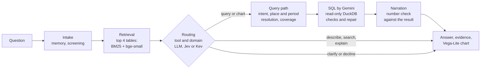

# Analyst Agent for Indian Public Data with Calibrated Decision Models

DS & AI Lab course project, Generative AI track, Group 4. Working title.

The agent answers questions in plain English about a curated catalogue of 14 Indian public
statistics tables. Every figure in an answer comes from a read-only SQL query on a versioned
table, and every answer carries its evidence: the table, the filters, the query and the result.
When the catalogue cannot answer, the agent says so instead of guessing.

The research contribution is the control layer. Small decision models, fine-tuned and calibrated
on the project's own labels, take the agent's routing decisions; a hosted LLM is used only where
text must be written (query intent, SQL, narration, clarifying questions).

## Contents

- [Status](#status)
- [Problem and users](#problem-and-users)
- [Architecture](#architecture)
- [Models](#models)
- [Data](#data)
- [Results](#results)
- [Setup](#setup)
- [Running](#running)
- [Repository layout](#repository-layout)
- [Documents](#documents)
- [Team](#team)

## Status

Milestone 4 (training, configuration and evaluation) was submitted on 19 November 2026.

| Area | State |
| --- | --- |
| Data catalogue | 14 tables frozen, 723,169 observations, built by a configuration-driven pipeline |
| Agent | LangGraph graph of 36 nodes, built and tested (569 tests); runs end to end with Gemini on Vertex AI |
| Versions measured | v0, v1, v2 on the held-out test set, 3 runs x 60 questions |
| Decision model | Kev-0.8B fine-tuned for the domain decision; passes the gate against Jev on 198 human labels |
| Demonstration app | FastAPI service with a streaming browser page (`app/api`, `app/ui`) |
| Next (Milestones 5 and 6) | Optimised prompts (v3), Kev inside the agent (v4), calibrated verification and the confidence badge (v5), deployment, evidence and data provenance report |

## Problem and users

Indian public data from data.gov.in, MoSPI (PLFS, CPI), IMD, the agriculture ministry, NFHS and
NCRB is open but hard to use: tables arrive in different shapes (years as columns, footnotes,
lakh and crore), names change (Orissa and Odisha), and domain conventions matter (usual against
weekly status, agricultural against fiscal year). A chatbot figure cannot be checked against the
source. The goal is a correct, explained and verifiable answer for a non-expert in about 30
seconds.

Primary users are journalists and fact-checkers. Secondary users are students and researchers,
NGO staff and local administrators.

### Objectives

| | Objective | Target |
| --- | --- | --- |
| O1 | Execution accuracy on the held-out test set | Above v0, with a 95% interval |
| O2 | Claim support | At least 0.95 |
| O3 | ECE of the confidence badge | At most 0.10 |
| O4 | Abstention precision | At least 0.85 |
| O5 | Time to first streamed event; p95 end to end | At most 1.5 s; at most 20 s |
| O6 | Cost per answered question | Below v0 |
| O7 | Improvement across versions | Measurable |
| O8 | Chart appropriateness | At least 0.90 |

## Architecture

A fixed LangGraph workflow, not an open-ended agent loop. Every path ends in one of six
terminal outcomes (answer, clarification, decline, abstention, out of scope, system failure),
and every edge enforces a 45 s deadline and a budget of 8 model calls.



| Stage | What happens |
| --- | --- |
| Intake | Reads the last five turns, a pending clarification and the prior result; screens prompt-override attempts |
| Retrieval | Ranks the catalogue (BM25 fused with `bge-small-en-v1.5`, plus place and indicator slots), then retrieves indicators, guidance cards and verified examples for the top four tables |
| Routing | Chooses one of seven branches (query, chart, describe, search, explain, clarify, decline) and the domain |
| Query path | Extracts the query intent, resolves places, periods and units, checks coverage, writes SQL, executes it read-only, derives values in code and checks the result against the intent |
| Output | Narrates the result, checks that every narrated number is in the result, stores the evidence bundle and draws the chart |

Full design contract: [docs/specs/agent_graph.md](docs/specs/agent_graph.md). Built system and
its configuration: [Milestone 4 report](docs/milestones/Milestone4_Report.md), Section A2.

### Version ladder

| Version | Change | State |
| --- | --- | --- |
| v0 | Hosted LLM routes and writes SQL; catalogue only | Measured |
| v1 | v0 plus guidance cards in the retrieved context | Measured |
| v2 | v1 plus verified question and SQL examples; Jev routes | Measured |
| v3 | Optimised prompts (DSPy, GEPA) | Milestone 5 |
| v4 | Fine-tuned Kev takes the domain decision | Kev trained and gated; not yet in the agent |
| v5 | Calibrated answer verification and the confidence badge | Milestone 5 |
| v6 | Recalibration and human-approved retraining after drift | Milestone 6 |

## Models

No model is trained from scratch, and no model is fine-tuned to write SQL. Reasons and
alternatives: [Milestone 4 report](docs/milestones/Milestone4_Report.md), Section 1.4.

| Role | Model | How it is used |
| --- | --- | --- |
| Query intent, SQL, narration, clarification | `gemini-3.5-flash-lite` on Vertex AI | Temperature 0, JSON-schema replies validated by code, thinking level set per purpose ([configs/model.yaml](configs/model.yaml)) |
| Domain decision | Kev-0.8B (Qwen3.5-0.8B base, LoRA rank 16, pointer head) | Fine-tuned on 1,876 routing records; one temperature fitted for calibration ([configs/train.yaml](configs/train.yaml)) |
| Tool selection, reference decision model | Jev (hosted, TypeSafe AI) | Zero-shot; routes in v2; reference for the Kev gate and the fallback of the cascade |
| Retrieval embeddings | `BAAI/bge-small-en-v1.5` | CPU, fused with BM25 |

## Data

Fourteen tables from government sources, each published as one observation table
(`obs_<dataset>`) under a fixed [data contract](docs/specs/data_contract_v1.md). Raw and
processed files are not in git; the download and pipeline scripts rebuild them, and
[data/MANIFEST.md](data/MANIFEST.md) holds their hashes.

| Domain | Tables |
| --- | --- |
| Labour | PLFS unemployment rate by State (2017-18 to 2021-22); PLFS urban labour force participation rate by State (2023-24) |
| Agriculture | Crop area and production by district and season (1997-98 to 2015-16); minimum support prices of 24 crops (2013-14 to 2024-25) |
| Rainfall | IMD monthly rainfall for 36 sub-divisions (1901-2017); IMD district rainfall normals (1951-2000) |
| Prices and economy | CPI All India, rural, urban and combined (2013-2023); Mandi daily commodity prices; per capita GSDP by State (2019-20 to 2023-24) |
| Health | NFHS-5 district indicators; NFHS-5 State factsheets; SRS infant mortality rate by State (2015-2019) |
| Other | NCRB crime incidence and rates (2022-2024); NCRB violent crimes by State (2021-2023) |

Sources, units and quirks of each table: [docs/specs/candidate_tables.md](docs/specs/candidate_tables.md).

| Evaluation material | Size | Use |
| --- | --- | --- |
| `e2e_v1` ([data/eval/](data/eval/)) | 100 questions: 40 development, 60 test (+20 development only) | End-to-end evaluation of the agent; outcomes fixed in advance |
| Routing data v2 ([data/splits/kev/](data/splits/kev/)) | 1,876 train, 322 calibration, 355 validation | Kev training, calibration and checkpoint selection |
| `dev_human` ([data/labels/dev_human_v1/](data/labels/dev_human_v1/)) | 198 items, two labellers and an adjudicator | Test set for the decision models, scored once |

## Results

Milestone 4 results. All figures come from committed files under [outputs/](outputs/); costs
are estimates from token counts.

**Agent, held-out test set** (`e2e_test`, 3 runs x 60 questions;
[version_ladder_test.md](outputs/reports/version_ladder_test.md)):

| Measure | v0 | v1 | v2 |
| --- | --- | --- | --- |
| End-to-end success | 0.683 | 0.689 | 0.694 |
| Execution accuracy | 0.433 | 0.525 | 0.633 |
| Wrong-answer rate | 0.038 | 0.012 | 0.083 |
| Latency p95 (s) | 13.0 | 11.9 | 10.0 |
| Model calls per answer | 8.75 | 8.56 | 6.05 |
| Cost per answer (USD, estimate) | 0.0269 | 0.0296 | 0.0190 |

Execution accuracy rises with each version; end-to-end success stays flat because most failures
occur before the query is written, mainly in place resolution (report Section A6.4). Declines and
searches succeed in every run; clarification is the weakest action.

**Domain decision, human-labelled test set** (`dev_human`, 198 items; report Section B12):

| Model | Accuracy (95% CI) | Macro-F1 | ECE after calibration |
| --- | --- | --- | --- |
| Kev-0.8B zero-shot | 0.783 (0.727-0.838) | 0.625 | 0.081 |
| Kev-0.8B fine-tuned (`ep3`) | 0.980 (0.960-0.995) | 0.973 | 0.040 |
| Jev (reference) | 0.970 (0.944-0.990) | 0.962 | 0.034 |

The gate (accuracy within 3 points of Jev, ECE at most 0.10) passes. At a 5% error budget the
Kev-to-Jev cascade keeps every item on Kev.

## Setup

Python 3.12 or 3.13. On Windows, follow [docs/setup_windows.md](docs/setup_windows.md).

```bash
python -m venv .venv && source .venv/bin/activate
python -m pip install -e ".[dev,retrieval,eval]"
cp .env.example .env        # fill in the keys you need; never commit .env
```

The exact versions behind the reported results are in
[requirements.lock.txt](requirements.lock.txt).

Build the data (needs a free `DATA_GOV_IN_API_KEY` from data.gov.in):

```bash
python scripts/download_raw.py
python scripts/run_pipeline.py
python scripts/build_manifest.py      # compare hashes with data/MANIFEST.md
```

Details and the handling of blocked runs: [scripts/README.md](scripts/README.md).

## Running

**Tests** (after the data build):

```bash
python -m pytest
```

**Agent from the command line.** The default `stub` mode runs every node with scripted model
replies and spends nothing; `live` calls Gemini on Vertex AI and spends cloud credit.

```bash
python scripts/run_agent.py --question "Show monthly rainfall in Kerala"
GOOGLE_CLOUD_PROJECT=<project> python scripts/run_agent.py --llm live --yes \
    --version v2 --question "What was the unemployment rate in Gujarat in 2021-22?" --save-chart
```

Live mode authenticates with Google Application Default Credentials
(`gcloud auth application-default login`); v2 also needs `TYPESAFE_API_KEY` for Jev.

**Demonstration app** (streams each stage, then the answer, evidence and chart):

```bash
AGENT_LLM=stub uvicorn app.api.main:app --port 8000
# open http://localhost:8000/ ; AGENT_LLM=live uses the hosted model
```

The full stack (UI, API, admin, Postgres with pgvector, Caddy) runs with `docker compose up --build`;
see [infra/README.md](infra/README.md).

**Evaluation of the agent** (report Section A6.7):

```bash
python -m analyst.evaluation.e2e_eval run --live --yes --allow-unvalidated --version v2 \
    --experiment test_v2_r1 --set data/eval/e2e_test.v1.jsonl \
    --out outputs/predictions/test_v2_r1.jsonl
python -m analyst.evaluation.e2e_eval score \
    --predictions outputs/predictions/test_v2_r1.jsonl --out outputs/reports/test_v2.json
```

Scoring is deterministic: saved predictions are compared with the gold records, so re-scoring
gives the same figures and calls no model.

**Kev training and scoring.** Training runs in
[notebooks/kev_train_t4.ipynb](notebooks/kev_train_t4.ipynb) on a Colab or Kaggle T4 (fp32);
serving uses [scripts/serve_kev.sh](scripts/serve_kev.sh) and scoring
`scripts/score_kev_run.sh <run>`. The protocol is
[docs/specs/kev_training_protocol.md](docs/specs/kev_training_protocol.md), and every command
with its output is listed in report Appendix A. Weights are not in git; run records are in
[outputs/reports/kev_runs/](outputs/reports/kev_runs/) and [models/registry.json](models/registry.json).

## Repository layout

```
app/           api (FastAPI service, /ask and /stream), ui (browser page), admin (health check only)
configs/       agent, model, train, inference and evaluation settings; prompts; table sources
data/          eval sets, routing splits, human labels, samples (raw and processed not tracked)
docs/          milestone reports and slides, specifications
infra/         Caddy, database initialisation, deployment notes
models/        run registry (checkpoints not tracked)
notebooks/     EDA, Kev and Laya training notebooks
outputs/       committed predictions, reports, figures and logs cited by the reports
scripts/       data pipeline, agent runner, evaluation and Kev tooling
src/analyst/
  agents/      LangGraph graph, control, model and tool nodes, memory, run log
  contracts/   Pydantic contracts shared by every node
  data/        acquisition, cleaning, catalogue
  decisions/   routing and coverage decisions; System One client for Kev and Jev
  evaluation/  end-to-end scoring; decision-model scoring, gate and cascade; retrieval evaluation
  inference/   hosted LLM client and prompt registry
  models/      Kev run planning, registry and reports
  ops/         run export and collation for the drift baseline
  pipelines/   RAG proof of concept of Milestone 3
  retrieval/   hybrid catalogue retrieval, guidance cards, verified examples
  tools/       read-only SQL, resolvers, derivations, checks, charts
tests/         569 tests
```

## Documents

| Document | Content |
| --- | --- |
| [Milestone 4 report](docs/milestones/Milestone4_Report.md), [slides](docs/milestones/Milestone4_TA_Presentation.pptx) | Training, configuration and evaluation (current) |
| [Milestone 3 report](docs/milestones/Milestone3_Report.md) | Architecture and end-to-end pipeline design |
| [Milestone 2 report](docs/milestones/Milestone2_Report.md) | Dataset identification and preparation |
| [Milestone 1 report](docs/milestones/Milestone1_Report.md) | Problem definition and literature review |
| [docs/README.md](docs/README.md) | Index of every report, slide deck and specification |
| [CHANGELOG.md](CHANGELOG.md), [WORKLOG.md](WORKLOG.md) | Changes by milestone; individual contributions by week |
| [CONTRIBUTING.md](CONTRIBUTING.md) | Branches, code standards and working agreements |

## Team

| Track (Milestone 4) | Member | Roll number |
| --- | --- | --- |
| T1 Data and Tools | Shaoni Samanta | 21f1003157 |
| T2 Agent | Shivanshu Gupta | 22f3002985 |
| T3 Model | Sathya Prakash | 21f1006001 |
| T4 Ops and Evaluation | Ashmit Ghose | 24f1001827 |

Tracks rotate between milestones; see [CONTRIBUTING.md](CONTRIBUTING.md).

## Licence

Code and documentation: MIT, see [LICENSE](LICENSE). The datasets are published by Indian
government bodies under their own terms.
