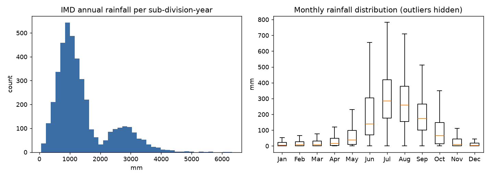
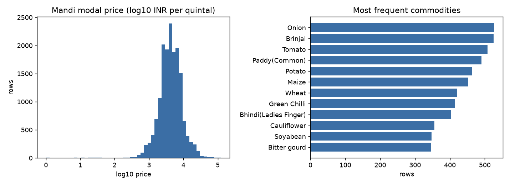
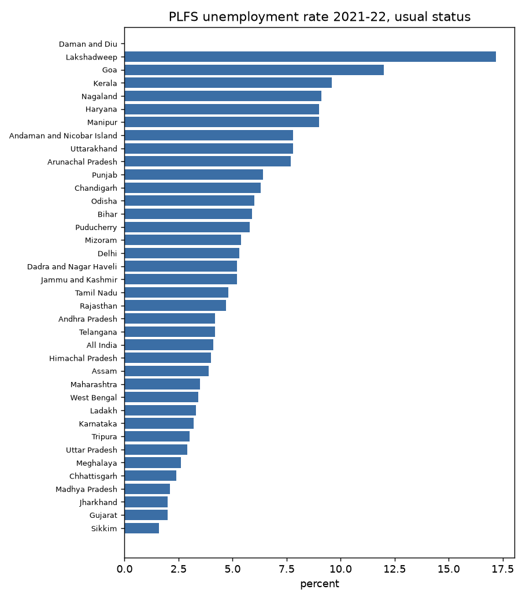
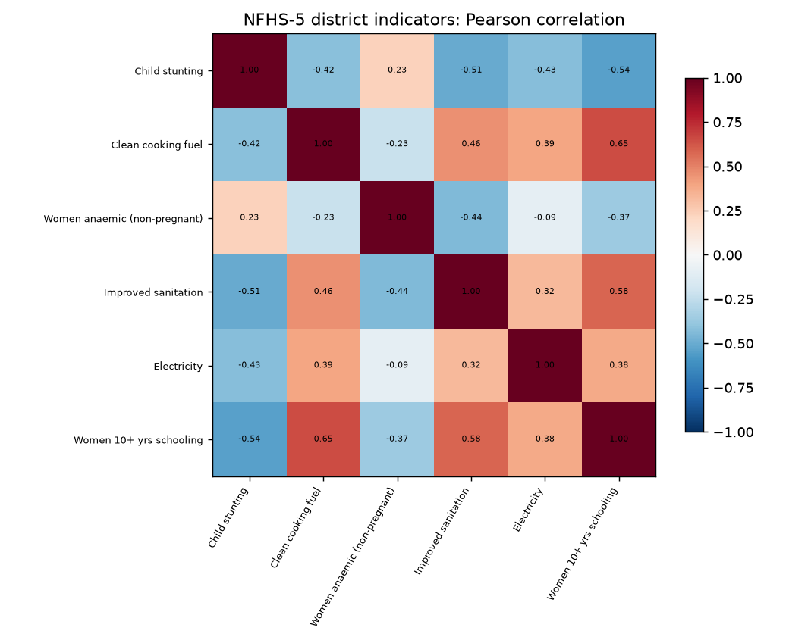
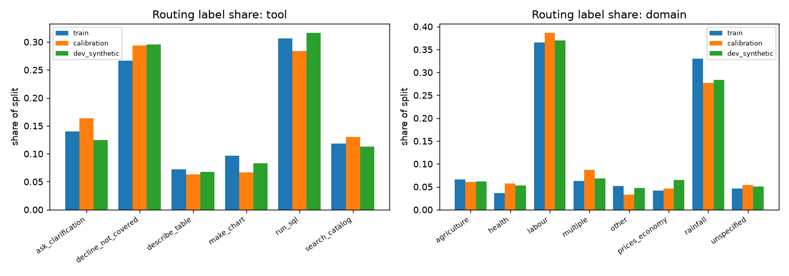

# Milestone 2: Dataset Identification and Data Preparation

**Project:** Analyst Agent for Indian Public Data with Calibrated Decision Models
**Group 4:** Shaoni Samanta (21f1003157), Shivanshu Gupta (22f3002985), Sathya Prakash (21f1006001), Ashmit Ghose (24f1001827)
**Document version:** 1.1, 3 November 2026 (revises version 1.0 of 29 October 2026)
**Branch:** `docs/milestone-2`

---

## Document change log

| Version | Date | Revision | Requirement | Where | Status |
| --- | --- | --- | --- | --- | --- |
| 1.0 | 29 Oct 2026 | Report in the thirteen sections of the Milestone 2 outline | TA guidance for the report | Sections 1-13 | Incorporated |
| 1.0 | 29 Oct 2026 | Change log, contribution log and sign-off | TA instruction for every milestone | This table; [Contribution log](#contribution-log); [Sign-off](#sign-off); `CHANGELOG.md`; `WORKLOG.md` | Incorporated |
| 1.0 | 29 Oct 2026 | Data gaps kept distinct from system errors: each reference pair records the expected action, and abstentions are labelled by cause | Milestone 1 review: separate data problems from system errors | Sections 3.4, 9.2 | Incorporated |
| 1.0 | 29 Oct 2026 | Correctness measurable at data level: expected result type per pair and a quality flag per value | Milestone 1 review: define correctness and trust | Sections 3.4, 6 | Incorporated |
| 1.0 | 29 Oct 2026 | Deterministic checks are preprocessing rules; only the routing decisions receive training data | Milestone 1 review: rules versus learned models | Sections 6, 9.1 | Incorporated |
| 1.1 | 3 Nov 2026 | One configuration-driven pipeline replaces per-table scripts; generic and source-specific steps separated; onboarding, drift flagging, lineage and scope described and tested | TA review: reusability and scalability of data preparation | Section 6A; Sections 4, 6, 7, 12 | Incorporated |
| 1.1 | 3 Nov 2026 | Every value of every dataset carries `value_raw`, `quality_flag` and `rule_ids` from one flag vocabulary | TA review: consistency of quality information | Sections 3.1, 3.2a, 5.1, 6A.5 | Incorporated |
| 1.1 | 3 Nov 2026 | Limitation of the rule-generated routing labels stated; human verification moves to Milestone 3, when the question sets are regenerated for the extension datasets and owners are allocated | TA review: reliability of routing labels | Sections 5.4, 11, 13.4 | Limitation stated; moved to Milestone 3 |
| 1.1 | 3 Nov 2026 | Limits of the Text-to-SQL pairs stated with their effect on conclusions; the independently written test set moves to Milestone 3, written and validated as the extension datasets are added | TA review: adequacy of Text-to-SQL evaluation data | Sections 9.3, 11, 13.4 | Limits stated; moved to Milestone 3 |
| 1.1 | 3 Nov 2026 | Five State spellings left unstandardised in 1.0 corrected; reference queries `Q025` and `Q059` use the shared flag names | Found while rebuilding from configuration | Sections 6A.6, 7 | Incorporated |
| 1.1 | 3 Nov 2026 | Source changes handled explicitly: changing year windows declared, overlapping or absent periods reported, each release compared with the live one, quarters supported, place names matched ignoring case | Reviewer questions on year-window changes and re-published tables | Sections 6A.4, 6A.6, 6A.7 | Incorporated |

Milestone 1 revisions after the review of 27 October 2026 are recorded in `CHANGELOG.md`.

---

## 1. Introduction

### 1.1 Project recap

Indian public statistics (data.gov.in, MoSPI, IMD, NFHS, NCRB) are open but hard to use correctly: years as columns, footnote markers inside values, renamed places (Orissa and Odisha), suppressed and low-sample estimates, and several year conventions (calendar, fiscal, July-June). The project builds an analyst agent for journalists and fact-checkers. It answers from a curated catalogue of tables, shows its evidence, reports a calibrated confidence and abstains when the catalogue cannot answer. A hosted LLM writes read-only DuckDB queries; small decision models make the control decisions (tool selection and domain); calibrated verification checks the answer.

### 1.2 Objectives of Milestone 2

1. Identify, verify and download the source tables; record ownership, licence and format.
2. Clean them into versioned Parquet files with unit, place and period checks and per-value quality flags.
3. Profile them (size, distributions, missing values, duplicates, outliers, correlations).
4. Define the labelling schema for the routing decisions and produce training, calibration and development splits.
5. Produce the first question and reference-query pairs, split by template.
6. Report the week-1 feasibility results.

### 1.3 Relationship between the data and the project goals

The **source tables** are what the agent queries; their cleaning decides whether an answer can be correct at all (O1 execution accuracy, O2 claim support). The **label sets** train and evaluate the decision layer: the routing splits train tool selection and domain (O3 calibration, O4 abstention precision), and the reference pairs measure end-to-end correctness, including abstention for the right reason.

## 2. Dataset Identification

### 2.1 Source tables

| # | Table | Source and publisher | Licence | Domain | Content |
| --- | --- | --- | --- | --- | --- |
| 1 | `imd_subdivision_monthly_rainfall` | India Meteorological Department, via data.gov.in, resource `8e0bd482-4aba-4d99-9cb9-ff124f6f1c2f` | GODL | Rainfall | Monthly and seasonal rainfall by sub-division, 1901-2017 |
| 2 | `plfs_state_ur_usual_status` | Rajya Sabha answer citing MoSPI (PLFS), via data.gov.in, resource `d038e512-231e-4adb-bbb7-a3f95102d18a` | GODL | Labour | State unemployment rate (usual status), 2017-18 to 2021-22 |
| 3 | `nfhs5_district_indicators` | NFHS-5 district factsheets (IIPS, MoHFW), via data.gov.in, resource `cf80173e-fece-439d-a0b1-6e9cb510593d`; https://www.data.gov.in/catalog/national-family-health-survey-5-nfhs-5-india-districts-factsheet-data-provisional | GODL | Health | 104 district indicators, 2019-2021 |
| 4 | `mandi_daily_prices` | AGMARKNET, via data.gov.in, resource `9ef84268-d588-465a-a308-a864a43d0070`; https://www.data.gov.in/catalog/current-daily-price-various-commodities-various-markets-mandi | GODL | Prices | Minimum, maximum and modal prices by market and day |
| 5 | `ncrb_annual_crime_statistics` | NCRB, Crime in India 2024, Table 1.1(ii), via data.gov.in; https://www.data.gov.in/catalog/crime-india-cii-2024 | GODL | Other (crime) | National incidence and rates under IPC/BNS and SLL, 2022-2024 |

All are public; GODL is the Government Open Data License - India. Tables 1-2 were retrieved on 23 October 2026 and tables 3-4 on 29 October 2026 through the data.gov.in API (CSV); table 5 comes from the catalogue download of 29 October 2026. The Mandi resource is a rolling daily snapshot; the prepared version is that of 29 October 2026, identified by its SHA-256 in `data/MANIFEST.md`.

### 2.2 Label sets

| Set | Location | Purpose |
| --- | --- | --- |
| Routing splits v1 (train, calibration, dev-synthetic) | `data/splits/kev/*.v1.jsonl` | Fine-tune and calibrate the tool-selection and domain decisions of Kev-0.8B |
| Text-to-SQL reference pairs v1 (dev, test) | `data/ground_truths/text_to_sql_{dev,test}.v1.csv` | End-to-end evaluation of queries and abstention |
| Week-1 routing sample (200) and v0 questions (20) | `data/sample/` | Feasibility checks (Section 13.1) |

### 2.3 Why these tables, and alternatives considered

Each table exercises a convention that makes public statistics hard to use: sub-divisions instead of States (IMD); July-June survey years as columns and `NA` strings (PLFS); wide indicator tables with suppressed and low-sample markers (NFHS-5); high-volume data with place names at three levels (Mandi); and a short national series with checkable arithmetic (NCRB). They cover four of the five planned domains, and NCRB supplies questions the domain decision must label `other`.

Rejected: a near-duplicate PLFS resource (`89e6c4b7-4c56-4f4c-b196-a40726ebd7fe`) and an all-ages variant (`302a4e58-b2e0-46c8-a40e-154392a9c5d9`), kept as distractors for catalogue search; MoSPI microdata, because the project uses published tables only.

### 2.4 Catalogue scope for this milestone

The plan names 8-12 core tables. The five prepared tables are the catalogue for a proof of concept, which tests whether this curation approach (long format, per-value flags, catalogue descriptions) serves the agent. Extension tables are identified (agricultural production, consumer prices, State income, population denominators, district rainfall normals, all on data.gov.in) and are added afterwards. Any curation change the proof of concept shows is applied to every table before the extension.

## 3. Dataset Description

### 3.1 Source tables after cleaning

| Table | Rows | Columns | Grain | Coverage |
| --- | --- | --- | --- | --- |
| `imd_subdivision_monthly_rainfall` | 4,188 | 21 | sub-division x year | 36 sub-divisions, 1901-2017; 12 months, annual, four seasons (mm) |
| `plfs_state_ur_usual_status` | 38 | 8 | State/UT | 37 States/UTs and All India; 5 survey years (percent) |
| `nfhs5_district_indicators` | 73,528 | 21 | district x indicator | 707 districts in 36 States/UTs x 104 indicators (raw 707 x 109) |
| `mandi_daily_prices` | 16,393 | 23 | market x commodity x variety x grade x day | 29 states, 1,725 markets, 261 commodities; 29 Oct 2026 |
| `ncrb_annual_crime_statistics` | 3 | 23 | year | India, 2022-2024 (9 measures plus source and validation columns) |

These are the agent tables. Each is derived by configuration from an observation table (`obs_<dataset>`, one row per value): IMD 71,196 values, PLFS 190, NFHS-5 73,528, Mandi 49,179, NCRB 24 (`docs/data_contract_v1.md`). Column counts include `quality_flag` and `rule_ids`, which version 1.0 had for NFHS-5, Mandi and NCRB only.

The tables are queried, not modelled, so there is no target variable. The measured quantities are `value` (NFHS-5), the three prices (Mandi), rainfall (IMD), the unemployment rate (PLFS) and crime counts and rates (NCRB).

### 3.2 Schemas of the cleaned tables

- **`nfhs5_district_indicators`** (long): `source_name`, `source_table`, `survey_round`, `survey_period`, `geography_level`, `state_name_source`, `state_name`, `district_name_source`, `district_name`, `indicator_id`, `indicator_label`, `value`, `unit` (`percent`, `per_1000_males`, `INR`, `unknown`), `is_suppressed`, `is_low_sample_estimate`, `quality_flag`, `rule_ids`, `sample_households`, `sample_women_15_49`, `sample_men_15_54`, `value_raw`.
- **`mandi_daily_prices`**: `source_name`, `source_table`, `geography_level`, `state_name_source`, `state_name`, `district_name_source`, `district_name`, `market_name`, `commodity_name`, `variety`, `grade`, `arrival_date`, `min_price_inr_per_quintal`, `max_price_inr_per_quintal`, `modal_price_inr_per_quintal`, `price_unit`, `is_arrival_date_valid`, `is_price_non_negative`, `is_price_order_valid`, `is_price_plausible`, `quality_flag`, `rule_ids`, `arrival_date_raw`.
- **`imd_subdivision_monthly_rainfall`**: `subdivision`, `year`, `jan` ... `dec`, `annual`, `jf`, `mam`, `jjas`, `ond` (mm), `quality_flag` (highest-priority flag among the row's 17 values), `rule_ids`.
- **`plfs_state_ur_usual_status`**: `state_ut`, `fy_2017_18` ... `fy_2021_22` (percent; July-June years), `quality_flag` (highest-priority flag of the row), `rule_ids`.
- **`ncrb_annual_crime_statistics`**: `year`, `population_lakhs`, IPC/BNS, SLL and total counts and rates, `ipc_bns_percentage`, source metadata, validation columns (`incidence_total_valid`, `ipc_bns_percentage_valid`, three rate checks, `is_duplicate_year`), `quality_flag`, `rule_ids`.

### 3.2a Quality information at value level

In version 1.0 only NFHS-5, Mandi and NCRB had flags, with different vocabularies; IMD and PLFS had empty cells without a reason. In version 1.1 every value of every dataset carries `quality_flag` (one vocabulary), `value_raw` (the source text) and `rule_ids` (the rules that touched it). Agent tables with one column per measure hold the row's highest-priority flag; the per-value flag is in the observation table.

| Dataset | Values | Flags | Declared checks |
| --- | --- | --- | --- |
| IMD rainfall | 71,196 | `reported` 71,062; `missing_in_source` 134 | not negative; one value per sub-division and period |
| PLFS unemployment | 190 | `reported` 186; `missing_in_source` 4 | within 0-100; State names against the reference list |
| NFHS-5 indicators | 73,528 | `reported` 64,512; `low_sample_estimate` 4,884; `suppressed` 4,132 | not negative; percentages within 0-100; State names |
| Mandi prices | 49,179 | `reported` 49,166; `implausible` 13 (10 records) | not negative; minimum <= modal <= maximum; maximum <= 10 x modal; minimum >= 1 |
| NCRB crime | 24 | `reported` 24 | total = IPC/BNS + SLL; percentage and rates consistent with counts and population (tolerance 0.15); one value per year |

Counts are from the release of 3 November 2026 and match version 1.0. The vocabulary and its priority order are in Section 6A.5.

### 3.3 Routing splits (decision-model training data)

JSON Lines in the Kev training format. Each record has a `state` (catalogue shown to the agent, conversation context, user message); two choice decisions, `tool` (`run_sql`, `make_chart`, `describe_table`, `search_catalog`, `ask_clarification`, `decline_not_covered`) and `domain` (`labour`, `agriculture`, `rainfall`, `prices_economy`, `health`, `other`, `multiple`, `unspecified`), each with instructions, option descriptions and a `label`; and `_meta` with the labelling rule, template, slots, group id and generator and guide versions.

| Split | Records | Groups | Longest state (characters) |
| --- | --- | --- | --- |
| train | 1,718 | 1,079 | 677 |
| calibration | 300 | 200 | 680 |
| dev-synthetic | 338 | 218 | 672 |

Sample record (abridged):

```json
{"state": {"catalogue": "1. plfs_state_ur_usual_status: PLFS unemployment rate (%), usual status (ps+ss), persons aged 15+, by State/UT plus an All India row, survey years 2017-18 to 2021-22 (July-June)",
           "context": "No result table yet.",
           "user_message": "What was the unemployment rate in Kerala for January to December 2018?"},
 "questions": {"tool": {"type": "choice", "instructions": "Choose the next step of a data-analysis agent ...", "criteria": {"run_sql": "...", "ask_clarification": "...", "...": "..."}, "label": "ask_clarification"},
               "domain": {"type": "choice", "...": "...", "label": "labour"}},
 "_meta": {"label_source": "rule", "tool_rule": "R14", "domain_rule": "M1", "template_id": "plfs.calendar.0", "group_id": "clarify:7c5bb8b6a0e0", "guide_version": "1.0-draft.4"}}
```

The label is `ask_clarification` because the user asks for a calendar year and the table reports July-June years.

### 3.4 Text-to-SQL reference pairs

100 pairs: NFHS-5 42, Mandi 34, NCRB 23, cross-table 1. Fields: `id`, `question`, `gold_sql`, `dataset`, `category` (21 templates, for example `filter_sort`, `top_k`, `window`, `quality_audit`, `missing_measure`, `incompatible_geography`), `difficulty` (easy 60, medium 38, hard 2), `expected_action` (answer 90, abstain 9, clarify 1), `expected_result_type`, `expected_behavior`. Abstentions are labelled by cause, so a data gap can be told apart from a system error.

Sample `Q001`: "Show the electricity percentage for every district, highest first." `SELECT state_name, district_name, indicator_label, value, unit FROM nfhs5_district_indicators WHERE indicator_label = 'Population living in households with electricity (%)' AND quality_flag = 'reported' ORDER BY value DESC;`

## 4. Data Governance

**Source and licensing.** All tables are published on data.gov.in under the GODL, which permits use, adaptation and redistribution with attribution. Ownership stays with the publishers (IMD, MoSPI, IIPS/MoHFW, the Directorate of Marketing and Inspection, NCRB). Every row carries `source_name` and `source_table`, and the evidence panel cites them. Raw files are not committed; they are re-downloaded by script.

**Privacy.** The tables are published aggregates (district level and above) with no personal data; the publisher already suppresses district estimates based on fewer than 25 cases. The label sets contain synthetic messages only.

**Data quality.** Nothing is silently dropped or corrected: every value has a flag, its source text and the rules that touched it (Sections 3.2a, 6, 6A). Anything the configuration does not anticipate is held for review (Section 6A.4).

**Ethics and bias.** Coverage is uneven: Mandi lists only markets that report that day, small-district NFHS-5 estimates are imprecise, IMD sub-divisions do not follow State boundaries, and NCRB counts registered cases, not incidence. Answers state these limits. The routing labels follow written rules, so they carry the rules' biases, and their domain mix reflects the two tables they cover (Section 5.4).

**Reproducibility.** Every prepared file is versioned and listed with its row count and SHA-256 in `data/MANIFEST.md`. The pipeline is deterministic: the same raw file, configuration and code give byte-identical output. Each run writes a lineage log; the manifest records the raw checksum, configuration version and code commit of each table. The routing generator records its seed and version in every record.

## 5. Exploratory Data Analysis

Produced by `scripts/eda_tables.py`; full output in `docs/figures/milestone2/eda_summary.md`.

### 5.1 Summary statistics, missing values and duplicates

| Table | Rows | Missing cells | Exact duplicates | Duplicate keys |
| --- | --- | --- | --- | --- |
| IMD rainfall | 4,188 | 134 (26 in `annual`; at most 13 in any other column) | 0 | 0 (sub-division, year) |
| PLFS unemployment | 38 | 4 (one `NA` per year except 2019-20) | 0 | 0 |
| NFHS-5 indicators | 73,528 | 4,132 `value` cells (5.6%), all suppressed by the publisher | 0 | 0 (State, district, indicator) |
| Mandi prices | 16,393 | 0 | 0 | 0 (market, commodity, variety, grade, date) |
| NCRB crime | 3 | 0 | 0 | 0 (year) |

| Measure | Mean | Median | Min | Max |
| --- | --- | --- | --- | --- |
| IMD annual rainfall (mm) | 1,409 | 1,120 | 62 | 6,331 |
| IMD June-September rainfall (mm) | 1,064 | 881 | 57 | 4,537 |
| PLFS unemployment rate 2021-22 (%) | 5.48 | 4.80 | 1.60 | 17.20 |
| Mandi modal price (INR per quintal) | 5,604 | 4,000 | 0.01 | 125,000 |

NFHS-5 flags: reported 87.7%, low-sample estimate 6.6%, suppressed 5.6%. Flags for all tables are in Section 3.2a.

### 5.2 Distributions and outliers



Rainfall is right-skewed and seasonal: July has the highest median (285 mm), December the lowest (3 mm). All 401 IQR outliers of annual rainfall are high values from the wettest sub-divisions (Coastal Karnataka 99, Konkan and Goa 65, Kerala 61, Andaman and Nicobar 57, Arunachal Pradesh 55) and are kept.



Mandi prices span five orders of magnitude, so comparisons are made within a commodity. Ten records are implausible (for example wheat at Aurangabad APMC with a maximum of INR 30,002,800 against a modal INR 2,600, or prices below INR 1) and are flagged. In 3,598 rows the minimum equals the maximum: the market reported one price.



### 5.3 Correlation analysis



Across 707 districts (Pearson), household electricity, improved sanitation, clean cooking fuel and women's schooling (10+ years) correlate positively (0.32 to 0.65). Child stunting correlates negatively with all four (-0.42 to -0.54). Anaemia in non-pregnant women correlates with sanitation (-0.44) and schooling (-0.37) but barely with electricity (-0.09). These are associations between district averages, not causes, and the agent must say so.

### 5.4 Class distribution of the label sets



| `tool` | train | calibration | dev-synthetic |
| --- | --- | --- | --- |
| run_sql | 30.6% | 28.3% | 31.7% |
| decline_not_covered | 26.7% | 29.3% | 29.6% |
| ask_clarification | 14.0% | 16.3% | 12.4% |
| search_catalog | 11.8% | 13.0% | 11.2% |
| make_chart | 9.7% | 6.7% | 8.3% |
| describe_table | 7.2% | 6.3% | 6.8% |

`domain` is imbalanced: `labour` 36.5% and `rainfall` 33.0% of training, because v1 draws from the two week-1 tables; `health` (3.7%) and `prices_economy` (4.1%) are below 5%. Shares differ across splits by at most 5.3 points, so the three splits measure about the same distribution.

A lexical baseline (TF-IDF word 1-2 grams with logistic regression) reaches 0.885 on `tool` in dev-synthetic, against 0.317 for the majority class. The templates recur across splits, so this is what wording alone predicts, and it is the baseline a fine-tuned model must beat on human labels.

**Limitation: reliability of the routing labels.** Labels come from deterministic rules (labelling guide v1) applied to slots the generator itself fills. No person has verified them, so their correctness is unmeasured, and a model can score well by recognising templates. Dev-synthetic accuracy is therefore a training diagnostic only; no claim about the decision models rests on it.

**Moved to Milestone 3 (decision of 3 November 2026).** The question sets are regenerated when the extension datasets are added, so labelling, agreement and audit are done once on the final catalogue, and owners are allocated then. The planned evaluation uses human labels only:

1. **dev-human set:** 150-200 questions per decision, written by members who wrote neither the templates nor the rules, with paraphrases, typing errors and Hinglish.
2. **Label verification:** two members label each question; Cohen's kappa per decision; disagreements resolved and recorded in the guide.
3. **Rule audit:** 200 random rule-labelled training records labelled by hand; rule error rate with a confidence interval.
4. **Generalisation sets:** a held-out-table set and a paraphrase set.
5. **Baselines on the same sets:** lexical baseline, zero-shot Kev-0.8B, Jev and the fine-tuned model. An improvement is claimed only if the fine-tuned model beats the lexical baseline on dev-human.

### 5.5 Text-to-SQL reference pairs

Of 90 answerable queries, 88 return rows; `Q025` and `Q059` correctly return none, because the data holds no missing stunting values and no out-of-order prices. The three NCRB rows pass every arithmetic check: counts add up to the total, and rates and percentages agree with counts and population within rounding.

## 6. Data Preprocessing

The steps per dataset are below; Section 6A describes the pipeline that performs them.

| Step | IMD | PLFS | NFHS-5 | Mandi | NCRB |
| --- | --- | --- | --- | --- | --- |
| Text cleaning (repeated and non-breaking spaces) | yes | yes | yes | yes | yes |
| Missing values | `NA` -> `missing_in_source` | `NA` -> `missing_in_source` | `*` -> `suppressed` | empty -> `missing_in_source` (none found) | empty -> `missing_in_source` |
| Duplicates | none found | none found | none found | exact duplicates removed (none found) | duplicate years flagged |
| Place names | kept as published; checked against 36 sub-divisions | checked against the State reference list | `state_name` standardised through `configs/reference/place_aliases.csv`; source kept | same | national only |
| Standardisation | numeric months and seasons | survey years as columns | wide to long; units from the label (percent, per 1,000 males, INR) | dates from DD/MM/YYYY; INR per quintal | Indian digit grouping removed |
| Validation | not negative; one value per period | within 0-100 | markers; not negative; percentages within 0-100 | price order, plausibility, valid date | totals, percentages and rates consistent |

Normalisation, encoding and feature selection do not apply: the tables are queried, not used as model features.

**A source defect found and corrected.** The NFHS-5 factsheet marks estimates from 25-49 cases with parentheses, `(29.5)`; the API export renders them as negative numbers. 4,884 cells were negative, including vaccination coverage of `-100` and delivery costs of `-10,557` rupees. No NFHS-5 indicator can be negative, so the leading minus is read as the low-sample marker; afterwards no value is negative and no percentage exceeds 100. Without this, a query for the lowest coverage would return a corrupted value as valid. The correction is the registered rule `nfhs5_minus_as_low_sample`; detecting negatives in a non-negative column is generic.

**Routing splits.** Labels follow labelling guide v1 (16 tool and 8 domain rules with fixed precedence; `docs/labelling_guide_v1.md`). Tokenisation happens at training time. Minimal pairs (one detail changed, label changed) are generated together and kept in one group.

## 6A. Reusable data preparation

One engine prepares every table. A table-specific decision is a line of configuration (`configs/sources/<dataset>.toml`); the only defect-specific code is one named, tested rule in a registry. Every output follows one data contract (`docs/data_contract_v1.md`); usage is in `scripts/README.md`.

### 6A.1 Scope

The catalogue for this project is the five tables of Section 2. The procedure itself is not specific to them. It is implemented for CSV files with one header row: long tables, tables wide by period or by indicator, tables with year and quarter columns, and short series with checkable arithmetic. JSON, XLSX and multi-row headers are not implemented; PDF, scanned tables and microdata are out of scope. Onboarding a table in a supported layout is feasible but takes a configuration of about 40-150 lines, written and reviewed by a person, and a new layout may need a pipeline addition (Sections 6A.3, 6A.6). Onboarding beyond the extension tables of Section 2.4 is not a project deliverable.

### 6A.2 Generic and source-specific operations

| Operation | Type | Set by |
| --- | --- | --- |
| Reading (encoding, header rows, escaped headers such as `Min_x0020_Price`) | Generic | Configuration |
| Text clean-up | Generic | Always |
| Missing-value markers to flags | Generic | Configuration |
| Number parsing (digit grouping, footnote marks, bracketed estimates) | Generic | Configuration |
| Dates in a stated format | Generic | Configuration |
| Period label to start and end dates, with the year's start month | Generic | `period` section |
| Wide to long (periods or indicators as columns) | Generic | `values` section |
| Place names to canonical names; total rows | Generic | Reference tables, configuration |
| Units from header or label | Generic | Unit rules |
| Range, order, sum, ratio and unique-key checks | Generic | Declared checks |
| Exact-duplicate removal | Generic | Configuration |
| NFHS-5: leading minus is the low-sample marker | **Source-specific** | Rule `nfhs5_minus_as_low_sample` (evidence; 4,884 values) |
| NCRB: catalogue download instead of the API | Source-specific acquisition | `adapter = "manual_download"` |

### 6A.3 Introducing a new dataset

1. Put the raw file in `data/raw/`.
2. Copy the configuration of the most similar table and edit it: what the table is, how it is read, what rows and columns mean, its year and place conventions, its checks and its agent table.
3. Run the pipeline and read `outputs/review/<dataset>.csv` (severity, finding, count, suggested change).
4. Resolve every blocking item, run with `--approve` to store the header snapshot and value profile, and commit.

Configuration sizes (lines without comments): PLFS 48, IMD 62, NFHS-5 91, Mandi 107, NCRB 150, against about 2,300 lines of shared code (12 modules). Version 1.0 had 561 lines of table-specific code for NFHS-5, Mandi and NCRB and 46 for IMD and PLFS. A trial on four further files (Section 6A.6, item 7) needed configurations of 40-64 lines and four pipeline additions, so authoring is part of onboarding. Onboarding effort is measured when extension tables are added in Milestone 3.

### 6A.4 Detection of unexpected formats, units, missing values and inconsistent records

Each run is compared with its configuration, the approved header snapshot, the approved value profile and the live release. A doubtful value keeps its source text and gets a flag; the finding enters the review list with a suggested change. A table with a blocking item is not published, and the previous version stays live.

| Situation | Detection | Result |
| --- | --- | --- |
| Column added, dropped or renamed | Headers against configuration and snapshot; renames suggested | Block |
| New period column matching the pattern | Pattern | Info; accepted |
| New period format, or unstated year start | Pattern; `start_month` required for survey years | Block |
| Text that is not a number or known marker | Parsing | Block; value empty, text kept, flag `unparsed` |
| Date in another format | Strict parsing | Block |
| Unit change | Header change, or median moving by a factor of 9 or more | Block |
| Out of range, order or sum broken, implausible | Declared checks | Warn; value kept and flagged |
| Unknown place name | Reference and alias matching, closest name suggested | Block |
| Repeated observation key | Key uniqueness | Block |
| Exact duplicate rows (where configured) | Duplicate check | Info; count recorded |
| Distribution shift (3 robust z) or row count change > 20% | Profile comparison | Warn |
| No approved snapshot | Snapshot lookup | Warn |
| Year window changes (July-June to April-March) | Overlapping periods; earlier periods re-dated against the live release | Block |
| Window changed from a known year | `period.conventions` and `period.exceptions`; earlier years keep their window | Both kept |
| Years after the last one confirmed with the publisher | `period.verified_through` | Warn |
| Period absent between two present ones | Consecutive years and quarters; same month or season every year | Warn |
| Values revised, history dropped, periods relabelled, indicator lost, unit changed | Comparison with the live release of the same dataset | Warn; block above 10% revised or 5% lost, or on any relabel, re-dating, lost indicator or unit change; a person may accept with a reason kept in the lineage |
| New places, categories or indicators | Comparison with the live release | Info |
| A check names a missing column | Check targets | Warn |

Thresholds are initial values, to be tuned on real refreshes. Planned for Milestone 3: change detection from publisher metadata and a scheduled refresh. Different datasets that publish the same statistic are not reconciled.

### 6A.5 Original values, transformations and quality flags

Raw files are never edited and are identified by SHA-256. Every value keeps `value_raw` and `rule_ids`. Each run writes a lineage log (rows read, values touched per rule, flag counts, configuration version, code commit); `data/MANIFEST.md` records the raw checksum, configuration version, code commit and output checksum per table.

Every value has one flag; where several apply, the first in this list wins.

| Flag | Meaning | Value |
| --- | --- | --- |
| `unparsed` | Text the configuration does not recognise | empty |
| `missing_in_source` | Missing-value marker in the source | empty |
| `suppressed` | Withheld by the publisher | empty |
| `out_of_range` | Outside the allowed range | kept |
| `inconsistent` | Breaks an order or sum rule | kept |
| `implausible` | In range, outside the believable band | kept |
| `low_sample_estimate` | Published with a sample-size caveat | kept |
| `revised`, `provisional` | Declared by the source (unused so far) | kept |
| `reported` | Published value; all checks passed | kept |

### 6A.6 Evidence

1. **Rebuild equality.** The five tables rebuilt from configuration equal the version 1.0 outputs in every column (checksums in `tests/test_rebuild.py`), apart from renamed flags and five State spellings. The 90 executable reference queries return identical results. Flag counts are unchanged.
2. **A defect found by the new checks.** Version 1.0 left five State spellings unstandardised: `Maharastra`, `Jammu & Kashmir`, `Dadra and Nagar Haveli & Daman and Diu` (NFHS-5), `Chattisgarh`, `Andaman and Nicobar` (Mandi). A join on `state_name` would have missed 6,136 NFHS-5 and 183 Mandi rows. The aliases were added; source spellings stay in `state_name_source`. No reference query used them.
3. **Fault injection.** Eight planted faults were all caught and none corrected silently: a new missing-value marker, a unit change in a header, negative values, a renamed State, swapped price columns, duplicated rows, a dropped column and a new date format. Drills also cover a changed year start month, a new period column or format, exact duplicates, an alias and a hundredfold scale change.
4. **Tests.** 124 pass and 2 are skipped (`pytest -q`), including byte-identical repeated runs, a hand-edited catalogue fact, moving year windows, quarters, overlapping and absent periods, and release-against-release comparison.
5. **Periods absent from the IMD source.** The table holds 4,188 of 4,212 sub-division-years (36 x 1901-2017). The 24 absent years are in Andaman and Nicobar (1909, 1943-1945, 1948), Arunachal Pradesh (1901-1915, 1954-1956) and Lakshadweep (1918). The gap check reports 9 of them (5 stretches); the 15 years before Arunachal Pradesh's first observation show only in the row count. Totals over a sub-division silently omit these years, so answers must state coverage.
6. **Mutation sweep.** `scripts/robustness_sweep.py` applies 13 kinds of change to each real raw file (59 changes): shuffled rows, upper-cased places, an appended duplicate, a dropped or unannounced column, a misspelt place, an unparseable cell, a negative value, one indicator rescaled by 100, 30% of values raised by 5%, half the history cut, the year window moved from July to April, and two columns swapped. Of 50 harmful changes, 42 were blocked, 7 published with a warning naming the change, and 1 (exact Mandi duplicates, removed by configuration) with information only; none passed silently. None of the 9 harmless changes was blocked. The sweep exposed that `ALL INDIA` in capitals was not recognised as a total; this was fixed and tested. The changes are synthetic and chosen by the author: they show that the checks fire, not how often such changes occur.
7. **Trial on four further files.** Four CSV files from the data discovery branch (infant mortality rate by State, June-September rainfall by sub-division, daily rainfall by State, quarterly labour force participation) were run with trial configurations outside the catalogue. All four produced a review list; none was published. Findings: 12 unmatched sub-division names, 32 cells of `-99.9`, 29 near-duplicate State-days, 276 keys with two different values, and June values differing from the IMD table already held in about 2,000 of 2,790 shared sub-division-years. Quarterly values would have been dated as whole years without any message. Four additions followed, each with tests: a quarter period type, sub-division aliases, place matching that ignores case and spacing, and single-year header patterns. All four files now stop at items that need an answer from the source. The trial supports holding unexpected input for review; it does not show that onboarding needs no code, and the pipeline's author ran it.

### 6A.7 Limits

- The 36 IMD sub-division names were taken from the current file, so earlier errors in it are not detected.
- Official LGD place codes and lineage tables for district splits and mergers are not yet built (planned for the week of 4 November); place codes are project codes.
- Believable ranges sit in each table's checks, not in shared domain configuration.
- Drafting configurations with a language model is a possible extension, not built.
- JSON, XLSX and multi-row headers are neither implemented nor tested.
- A publisher that changes the year window for new periods only, with unchanged labels and earlier rows, leaves no trace in the data; only `period.verified_through`, set by a person, flags it.
- The live-release comparison uses the release on the machine that runs the pipeline; a fresh machine has none.
- Absent periods are reported, not filled; an answer over them must state the coverage.
- Sub-division aliases are supported, but the alias file is empty until a person confirms the proposed spellings.

## 7. Dataset Integration

The tables are not merged; the agent queries each through DuckDB, and the catalogue describes how they relate.

- **Places.** Each table keeps the published name (`*_source`) and a standardised `state_name` from one list of 36 States/UTs and one alias table; an unmatched name blocks the table. Version 1.1 corrects the five spellings missed in 1.0 (Section 6A.6). IMD sub-divisions are not States, so a State-level rainfall question is clarified or answered with a stated mapping, never joined silently.
- **Periods.** NFHS-5 covers 2019-2021, PLFS uses July-June years, IMD and NCRB calendar years, and Mandi a single day. Each table records its convention, and questions that mix conventions route to `ask_clarification` (Section 3.3). Every value has a start and end date, and `dim_period` maps each day to its calendar, fiscal and July-June year, so a change of convention is detected rather than absorbed.
- **Units.** Stored per value (NFHS-5), in the column name (`*_inr_per_quintal`, `*_lakhs`) or in the catalogue (IMD mm, PLFS percent).
- **Duplicated names.** Eight district names occur in more than one State (for example Aurangabad, Bilaspur, Hamirpur), so the key is (State, district); counting by name alone gives 699 instead of 707 districts. No post-integration deduplication is needed, since no rows are merged.

Routing states list the catalogue entries shown to the agent, and each reference query names its table.

## 8. Data Augmentation

Only the routing set is augmented. Questions come from templates with slot values (place, period, measure, breakdown, definition), plus minimal pairs and context variants (with and without a prior result). These are the 2,356 records of Section 3.3. No model-generated text is in v1. The source tables are not augmented.

## 9. Dataset Splitting

### 9.1 Routing splits

| Split | Records | Share | Purpose |
| --- | --- | --- | --- |
| train | 1,718 | 72.9% | Fine-tuning |
| calibration | 300 | 12.7% | Temperature fit |
| dev-synthetic | 338 | 14.3% | Model selection, early stopping |

A template, its minimal pairs and its variants share a `group_id`, and each group goes to one split, so no near-copy of a training message reaches evaluation. Leakage checks (`src/analyst/data/kev_checks.py`) all return 0: groups in two splits, exact duplicate states, identical states with conflicting labels, and evaluation messages within character 5-gram Jaccard 0.8 of a training message. Label shares are close across splits (Section 5.4).

### 9.2 Text-to-SQL reference pairs

| Split | Questions | Templates | Datasets | Expected actions |
| --- | --- | --- | --- | --- |
| dev | 63 | 18 | NFHS-5 38, NCRB 15, Mandi 10 | answer 58, abstain 4, clarify 1 |
| test | 37 | 14 | Mandi 24, NCRB 8, NFHS-5 4, cross-table 1 | answer 32, abstain 5 |

A template (dataset and category) goes wholly to one split (seeded, `scripts/split_ground_truth.py`); abstention templates are divided so both splits measure abstention. Leakage checks return 0: shared ids, shared templates, and dev-test pairs with word Jaccard of 0.8 or more. The test split is never used for training or prompt tuning. Keeping templates whole makes the dataset mix differ between splits, so results are reported per dataset.

### 9.3 Limits of the reference pairs and their effect on conclusions

One member wrote all 100 pairs. The test split therefore supports only limited conclusions:

| Property of the test split | Value | Effect on conclusions |
| --- | --- | --- |
| Abstention cases | 5 | 5 of 5 correct gives a 95% Wilson lower bound of 0.57; O4 (abstention precision >= 0.85) cannot be assessed |
| Clarification cases | 0 (dev: 1) | Clarification is not evaluated |
| NFHS-5 questions | 4 | 4 of 4 gives a lower bound of 0.51; no conclusion on health |
| Mandi questions | 24 of 37 | The score is dominated by one day of prices |
| NCRB questions | 8 | Lower bound 0.68 if all correct; three national rows |
| IMD, PLFS questions | 0 | Not covered (the 20 v0 questions are separate) |
| Authorship | One author | One style of phrasing |

Test results are reported per dataset with 95% Wilson intervals, never as one headline score, and used to compare system versions on identical questions.

**Moved to Milestone 3 (decision of 3 November 2026).** Questions are written and validated as the extension datasets are added, and owners are allocated then. The set grows toward the planned 200-question frozen test set with at least 20 unanswerable questions, written by members other than the current author and balanced across datasets, including IMD and PLFS. It covers abstention (not in the catalogue, period outside coverage, grain unavailable, unsupported breakdown), clarification (missing place or period, year-convention mismatch) and unsupported requests (forecasts, causal claims, missing definitions). It is frozen before any tuning.

## 10. Final Prepared Dataset

| Deliverable | Size | Fields | Distribution | Location |
| --- | --- | --- | --- | --- |
| Five agent tables | 94,150 rows (4,188 + 38 + 73,528 + 16,393 + 3) | 21, 8, 21, 23, 23 columns | Section 5 | `data/processed/<dataset>.parquet`; checksums in `data/MANIFEST.md` |
| Five observation tables | 194,117 values (71,196 + 190 + 73,528 + 49,179 + 24) | one row per value; 27-30 columns | Section 3.2a | `data/processed/obs_<dataset>.parquet`, `catalogue.json`, `dim_period.parquet` |
| Routing splits v1 | 2,356 records | state and two labelled decisions | Section 5.4 | `data/splits/kev/*.v1.jsonl` |
| Reference pairs v1 | 100 (dev 63, test 37) | 9 fields | Section 3.4 | `data/ground_truths/` |

**Preprocessing in brief.** One configuration-driven pipeline (Section 6A): text cleaning, missing-value and suppression handling, place standardisation with source values kept, wide-to-long reshaping, units, date and number parsing, rule-based validation with per-value flags, the NFHS-5 sign correction, and group-based splitting with leakage checks.

**Readiness for model training.** The routing splits load with Kev's trainer, the training pipeline ran end to end in a dry run (Section 13.1), and the calibration split is held out. Training can start from `data/splits/kev/train.v1.jsonl` without further preparation. The tables and reference pairs are ready for the v0 baseline. The splits support training, not evaluation claims, which need the human-labelled sets of Section 5.4.

## 11. Challenges Encountered

- **Availability.** NCRB 2022-2024 is not on the data.gov.in API; it came from the catalogue download.
- **Quality.** The NFHS-5 export encodes low-sample markers as negatives (Section 6); Mandi has implausible prices and is a single-day snapshot; IMD and PLFS have `NA` cells and an All India row that must not be summed with States.
- **Source-version drift.** Two reference queries were written against another copy of NFHS-5 (a double space in a label; `≥` rendered as `?`). Both were corrected.
- **Licensing.** No constraint beyond GODL attribution.
- **Class imbalance.** `domain` labels concentrate on labour and rainfall (Section 5.4).
- **Unverified labels.** Routing v1 covers two tables, its labels are rule-generated and unchecked, and wording alone predicts 0.885 (Section 5.4). Human verification moves to Milestone 3.
- **Integration.** Sub-divisions versus States, survey versus calendar years, repeated district names (Section 7).
- **Remaining limits.** The test split has 5 abstention cases and 4 NFHS-5 questions and leans to Mandi (Section 9.3); NCRB supports national trends only; pipeline limits are in Section 6A.7.

## 12. Deliverables Produced

| Deliverable | Path |
| --- | --- |
| Raw-file download (data.gov.in API) | `scripts/download_raw.py`; `src/analyst/data/ogd.py` |
| Pipeline (engine, operations, source rules, validation, periods, release comparison, agent tables, profiles, publication) | `src/analyst/data/` |
| Table configurations, reference lists, approved profiles | `configs/sources/`, `configs/reference/`, `configs/profiles/` |
| Pipeline command and guide | `scripts/run_pipeline.py`; `scripts/README.md` |
| Data contract | `docs/data_contract_v1.md` |
| EDA and figures | `scripts/eda_tables.py`; `docs/figures/milestone2/` |
| Data manifest | `scripts/build_manifest.py`; `data/MANIFEST.md` |
| Routing generator and leakage checks | `src/analyst/data/kev_generate.py`, `kev_checks.py`; `src/analyst/decisions/kev_questions.py` |
| Labelling guide | `docs/labelling_guide_v1.md` |
| Routing splits; reference pairs and split | `data/splits/kev/`; `data/ground_truths/`, `scripts/split_ground_truth.py` |
| Read-only SQL runner and evaluation harness | `src/analyst/tools/sql_runner.py`, `src/analyst/evaluation/` |
| Data dictionary | Section 3.2; `data/sample/README.md` |
| Tests (fault injection, rebuild equality) and mutation sweep | `tests/` (124 pass); `scripts/robustness_sweep.py` |

Reproduction from the repository root:

```bash
python scripts/download_raw.py           # NFHS-5 and Mandi into data/raw (NCRB: catalogue download)
python scripts/run_pipeline.py           # observation and agent tables, catalogue, lineage
python scripts/run_pipeline.py --verify  # catalogue facts recomputed from the files
python scripts/eda_tables.py             # EDA summary and figures
python scripts/split_ground_truth.py     # reference-pair dev/test split
python scripts/build_manifest.py         # rows and SHA-256 of every prepared file
pytest -q
```

## 13. Summary and Next Steps

### 13.1 Summary of work completed

Five public tables were identified, licensed, downloaded, cleaned and profiled through one configuration-driven pipeline; 2,356 routing records were generated in three leakage-checked splits; and 100 reference pairs were written and split by template. Week-1 feasibility checks:

| Check | Result |
| --- | --- |
| Kev-0.8B zero-shot against Jev, tool selection, 200 examples | 0.42 (95% interval 0.35-0.49) against 0.815 (0.76-0.87); preliminary, teacher-written labels. Gate not met zero-shot; tool selection stays on Jev until the fine-tune is evaluated |
| Hosted-LLM v0, 20 questions on two tables | Harness and read-only SQL runner built and tested; not run (no LLM provider configured) |
| Compose stack streams events through Caddy | Passed after two configuration defects were fixed |
| Kev-0.8B fine-tuning dry run (Apple MPS) | Runs end to end on 64 records (4 steps, 3.29 GB peak memory); no accuracy claimed |

### 13.2 Key observations

1. Source exports can differ from published factsheets in ways that change answers (the NFHS-5 sign defect), so range checks are required before a table enters the catalogue.
2. Period and geography conventions, not query syntax, are the main source of plausible-but-wrong answers; such questions should route to clarification.
3. Zero-shot Kev-0.8B is far from Jev on tool selection; the fine-tune must beat both Jev and the lexical baseline.
4. Checking names against a reference list finds defects that inspection misses (Section 6A.6).

### 13.3 Readiness

The routing splits are ready for fine-tuning and calibration; the tables and reference pairs are ready for the v0 baseline. Claims about the decision models and about abstention wait for the human-labelled sets (Section 5.4) and the extended test set (Section 9.3).

### 13.4 Planned activities for Milestone 3

- Agent graph architecture and integration: retrieval, typed tools, read-only SQL, evidence panel, confidence badge.
- Proof of concept on the five tables, including the v0 baseline on the reference pairs.
- First Kev-0.8B fine-tune on Colab and its calibration.
- Extension datasets, prepared after the proof of concept with any curation change it shows.
- With the extension datasets: human-labelled routing sets with agreement and audit (Section 5.4) and the independently written Text-to-SQL test set (Section 9.3). Owners are allocated at the start of Milestone 3, once the dataset list is fixed.
- LGD place codes with alias and lineage tables; publisher-metadata change detection (Section 6A.4); measured onboarding effort (Section 6A.3).

---

## Contribution log

Milestone 2, week ending 29 October 2026. Evidence is linked in `WORKLOG.md`.

| Member | Track | Contribution |
| --- | --- | --- |
| Shivanshu Gupta (22f3002985) | T2 Agent | Selected and documented the NFHS-5, Mandi and NCRB sources; wrote their preprocessing and documentation; wrote the 100 Text-to-SQL reference pairs; revised the Milestone 1 report and change log. |
| Sathya Prakash (21f1006001) | T3 Model (with T1 data work) | Week-1 feasibility checks; IMD and PLFS tables; labelling guide v1, routing generator, leakage checks and 2,356 records; branch integration; NFHS-5 sign correction and Mandi plausibility flag; EDA, manifest, reference-pair split; report and presentation. |
| Shaoni Samanta (21f1003157) | T1 Data and Tools | Identify and verify candidate extension tables for the remaining domains (source, licence, format), to be added after the proof of concept. |
| Ashmit Ghose (24f1001827) | T4 Ops and Evaluation | Clean-clone run of the tests and pipeline, checksum check of the manifest, and review of the PR. |

### Revision of 3 November 2026 (version 1.1)

| Member | Track | Contribution |
| --- | --- | --- |
| Sathya Prakash (21f1006001) | T3 Model (with T1 data work) | Configuration-driven pipeline for the five tables; observation tables with per-value flags; generated catalogue; review list, drift and release checks; fault-injection, rebuild-equality and mutation tests; data contract; Sections 3.2a, 5.4, 6A, 9.3 and related edits |

## Sign-off

Each member has reviewed and approved this document.

| Name | Roll number | Track | Version 1.0 approved on | Version 1.1 approved on |
| --- | --- | --- | --- | --- |
| Shaoni Samanta | 21f1003157 | T1 Data and Tools | 29 October 2026 | 3 November 2026 |
| Shivanshu Gupta | 22f3002985 | T2 Agent | 29 October 2026 | 3 November 2026 |
| Sathya Prakash | 21f1006001 | T3 Model | 29 October 2026 | 3 November 2026 |
| Ashmit Ghose | 24f1001827 | T4 Ops and Evaluation | 29 October 2026 | 3 November 2026 |
