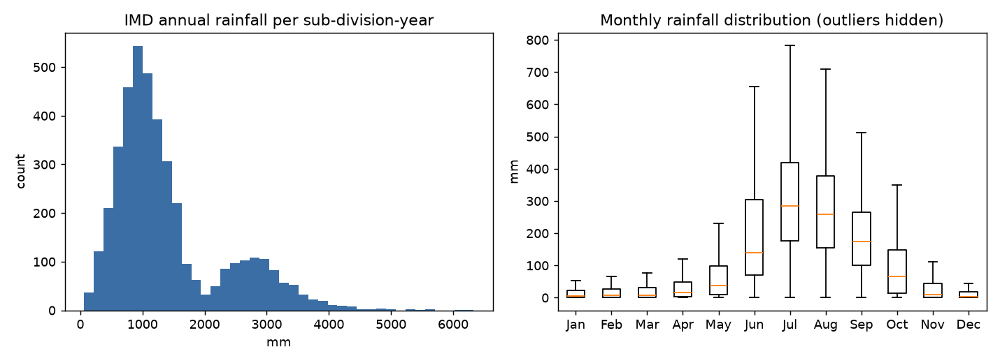
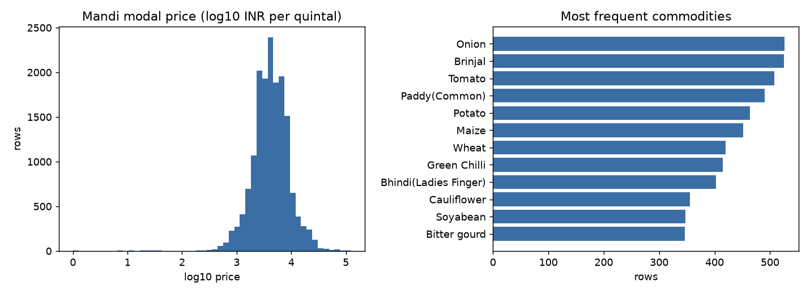
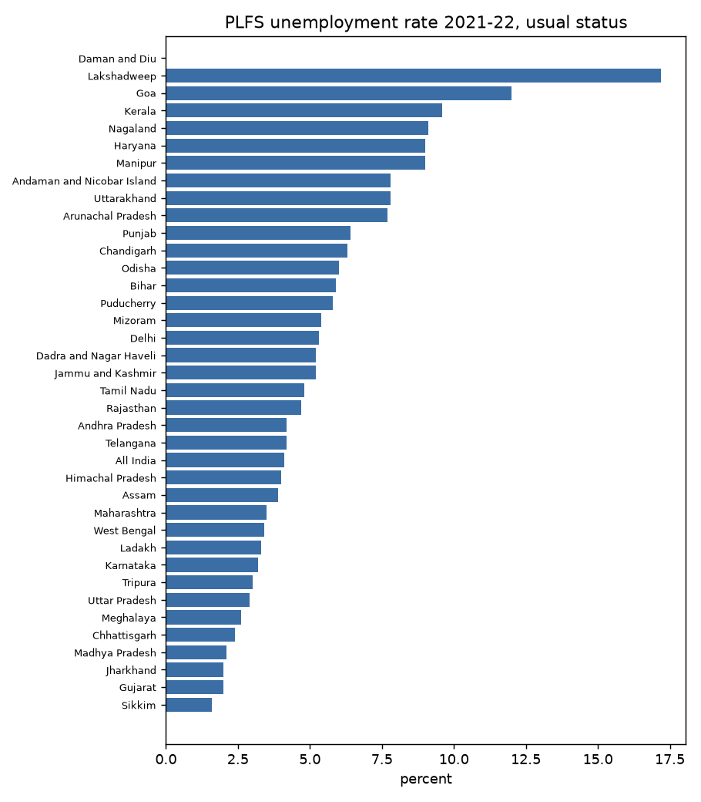
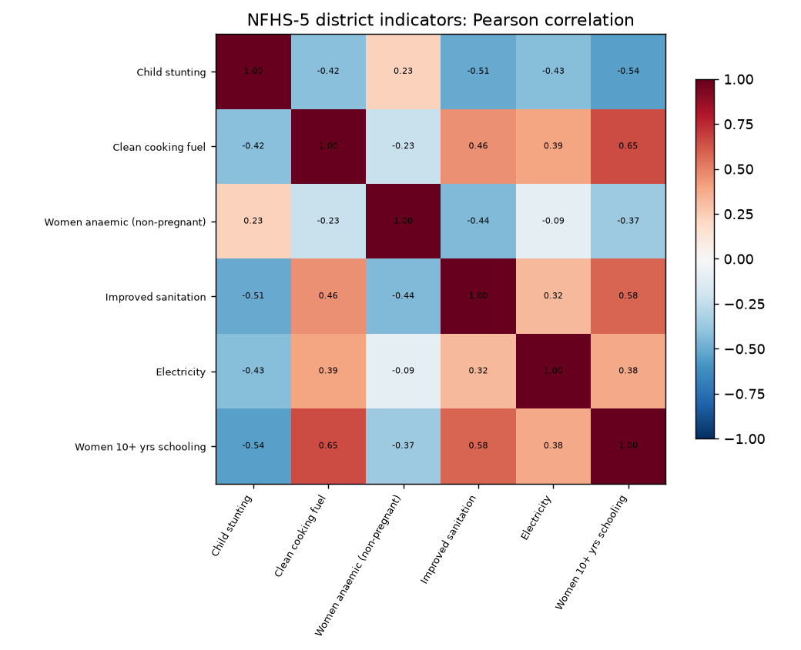
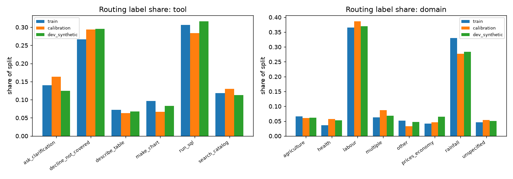

# Milestone 2: Dataset Identification and Data Preparation

**Project:** Analyst Agent for Indian Public Data with Calibrated Decision Models
**Group 4:** Shaoni Samanta (21f1003157), Shivanshu Gupta (22f3002985), Sathya Prakash (21f1006001), Ashmit Ghose (24f1001827)
**Document version:** 1.0, 29 October 2026
**Branch:** `docs/milestone-2`

---

## Document change log

| Version | Date | Revision | Source of the requirement | Where addressed | Status |
| --- | --- | --- | --- | --- | --- |
| 1.0 | 29 Oct 2026 | Report structured in the thirteen sections of the Milestone 2 outline | TA guidance for the Milestone 2 report | Sections 1-13 | Incorporated |
| 1.0 | 29 Oct 2026 | Change log maintained for the document, recording review revisions | TA instruction for this and all future milestones | This table; `CHANGELOG.md` | Incorporated |
| 1.0 | 29 Oct 2026 | Log of individual contributions for the milestone | TA instruction for every milestone | [Contribution log](#contribution-log); `WORKLOG.md` | Incorporated |
| 1.0 | 29 Oct 2026 | Sign-off section with names and dates of approval | TA instruction for all submissions | [Sign-off](#sign-off) | Incorporated once all four approvals are recorded |
| 1.0 | 29 Oct 2026 | Data-related failures kept distinct from system errors: the ground truth records the expected action (answer, abstain, clarify) and labels the abstention cases by cause (missing measure, missing survey round, incompatible geography, unsupported breakdown, measure mismatch) | Milestone 1 review: distinguish data-related problems from errors introduced by the system | Sections 3.4, 9.2 | Incorporated |
| 1.0 | 29 Oct 2026 | Correctness made measurable at the data level: each reference pair records the expected result type and behaviour, and every cleaned value carries a quality flag, so that a valid-but-wrong answer (wrong indicator, low-sample estimate used as reported) can be detected | Milestone 1 review: define correctness and trust clearly | Sections 3.4, 6 | Incorporated |
| 1.0 | 29 Oct 2026 | Rules and learned models separated at the data level: deterministic checks (unit, range, price order, date validity, arithmetic consistency) are implemented as preprocessing rules; only the routing decisions receive training data | Milestone 1 review: identify which tasks require a learned model and which can be handled by explicit rules | Sections 6, 9.1 | Incorporated |

The Milestone 1 revisions made in response to the review of 27 October 2026 are recorded in `CHANGELOG.md`.

---

## 1. Introduction

### 1.1 Project recap

Indian public statistics (data.gov.in, MoSPI, IMD, NFHS, NCRB and others) are openly published but difficult to use correctly: tables use years as columns, footnote markers inside values, renamed places (Orissa and Odisha), suppressed and low-sample estimates, and different year conventions (calendar, fiscal, July-June survey years). The project builds an analyst agent for journalists and fact-checkers that answers a question from a curated catalogue of tables, shows its evidence, reports a calibrated confidence, and abstains when the catalogue cannot answer. A hosted LLM writes read-only DuckDB queries; small decision models make the control decisions (tool selection and domain), and calibrated verification checks the answer.

### 1.2 Objectives of Milestone 2

1. Identify, verify and download the source tables, and record their ownership, licence and format.
2. Clean the tables into versioned Parquet files with unit, place and period checks and per-value quality flags.
3. Profile the tables (size, distributions, missing values, duplicates, outliers, correlations).
4. Define the labelling schema for the routing decisions and produce the routing training, calibration and development splits.
5. Produce the first question and reference-query pairs with development and test splits, separated by template.
6. Report the week-1 feasibility results.

### 1.3 Relationship between the data and the project goals

Two kinds of data serve the project. The **source tables** are what the agent queries; their cleaning determines whether an answer can be correct at all (objective O1, execution accuracy; O2, claim support). The **label sets** train and evaluate the decision layer: the routing splits train the tool-selection and domain decisions (O3 calibration, O4 abstention precision), and the question-reference pairs measure end-to-end correctness, including whether the agent abstains for the right reason.

## 2. Dataset Identification

### 2.1 Source tables

| # | Table (processed name) | Source and publisher | Access | Licence | Domain | Purpose |
| --- | --- | --- | --- | --- | --- | --- |
| 1 | `imd_subdivision_monthly_rainfall` | India Meteorological Department, via data.gov.in, resource `8e0bd482-4aba-4d99-9cb9-ff124f6f1c2f` | Public | Government Open Data License - India (GODL) | Rainfall | Monthly and seasonal rainfall by meteorological sub-division, 1901-2017 |
| 2 | `plfs_state_ur_usual_status` | Rajya Sabha answer citing MoSPI (PLFS), via data.gov.in, resource `d038e512-231e-4adb-bbb7-a3f95102d18a` | Public | GODL | Labour | State-wise unemployment rate (usual status), 2017-18 to 2021-22 |
| 3 | `nfhs5_district_indicators` | National Family Health Survey-5 district factsheets (IIPS, MoHFW), via data.gov.in, resource `cf80173e-fece-439d-a0b1-6e9cb510593d`; catalogue https://www.data.gov.in/catalog/national-family-health-survey-5-nfhs-5-india-districts-factsheet-data-provisional | Public | GODL | Health | 104 district-level health, nutrition and household indicators, 2019-2021 |
| 4 | `mandi_daily_prices` | AGMARKNET daily market prices, via data.gov.in, resource `9ef84268-d588-465a-a308-a864a43d0070`; catalogue https://www.data.gov.in/catalog/current-daily-price-various-commodities-various-markets-mandi | Public | GODL | Prices / agriculture | Minimum, maximum and modal commodity prices by market and day |
| 5 | `ncrb_annual_crime_statistics` | National Crime Records Bureau, Crime in India 2024, Table 1.1(ii), via data.gov.in; catalogue https://www.data.gov.in/catalog/crime-india-cii-2024 | Public | GODL | Other (crime) | National crime incidence and rates under IPC/BNS and SLL, 2022-2024 |

Retrieval dates: tables 1-2 on 23 October 2026; tables 3-4 on 29 October 2026 through the data.gov.in API (CSV format); table 5 from the catalogue download. The Mandi resource is a rolling daily snapshot; the prepared version is the snapshot of 29 October 2026, identified by its SHA-256 in `data/MANIFEST.md`.

### 2.2 Label sets

| Set | Location | Purpose |
| --- | --- | --- |
| Routing splits v1 (train, calibration, dev-synthetic) | `data/splits/kev/*.v1.jsonl` | Fine-tuning and calibrating the tool-selection and domain decisions of Kev-0.8B |
| Text-to-SQL reference pairs v1 (dev, test) | `data/ground_truths/text_to_sql_{dev,test}.v1.csv` | End-to-end evaluation of query correctness and abstention |
| Week-1 routing sample (200) and v0 questions (20) | `data/sample/` | Feasibility checks reported in Section 13.1 |

### 2.3 Why these tables, and alternatives considered

The tables were chosen to exercise the conventions that make public statistics hard to use: sub-divisions rather than states and calendar years (IMD); fiscal or July-June survey years as columns and `NA` strings (PLFS); wide indicator tables with suppressed and low-sample markers (NFHS-5); high-volume transactional data with place names at three levels (Mandi); and a small national series with internally checkable arithmetic (NCRB). Together they cover four of the five planned domains (rainfall, labour, health, prices) plus one out-of-domain table, which provides questions the domain decision must label `other`.

Alternatives considered: a near-duplicate PLFS resource (`89e6c4b7-4c56-4f4c-b196-a40726ebd7fe`) and an all-ages PLFS variant (`302a4e58-b2e0-46c8-a40e-154392a9c5d9`) were rejected in favour of the persons-15+ table; they remain useful as distractors for the catalogue-search decision. MoSPI microdata were rejected because the project works with published tables only. The remaining catalogue slots (agriculture production and prices/economy) are reserved for Ministry of Agriculture (DES), MoSPI CPI/WPI and RBI DBIE tables; five of the planned 8-12 tables are prepared in this release.

## 3. Dataset Description

### 3.1 Source tables after cleaning

| Table | Rows | Columns | Grain | Coverage |
| --- | --- | --- | --- | --- |
| `imd_subdivision_monthly_rainfall` | 4,188 | 19 | sub-division x year | 36 sub-divisions, 1901-2017; 12 months, annual and four seasons (mm) |
| `plfs_state_ur_usual_status` | 38 | 6 | State/UT | 37 States/UTs and an All India row; 5 survey years (percent) |
| `nfhs5_district_indicators` | 73,528 | 20 | district x indicator | 707 districts in 36 States/UTs x 104 indicators (raw: 707 rows x 109 columns) |
| `mandi_daily_prices` | 16,393 | 22 | market x commodity x variety x grade x day | 29 states, 1,725 markets, 261 commodities; arrival date 29 Oct 2026 |
| `ncrb_annual_crime_statistics` | NCRB-ROWS | NCRB-COLS | year | India, 2022-2024 |

Target variables: the source tables are analytical tables queried by the agent and have no target variable. The measured quantities are `value` (NFHS-5), `min/max/modal_price_inr_per_quintal` (Mandi), monthly and seasonal rainfall (IMD), the unemployment rate per survey year (PLFS) and crime counts and rates (NCRB).

### 3.2 Schemas of the cleaned tables

**`nfhs5_district_indicators`** (long format): `source_name`, `source_table`, `survey_round`, `survey_period`, `geography_level`, `state_name_source`, `state_name`, `district_name_source`, `district_name`, `indicator_id`, `indicator_label`, `value` (float), `unit` (`percent`, `per_1000_males`, `INR`, `unknown`), `is_suppressed`, `is_low_sample_estimate`, `quality_flag` (`reported`, `low_sample_estimate`, `suppressed`, `missing_or_unparseable`), `sample_households`, `sample_women_15_49`, `sample_men_15_54`, `value_raw`.

**`mandi_daily_prices`**: `source_name`, `source_table`, `geography_level`, `state_name_source`, `state_name`, `district_name_source`, `district_name`, `market_name`, `commodity_name`, `variety`, `grade`, `arrival_date` (date), `min_price_inr_per_quintal`, `max_price_inr_per_quintal`, `modal_price_inr_per_quintal`, `price_unit`, `is_arrival_date_valid`, `is_price_non_negative`, `is_price_order_valid`, `is_price_plausible`, `quality_flag`, `arrival_date_raw`.

**`imd_subdivision_monthly_rainfall`**: `subdivision`, `year`, `jan` ... `dec`, `annual`, `jf`, `mam`, `jjas`, `ond` (mm).

**`plfs_state_ur_usual_status`**: `state_ut`, `fy_2017_18` ... `fy_2021_22` (percent; survey years July-June).

**`ncrb_annual_crime_statistics`**: `year`, `population_lakhs`, `ipc_bns_crime_count`, `sll_crime_count`, `total_crime_count`, `ipc_bns_crime_rate`, `sll_crime_rate`, `total_crime_rate`, `ipc_bns_percentage`, source metadata, and validation columns (`incidence_total_valid`, `ipc_bns_percentage_valid`, three rate-consistency checks, `is_duplicate_year`, `quality_flag`).

### 3.3 Routing splits (decision-model training data)

Format: JSON Lines in the Kev training contract. Each record has a `state` (the catalogue shown to the agent, the conversation context and the user message), a `questions` object with two choice decisions, `tool` (6 options: `run_sql`, `make_chart`, `describe_table`, `search_catalog`, `ask_clarification`, `decline_not_covered`) and `domain` (8 options: `labour`, `agriculture`, `rainfall`, `prices_economy`, `health`, `other`, `multiple`, `unspecified`), each with fixed instruction text, option descriptions and a `label`, and a `_meta` object recording the rule that produced each label, the template, slots, group id, generator version and guide version.

| Split | Records | Groups | Longest state (characters) |
| --- | --- | --- | --- |
| train | 1,718 | 1,079 | 677 |
| calibration | 300 | 200 | 680 |
| dev-synthetic | 338 | 218 | 672 |

Sample record (abridged):

```json
{"state": {"catalogue": "1. plfs_state_ur_usual_status: PLFS unemployment rate (%), usual status (ps+ss), persons aged 15+, by State/UT plus an All India row, survey years 2017-18 to 2021-22 (July-June)",
           "context": "No result table yet.",
           "user_message": "What was the unemployment rate in Kerala for January to December 2018?"},
 "questions": {"tool": {"type": "choice", "instructions": "Choose the next step of a data-analysis agent ...", "criteria": {"run_sql": "...", "ask_clarification": "...", "...": "..."}, "label": "ask_clarification"},
               "domain": {"type": "choice", "...": "...", "label": "labour"}},
 "_meta": {"label_source": "rule", "tool_rule": "R14", "domain_rule": "M1", "template_id": "plfs.calendar.0", "group_id": "clarify:7c5bb8b6a0e0", "guide_version": "1.0-draft.4"}}
```

The label is `ask_clarification` because the user asks for a calendar year while the table reports July-June survey years.

### 3.4 Text-to-SQL reference pairs

100 pairs over NFHS-5 (42), Mandi (34), NCRB (23) and one cross-table question. Columns: `id`, `question`, `gold_sql`, `dataset`, `category` (21 templates, for example `filter_sort`, `aggregation`, `top_k`, `window`, `self_join`, `quality_audit`, `missing_measure`, `incompatible_geography`), `difficulty` (easy 60, medium 38, hard 2), `expected_action` (answer 90, abstain 9, clarify 1), `expected_result_type` and `expected_behavior`. The abstention cases are labelled by cause, so an evaluation can separate a data gap from a system error.

Sample: `Q001`, "Show the electricity percentage for every district, highest first." with reference query `SELECT state_name, district_name, indicator_label, value, unit FROM nfhs5_district_indicators WHERE indicator_label = 'Population living in households with electricity (%)' AND quality_flag = 'reported' ORDER BY value DESC;`

## 4. Data Governance

**Source and licensing.** All five tables are published on the Open Government Data Platform India under the Government Open Data License - India, which permits use, adaptation and redistribution with attribution. Ownership remains with the publishing agencies (IMD, MoSPI, IIPS/MoHFW, the Directorate of Marketing and Inspection, NCRB). Every processed row carries `source_name` and `source_table`; the report and the agent's evidence panel cite the publisher and resource. Raw files are not redistributed in the repository; they are re-downloaded by script.

**Privacy.** The tables are published aggregates (sub-division, State/UT, district, market and national level). They contain no personal data. The smallest unit is a district-level survey estimate, which the publisher already protects by suppressing estimates based on fewer than 25 unweighted cases. The label sets contain synthetic user messages and no personal data.

**Data quality.** Validation and cleaning are described in Section 6 and the resulting flags in Section 5. Values are never silently dropped: suppressed and low-sample estimates, invalid dates, out-of-order or implausible prices and inconsistent arithmetic are flagged in a `quality_flag` column and the original text is kept in a `*_raw` column.

**Ethics and bias.** Coverage is uneven: Mandi reports only markets that upload on a given day, NFHS-5 district estimates have wide sampling error in small districts, and IMD sub-divisions do not align with State boundaries. The agent must state these limits instead of presenting a figure as exhaustive. The routing labels follow written rules (labelling guide v1), so their biases are the rules' biases; the domain distribution of the v1 splits reflects the two tables they cover (Section 5.4). Crime statistics count registered cases, not incidence, and comparisons across States are known to reflect reporting rates; questions on them are answered with that caveat.

**Reproducibility and compliance.** Each prepared file is versioned (`.v1` suffix for label sets) and listed with its row count and SHA-256 in `data/MANIFEST.md`. Preprocessing is scripted (Section 12) and deterministic; the routing generator records its seed and version in every record. Attribution requirements of the licence are met through the source columns and Section 2.

## 5. Exploratory Data Analysis

The analysis is produced by `scripts/eda_tables.py`; the full output is in `docs/figures/milestone2/eda_summary.md`.

### 5.1 Summary statistics, missing values and duplicates

| Table | Rows | Missing cells | Exact duplicate rows | Duplicate keys |
| --- | --- | --- | --- | --- |
| IMD rainfall | 4,188 | 134 (26 in `annual`; at most 13 in any other column) | 0 | 0 (sub-division, year) |
| PLFS unemployment | 38 | 4 (one `NA` per survey year except 2019-20) | 0 | 0 |
| NFHS-5 indicators | 73,528 | 4,132 `value` cells (5.6%), all suppressed by the publisher | 0 | 0 (State, district, indicator) |
| Mandi prices | 16,393 | 0 | 0 | 0 (market, commodity, variety, grade, date) |
| NCRB crime | NCRB-ROWS | NCRB-MISSING | NCRB-DUP | NCRB-DUP |

| Measure | Mean | Median | Min | Max |
| --- | --- | --- | --- | --- |
| IMD annual rainfall (mm) | 1,409 | 1,120 | 62 | 6,331 |
| IMD June-September rainfall (mm) | 1,064 | 881 | 57 | 4,537 |
| PLFS unemployment rate 2021-22 (%) | 5.48 | 4.80 | 1.60 | 17.20 |
| Mandi modal price (INR per quintal) | 5,604 | 4,000 | 0.01 | 125,000 |

NFHS-5 quality flags: reported 64,512 (87.7%), low-sample estimate 4,884 (6.6%), suppressed 4,132 (5.6%).

### 5.2 Distributions and outliers



Rainfall is strongly right-skewed and seasonal: July has the highest median (285 mm) and December the lowest (3 mm). IQR outliers (401 annual values) are genuine extremes of wet sub-divisions and are retained.



Mandi prices span five orders of magnitude across commodities, so comparisons are made within a commodity. Ten rows are implausible (for example wheat at Aurangabad APMC with a maximum of INR 30,002,800 against a modal INR 2,600 per quintal, or prices below INR 1); they are flagged `implausible_price`. In 3,598 rows the minimum, modal and maximum prices are equal, which indicates a single reported transaction.



### 5.3 Correlation analysis



Across 707 districts, household electricity, improved sanitation, clean cooking fuel and women's literacy and schooling are positively correlated, and child stunting is negatively correlated with them. The agent must therefore treat cross-indicator comparisons as associations, not causes.

### 5.4 Class distribution of the label sets



| `tool` | train | calibration | dev-synthetic |
| --- | --- | --- | --- |
| run_sql | 30.6% | 28.3% | 31.7% |
| decline_not_covered | 26.7% | 29.3% | 29.6% |
| ask_clarification | 14.0% | 16.3% | 12.4% |
| search_catalog | 11.8% | 13.0% | 11.2% |
| make_chart | 9.7% | 6.7% | 8.3% |
| describe_table | 7.2% | 6.3% | 6.8% |

The `domain` decision is imbalanced: `labour` (36.5%) and `rainfall` (33.0%) dominate the training split because the v1 generator draws questions from the two week-1 tables, while `health` (3.7%) and `prices_economy` (4.1%) fall below 5%. Option shares agree across the three splits within a few points, so the calibration and development splits measure the same distribution as training.

A lexical shortcut baseline (TF-IDF word 1-2 grams with logistic regression, trained on train, scored on dev-synthetic) reaches 0.885 accuracy on `tool` against a majority-class 0.317. Because the rule-generated text shares templates across splits, this is an upper bound on what surface wording alone predicts; it is the baseline the fine-tuned model must exceed on human-labelled data.

### 5.5 Text-to-SQL reference pairs

Of the 70 answerable NFHS-5 and Mandi reference queries, 68 return rows on the prepared tables; the remaining two (`Q025`, `Q059`) correctly return no rows because the prepared data contains no missing stunting values and no out-of-order prices. NCRB-GOLD

## 6. Data Preprocessing

| Step | IMD | PLFS | NFHS-5 | Mandi | NCRB |
| --- | --- | --- | --- | --- | --- |
| Text cleaning (non-breaking and repeated spaces, trimming) | yes | yes | yes | yes | yes |
| Missing-value treatment | `NA` to null | `NA` to null | `*` to null, flagged `suppressed` | none present | flagged `missing_or_unparseable` |
| Duplicate removal | none found | none found | none found | exact duplicates on the full key removed (none found) | duplicate years flagged |
| Label correction (place names) | kept as published (`Orissa` sub-division) | kept as published | `state_name` standardised (Orissa to Odisha, Pondicherry to Puducherry, Keralam to Kerala, NCT of Delhi to Delhi and others); source value kept | same mapping | national only |
| Standardisation | numeric months and seasons | survey years as named columns | wide to long (one row per district and indicator); units assigned from the label (percent, per 1,000 males, INR) | dates parsed from DD/MM/YYYY; prices in INR per quintal | Indian number formatting removed |
| Validation | year range | value range | low-sample marker, suppression marker | non-negative prices, min <= modal <= max, plausibility, valid date | totals add up, percentages and rates consistent with counts and population |
| Normalisation, encoding, feature selection | not applied: the tables are queried, not used as model features | | | | |

**A source-format defect found and corrected.** The NFHS-5 factsheet marks estimates based on 25-49 unweighted cases with parentheses, for example `(29.5)`. The data.gov.in API export renders these cells as negative numbers (`-29.5`): 4,884 cells were negative, including vaccination coverage of `-100` and out-of-pocket expenditure of `-10,557` rupees. No NFHS-5 indicator can be negative, so a leading minus is read as the low-sample marker; after correction no value is negative and no percentage exceeds 100. Without this step, a query for the lowest coverage in a State would have returned a corrupted value as a valid answer.

**Routing splits.** Labels are assigned by deterministic rules from labelling guide v1 (16 tool rules and 8 domain rules with a fixed precedence; `docs/labelling_guide_v1.md`). Messages are tokenised by the model's own tokenizer at training time; no separate tokenisation is stored. Minimal pairs (the same message with one detail changed, which changes the label) are generated together and kept in the same group.

## 7. Dataset Integration

The five tables are not merged into one table: the agent queries each table through DuckDB, and the catalogue describes how they relate. Integration is handled through schema alignment:

- **Place names.** Each table keeps the published name (`*_source`) and a standardised `state_name`, so that a join or comparison across NFHS-5 and Mandi uses one spelling. IMD sub-divisions are not States; the catalogue states this so that a State-level rainfall question is clarified or answered with a stated mapping, not joined silently.
- **Periods.** NFHS-5 covers 2019-2021, PLFS uses July-June survey years, IMD calendar years, NCRB calendar years, and Mandi a single day. Each table records its period convention, and the routing labels send a question that mixes conventions to `ask_clarification` (Section 3.3).
- **Units.** Units are stored per value (NFHS-5), per column name (`*_inr_per_quintal`, `*_lakhs`) or in the catalogue description (IMD mm, PLFS percent).
- **Conflicting attributes and deduplication.** District names that occur in more than one State (eight names, for example Aurangabad, Bilaspur and Hamirpur) are kept distinct by the (State, district) key; counts by district name alone undercount districts (699 names against 707 districts). Deduplication after integration is not required because no rows are merged.

The routing splits and the reference pairs are aligned with the tables through the catalogue: each routing state lists the catalogue entries shown to the agent, and each reference query names the processed table it runs on.

## 8. Data Augmentation

Augmentation applies only to the routing label set. The generator produces each question from templates with slot values (place, period, measure, breakdown, definition), and adds minimal pairs and context variants (no prior result, a prior result table) for each template. These are the 2,356 records of Section 3.3. No model-generated text is included in the v1 splits. The source tables are not augmented.

## 9. Dataset Splitting

### 9.1 Routing splits

| Split | Records | Share | Purpose |
| --- | --- | --- | --- |
| train | 1,718 | 72.9% | Fine-tuning |
| calibration | 300 | 12.7% | Fitting the temperature (calibration) |
| dev-synthetic | 338 | 14.3% | Model selection and early stopping |

Splitting is by group: a template, its minimal pairs and its paraphrase variants share a `group_id`, and a whole group goes to one split, so a near-copy of a training message cannot appear in evaluation. Leakage checks (`src/analyst/data/kev_checks.py`): groups in more than one split 0; exact duplicate states 0; identical states with conflicting labels 0; evaluation messages within character 5-gram Jaccard 0.8 of a training message 0. Option shares are close across splits (Section 5.4), which is the stratification target.

### 9.2 Text-to-SQL reference pairs

| Split | Questions | Templates | Datasets | Expected actions |
| --- | --- | --- | --- | --- |
| dev | 63 | 18 | NFHS-5 38, NCRB 15, Mandi 10 | answer 58, abstain 4, clarify 1 |
| test | 37 | 14 | Mandi 24, NCRB 8, NFHS-5 4, cross-table 1 | answer 32, abstain 5 |

A template is a (dataset, category) pair; every question of a template is assigned to one split (seeded, `scripts/split_ground_truth.py`), so no question pattern appears in both. Abstention templates are divided between the two splits so that both measure abstention. Leakage checks: shared ids 0, shared templates 0, dev-test question pairs with word Jaccard of 0.8 or more 0. The test split is never used for training or prompt tuning. Its dataset mix differs from dev (more Mandi, fewer NFHS-5) because whole templates are kept together; results are therefore also reported per dataset.

## 10. Final Prepared Dataset

| Deliverable | Size | Features / fields | Distribution | Location |
| --- | --- | --- | --- | --- |
| Five cleaned tables | 4,188 + 38 + 73,528 + 16,393 + NCRB-ROWS rows | 19, 6, 20, 22 and NCRB-COLS columns | Section 5 | `data/processed/*.parquet` (regenerated by script; checksums in `data/MANIFEST.md`) |
| Routing splits v1 | 2,356 records | state (catalogue, context, message) and two labelled decisions | Section 5.4 | `data/splits/kev/*.v1.jsonl` (tracked) |
| Reference pairs v1 | 100 pairs (dev 63, test 37) | 9 fields | Section 3.4 | `data/ground_truths/` (tracked) |

**Summary of preprocessing.** Text cleaning, missing-value and suppression handling, place-name standardisation with source values kept, wide-to-long reshaping, unit assignment, date and number parsing, rule-based validation with per-row quality flags, correction of the NFHS-5 negative-value export defect, and group-based splitting with leakage checks.

**Readiness for model training.** The routing splits are ready for training Kev-0.8B on the tool-selection and domain decisions: they load with Kev's training loader, a fine-tuning dry run completed end to end on them (Section 13.1), and the calibration split is held out for the temperature fit. Labels are rule-generated from labelling guide v1. The cleaned tables and the reference pairs are ready for the query-generation baseline (v0) and its evaluation. A team receiving the repository can start training from `data/splits/kev/train.v1.jsonl` without further preparation.

## 11. Challenges Encountered

- **Data availability.** The NCRB 2022-2024 table is not exposed through the data.gov.in API and was obtained from the catalogue download. Only five of the planned 8-12 tables are prepared.
- **Data quality.** The NFHS-5 API export encodes low-sample markers as negative numbers (Section 6); the Mandi feed contains implausible prices and is a rolling single-day snapshot, so results depend on the snapshot date; IMD and PLFS contain `NA` cells and an aggregate All India row that must not be summed with States.
- **Source-version drift.** Two reference queries were written against a different copy of the NFHS-5 file: one depended on a double space in an indicator label (removed by cleaning) and one on the `≥` character (rendered as `?` in the API copy). Both were corrected to match the prepared data.
- **Privacy and licensing.** No constraint beyond attribution under the GODL.
- **Class imbalance.** The `domain` labels are concentrated on labour and rainfall (Section 5.4).
- **Missing labels.** The v1 routing splits cover two tables. Labels have not been independently human-checked; evaluation on human-labelled sets follows in Milestone 3.
- **Integration.** Sub-divisions against States, survey years against calendar years, and district names repeated across States (Section 7).
- **Limitations that remain.** The reference pairs over NCRB are not yet execution-checked against the prepared table, and the test split is weighted towards Mandi questions. NCRB-LIMIT

## 12. Deliverables Produced

| Deliverable | Path |
| --- | --- |
| Download functions (data.gov.in API) | `src/analyst/data/ogd.py` |
| Cleaning of IMD and PLFS to Parquet | `src/analyst/data/loaders.py` |
| Cleaning of NFHS-5, Mandi and NCRB | `scripts/preprocess_data.py`; documentation `scripts/README.md` |
| Exploratory analysis and figures | `scripts/eda_tables.py`; `docs/figures/milestone2/` |
| Data manifest (rows, columns, SHA-256) | `scripts/build_manifest.py`; `data/MANIFEST.md` |
| Routing data generator and checks | `src/analyst/data/kev_generate.py`, `src/analyst/data/kev_checks.py`, `src/analyst/decisions/kev_questions.py` |
| Labelling guide (data dictionary of the routing labels) | `docs/labelling_guide_v1.md` |
| Routing splits v1 | `data/splits/kev/` |
| Reference pairs and their split | `data/ground_truths/`; `scripts/split_ground_truth.py` |
| Read-only SQL runner and routing / v0 evaluation harness | `src/analyst/tools/sql_runner.py`, `src/analyst/evaluation/` |
| Data dictionary of the source tables | `data/sample/README.md`, `scripts/README.md`, Section 3.2 |
| Tests | `tests/` (33 tests pass) |

Reproduction, from the repository root:

```bash
python scripts/preprocess_data.py      # NFHS-5, Mandi, NCRB (raw files in data/raw)
python scripts/eda_tables.py           # EDA summary and figures
python scripts/split_ground_truth.py   # reference-pair dev/test split
python scripts/build_manifest.py       # rows and SHA-256 of every prepared file
pytest -q
```

## 13. Summary and Next Steps

### 13.1 Summary of work completed

Five public tables were identified, licensed, downloaded, cleaned and profiled; a labelling schema for the routing decisions was written and used to generate 2,356 routing records in three leakage-checked splits; and 100 reference pairs were written and split by template. The week-1 feasibility checks were run:

| Check | Result |
| --- | --- |
| Kev-0.8B zero-shot against Jev, tool selection on 200 routing examples | Accuracy 0.42 (95% interval 0.35-0.49) against 0.815 (0.76-0.87); preliminary, on teacher-written labels. The 3-point gate is not met zero-shot; tool selection stays on Jev until the fine-tuned model is evaluated. |
| Hosted-LLM v0 on 20 questions over two tables | Harness and read-only SQL runner implemented and tested; not run, as no LLM provider is configured. |
| Compose stack streams events through Caddy | Passed after two configuration defects were fixed; events arrive unbuffered. |
| Kev-0.8B fine-tuning dry run (Apple MPS) | Pipeline runs end to end (4 steps, peak device memory 3.29 GB); no accuracy claimed. |

### 13.2 Key observations

1. Source exports differ from the published factsheets in ways that change answers (the NFHS-5 sign defect); checks on value ranges are necessary before any table enters the catalogue.
2. Period and geography conventions differ across every pair of tables; these, not query syntax, are the main source of plausible-but-wrong answers, which supports routing such questions to clarification.
3. Zero-shot Kev-0.8B is far from Jev on tool selection; the fine-tuning claim must be tested against the shortcut baseline as well as against Jev.

### 13.3 Readiness

The routing splits are ready for fine-tuning and calibration, and the cleaned tables and reference pairs are ready for the v0 baseline and its evaluation.

### 13.4 Planned activities for Milestone 3

Architecture and integration of the agent graph (retrieval, typed tools, read-only SQL, evidence panel and confidence badge); the v0 baseline run on the reference pairs; the first Kev-0.8B fine-tune on Colab and its calibration; human-labelled evaluation sets for the routing decisions; and onboarding of the remaining catalogue tables.

---

## Contribution log

Milestone 2, week ending 29 October 2026. Evidence is linked in `WORKLOG.md`.

| Member | Track | Contribution |
| --- | --- | --- |
| Shivanshu Gupta (22f3002985) | T2 Agent | Selected and documented the NFHS-5, Mandi and NCRB sources; wrote the preprocessing pipeline for the three tables and its documentation (`scripts/preprocess_data.py`, `scripts/README.md`); wrote the 100 text-to-SQL reference pairs; revised the Milestone 1 report and its change log. |
| Sathya Prakash (21f1006001) | T3 Model (with T1 data work) | Week-1 feasibility checks and the IMD and PLFS tables; labelling guide v1, routing data generator and leakage checks, 2,356 routing records; integration of the branches; NFHS-5 sign-defect correction and Mandi plausibility flag; EDA, manifest, reference-pair split; this report and the presentation. |
| Shaoni Samanta (21f1003157) | T1 Data and Tools | PENDING-SHAONI |
| Ashmit Ghose (24f1001827) | T4 Ops and Evaluation | PENDING-ASHMIT |

## Sign-off

Each member confirms having reviewed and approved this document.

| Name | Roll number | Track | Approved on |
| --- | --- | --- | --- |
| Shaoni Samanta | 21f1003157 | T1 Data and Tools | |
| Shivanshu Gupta | 22f3002985 | T2 Agent | |
| Sathya Prakash | 21f1006001 | T3 Model | |
| Ashmit Ghose | 24f1001827 | T4 Ops and Evaluation | |
