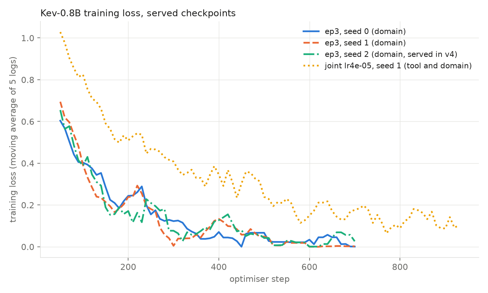
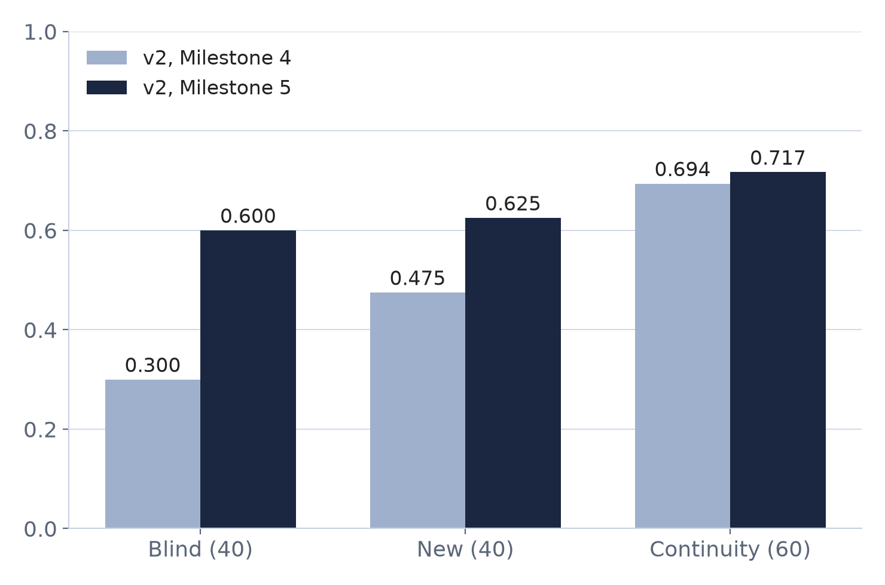
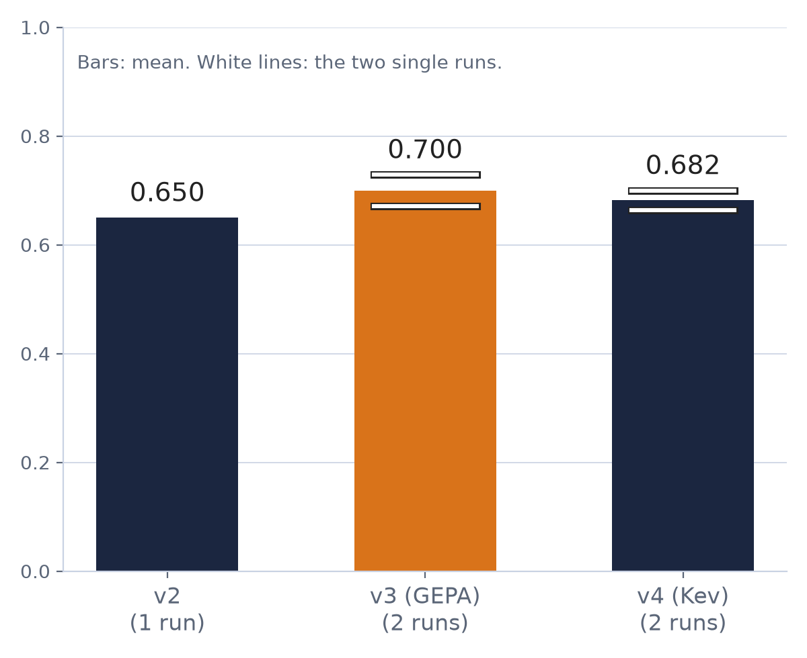
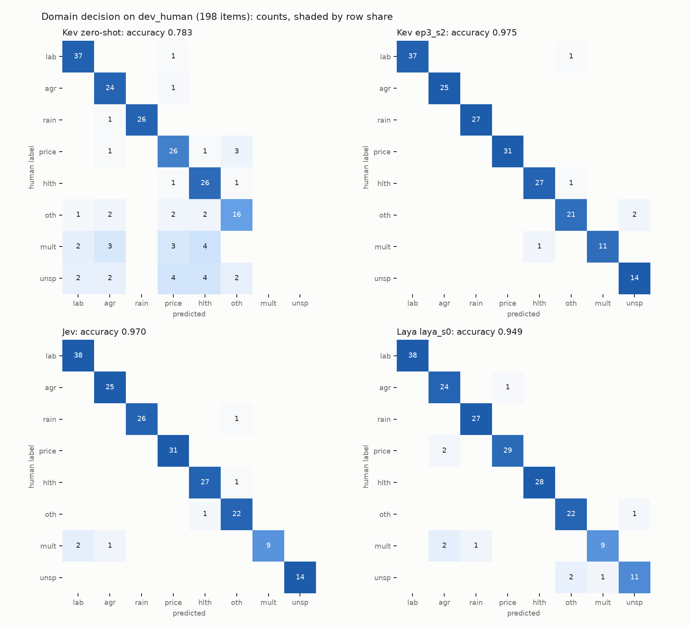
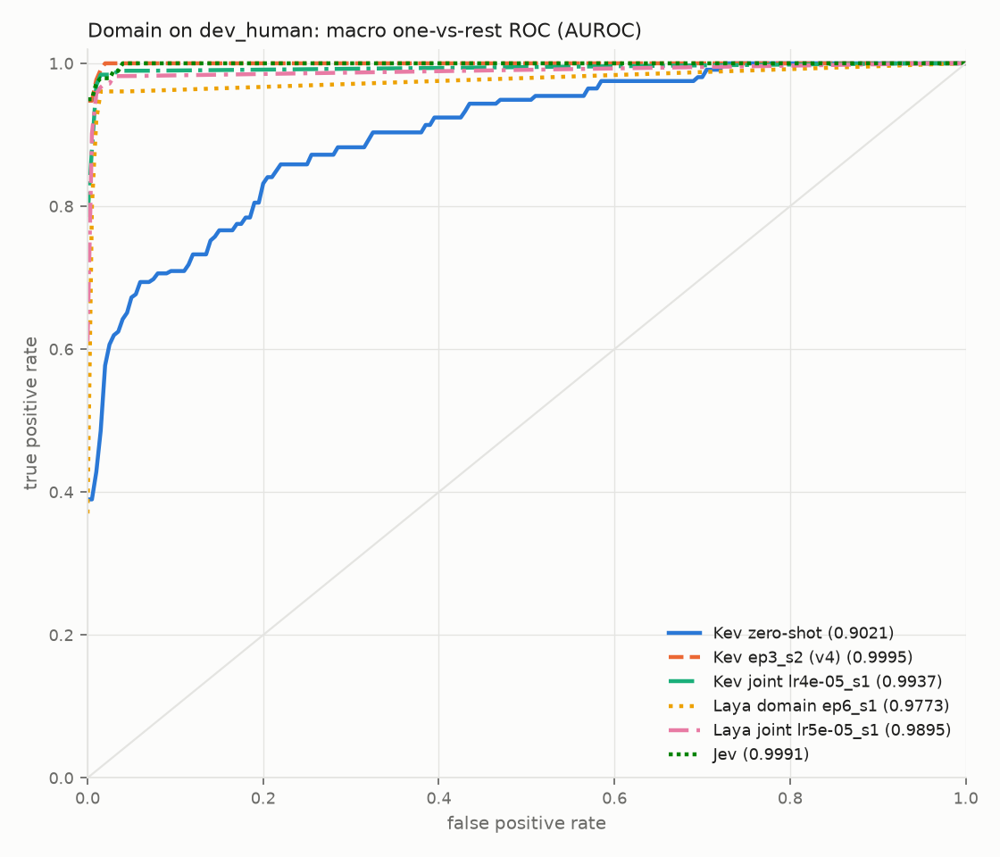
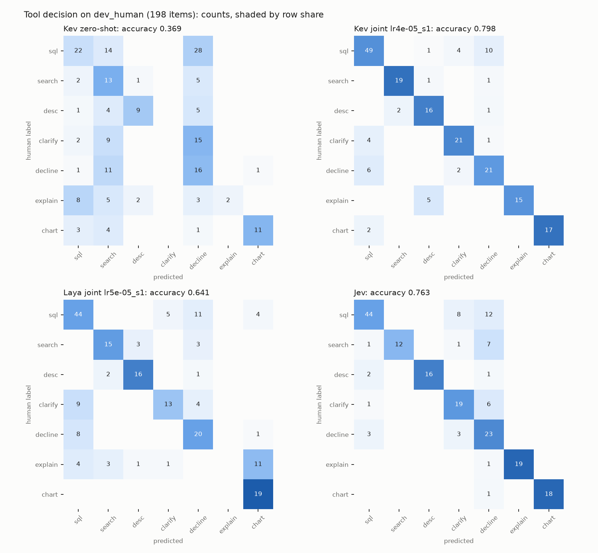
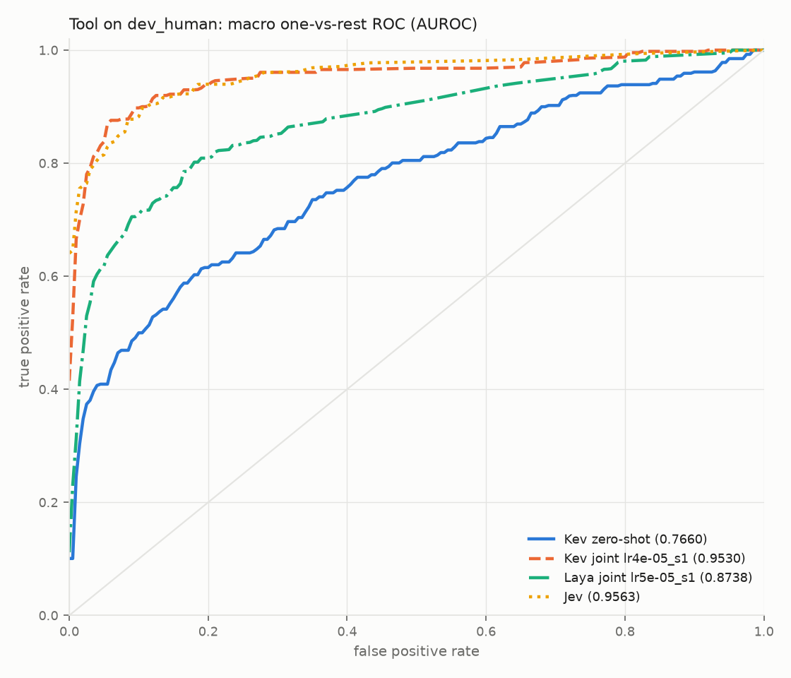

# Milestone 5: Evaluation and Analysis of Results

Project: Analyst Agent for Indian Public Data with Calibrated Decision Models (working title).
Course: DS & AI Lab, GenAI track, Group 4. Date: 26 November 2026. Version 1.0.

**Status of this file.** Every result cites the committed file that holds it and the command
that produced it (Appendix F).

**Scope of the evidence.** As in Milestones 3 and 4, every statement is tagged:

| Tag | Meaning |
| --- | --- |
| **Built** | Code exists in the repository and is covered by tests |
| **Measured** | A run was performed and its output is committed, with the command that produced it |
| **Designed** | Specified in [`docs/specs/agent_graph.md`](../../docs/specs/agent_graph.md) and not yet implemented |
| **Estimate** | A planning figure, not a measurement |
| **Self-reported** | A figure published by a vendor or project, not reproduced by the team |

## Document change log

| Version | Date | Change |
| --- | --- | --- |
| 0.1 | 25 Nov 2026 | Skeleton: sixteen sections, owners, response map to the Milestone 4 review, evaluation sets and configurations |
| 0.9 | 26 Nov 2026 | Results of the validated ground truth, the three test parts, v2-v4, decision models and `stress_v1`; Sections 1-16 drafted |
| 1.0 | 26 Nov 2026 | Kev-Laya parity and tool results on re-adjudicated labels; v4 with the joint Kev model end to end; GEPA prompt changes; blind human rating; sign-off |

## Summary

- **Ground truth.** 230 development and test items validated against written rules; 10 corrected
  and 7 rules added. The rules, not the agent, decided every change (Section 4.3).
- **Test set.** 140 items in three parts: 60 continuity, 40 new and 40 blind. Scorer v3 also checks
  interpretation, completeness, unit, period and evidence (Sections 4-5).
- **Agent fixes.** On the blind items, v2 rises from 0.30 to 0.60 (12 better, 0 worse; p = 0.0005).
  This is the one significant end-to-end gain (Section 7).
- **Versions.** On all 140 items (scorer v3): v2 0.650, v3 0.700, v4 0.682. v3 and v4 differ by less
  than the variation between runs (Section 6.1).
- **Clarification.** On validated gold, Milestone 5 asks when it should on 66.7% of the continuity
  clarify items; the same items give 61.1% for the Milestone 4 runs (Section 6.1).
- **Domain decision.** Kev `ep3_s2` scores 0.975 on `dev_human` against Jev's 0.970 (ECE 0.024) and
  passes the gate (Section 6.2).
- **Tool decision.** The Kev-to-Jev cascade scores 0.833 against Jev's 0.763 on `dev_human`
  (p = 0.016), but shows no measurable gain end to end; tool selection stays on Jev (Section 6.2).
- **Hard cases.** On `stress_v1` Kev scores 0.838 against Jev's 0.925, and its calibration degrades
  (ECE 0.117) (Section 6.2).
- **Open.** Abstention precision is 0.738, below the 0.85 target. Calibrated verification (v5) moves
  to Milestone 6, after deployment, the user interface and the provenance report (Sections 1.4, 16).

---

## 1. Introduction

### 1.1 Project objective

- A non-expert (primary users: journalists and fact-checkers) gets a correct, explained and
  verifiable answer from Indian public data in about 30 seconds.
- A hosted LLM writes queries, plans and narration; calibrated decision models make the control
  decisions; deterministic checks verify every figure against the data.

### 1.2 Scope of the evaluation

- Two parts, as in Milestone 4:

- **Part A, the complete agent:** end-to-end success, execution accuracy, interpretation,
  completeness, abstention and clarification, latency and cost, for versions v2, v3 and v4.
- **Part B, the decision models:** the domain decision (Kev-0.8B `ep3`, Jev, Laya) and the
  tool-selection decision (phase 2: joint Kev model), on human-labelled sets, with calibration
  and the cascade, including hard and unfamiliar questions.

### 1.3 Systems evaluated

| System | What it is | Section |
| --- | --- | --- |
| v2 (Milestone 4 baseline) | Hosted LLM (`gemini-3.5-flash-lite`), guidance cards and verified examples, Jev routing; frozen commit `a2c8c7d` | 6, 7 |
| v2 (Milestone 5) | v2 with the Milestone 5 fixes to place, period, clarification and follow-up handling | 6, 7, 9 |
| v3 | v2 (Milestone 5) with the intent prompt optimised by GEPA on development items | 6, 7, 8, 9 |
| v4 | v3 with fine-tuned Kev-0.8B `ep3_s2` on the domain decision and the cascade to Jev; tool selection stays on Jev | 6, 7, 9 |
| Kev-0.8B `ep3_s2` | Domain decision: seed 2 of the `ep3` recipe selected in Milestone 4, chosen by the fixed selection rule | 3, Part B |
| Kev-0.8B joint (phase 2) | Tool selection and domain in one model | 3, 8, Part B |
| Jev | Hosted decision model (zero-shot) | Part B |
| Laya | Comparator, fine-tuned with the library defaults | Part B |

### 1.4 Objectives of Milestone 5 and response to the Milestone 4 review

| # | Review point | Response | Where | Status |
| --- | --- | --- | --- | --- |
| 1 | End-to-end success flat; failures before SQL | General fixes on development items only; paired comparison on the frozen test set | 6, 7, 9, 10 | Done: +0.30 on blind items (p = 0.0005); Sections 7, 10 |
| 2 | Clarification 0.278, abstention precision 0.55-0.57; disputed gold | Expected-action rules v2; validation of every development and test item; Milestone 4 runs re-scored on validated gold; clarification slot scored | 4, 6, 10 | Done: 230 items validated, 10 corrected, 7 rules added; abstention precision 0.66-0.74 |
| 3 | Test set too small; scoring too lenient | 80 new test items, 40 of them blind (140 in all); scorer v3 checks interpretation, completeness, unit, period and evidence; blind human rating | 4, 5, 6 | Done: 140 items in three parts, including 40 blind; scorer v3; human rating of 30 answers by two raters (interpretation agreement 0.97) |
| 4 | Kev not evaluated inside the agent | v4 against v3 and v2 on the same frozen test set | 6, 7 | Done: v4 with Kev `ep3_s2` on the test set (0.682 over two runs; v3 0.700), no loss from replacing Jev |
| 5 | Limits of the decision-model evaluation | Laya fine-tuned; phase 2 joint model gated on re-adjudicated tool labels (guide 1.1); limits kept in the conclusions | Part B, 13 | Done: Kev and Laya under a matched protocol (27 runs); tool scored on re-adjudicated `dev_human`; held-out table |
| 6 | Calibration and cascade on hard cases and inside the agent | `stress_v1` (80 items); Kev confidence logged in agent runs | 6, 11 | Done: `stress_v1` shows calibration degrading out of distribution (ECE 0.117) |

- **Change of plan.** The Milestone 4 report planned calibrated verification (v5) for this
  milestone.
- It was moved to Milestone 6 to give priority to the ground-truth validation and the end-to-end
  fixes the review asked for.
- Its starting point and a first component measurement of the verifier are reported in Section 6.2.

---

## 2. Experimental setup

### 2.1 Hardware and software environment

| Component | Environment |
| --- | --- |
| Agent runs and scoring | Local machine: Apple M5, 16 GB, macOS; Python 3.13.14; packages in [`requirements.lock.txt`](../../requirements.lock.txt) |
| Kev training | Kaggle, 2 x Tesla T4 (CUDA, fp32); Kev at commit `2074cc44` with its own lock file |
| Laya training | Colab, Tesla T4 (CUDA); `laya` 0.4.23 |
| Hosted LLM | Vertex AI, `gemini-3.5-flash-lite` (default tier), global endpoint, temperature 0; the large tier for GEPA's reflection only |
| Decision-model serving | Kev served locally (`scripts/serve_kev.sh`, MPS, fp32); Jev hosted |

### 2.2 Frameworks and libraries

- LangGraph (agent graph), DuckDB (read-only SQL over versioned Parquet), sqlglot (SQL checks),
  Pydantic (contracts), BM25 and `BAAI/bge-small-en-v1.5` (retrieval), Kev (`kev.train`,
  `kev.serve`), DSPy 3.5.0 and `gepa` 0.1.4 (prompt optimisation), scipy (paired tests).

### 2.3 Dataset versions

- **Catalogue.** The 14 processed tables of Milestone 4 are unchanged; their row counts and SHA-256
  hashes are in [`data/MANIFEST.md`](../../data/MANIFEST.md) (built by `scripts/build_manifest.py`,
  17 November 2026).
- All sources are government-hosted (data.gov.in and ministry or department sites).
- **Reference files for place resolution (Built).** Milestone 4 traced six test failures in every
  version to place names.
- Four reference files, each from government sources and each with a test that every canonical value
  exists in its table ([`tests/test_reference_places.py`](../../tests/test_reference_places.py)),
  close these gaps:

- The four reference files (sub-division map, sub-division and market aliases, duplicate district
  names) and their tests are listed in Appendix G.2.

### 2.4 Evaluation sets and splits

| Set | File | Items | Use |
| --- | --- | --- | --- |
| `e2e_test` v1 (continuity) | [`data/eval/e2e_test.v1.jsonl`](../../data/eval/e2e_test.v1.jsonl) | 60 | Test, comparable with Milestone 4 |
| New test items | [`data/eval/e2e_test_ext.v1.jsonl`](../../data/eval/e2e_test_ext.v1.jsonl) | 40 | Test (new); written from the tables and the rules by a member who also took part in the fix work, kept outside the repository until the code freeze (Section 4.2) |
| Blind test items | [`data/eval/e2e_test_t1.v1.jsonl`](../../data/eval/e2e_test_t1.v1.jsonl) | 40 | Test (blind); written independently by a member outside the fix work, without access to the agent code (Section 4.2) |
| `e2e_dev` v1 and extra | [`data/eval/e2e_dev.v1.jsonl`](../../data/eval/e2e_dev.v1.jsonl), [`e2e_dev_extra.v1.jsonl`](../../data/eval/e2e_dev_extra.v1.jsonl) | 60 | Development, GEPA training and validation |
| Development supplement | [`data/eval/e2e_dev_m5.v1.jsonl`](../../data/eval/e2e_dev_m5.v1.jsonl) | 30 | Development |
| `dev_human` v1 / v1.1 | [`data/labels/dev_human_v1/`](../../data/labels/dev_human_v1/) | 198 | Decision-model test; tool labels re-adjudicated under guide 1.1 (v1.1) |
| `stress_v1` | [`data/labels/stress_v1/`](../../data/labels/stress_v1/) | 80 | Hard and unfamiliar cases for the domain decision |
| Routing data v2 | [`data/splits/kev/`](../../data/splits/kev/) | 1,876 / 322 / 355 | Training, calibration, model selection |

### 2.5 Random seeds and reproducibility

- Kev runs: seeds 0 and 1 for the joint model, seeds 0-2 for B0 (Milestone 4).
- Data split and GEPA split: seed 0.
- Bootstrap: 10,000 resamples, seed 0.
- The test runs use commit `c8ac5c7` (agent code frozen at `86a36a7`); commands in Appendix F.

### 2.6 Evaluation workflow

1. Expected-action rules v2 written; every development and test item validated against them
   (Section 4.3).
2. Agent fixes built and tested on development items only; code freeze (commit `86a36a7`).
3. GEPA optimisation of the intent prompt on development items (v3); Kev `ep3_s2` selected by the
   fixed rule and gated (v4).
4. Test runs, one configuration at a time (Section 4.4); scoring with scorers v2 and v3; paired
   comparisons.
5. Blind human rating of 30 answers; decision-model scoring on `dev_human` and `stress_v1`.

---

## 3. Model training summary

### 3.1 Domain decision: Kev-0.8B `ep3_s2` (recipe `ep3`, selected in Milestone 4)

- Milestone 4 selected the `ep3` recipe (B0 with three epochs).
- Milestone 5 trained two further seeds of that recipe and applied the selection rule fixed in
  advance in [`configs/train.yaml`](../../configs/train.yaml): temperature fitted on the calibration
  split, checkpoint chosen on `dev_synthetic` NLL after temperature.
- Seed 2 has the lowest NLL (0.0187, against 0.0237 for seeds 0 and 1) and is served in v4.
- `dev_human` is the test set of this decision and played no part in the choice (seeds 0, 1 and 2
  score 0.980, 0.965 and 0.975 on it).

| Item | Value |
| --- | --- |
| Architecture | `Qwen/Qwen3.5-0.8B-Base` with a rank-16 LoRA (all targets) and Kev's pointer head; warm start `jaredpalmer/kev-0.8b@bf75a6a8` |
| Optimiser and schedule | AdamW (weight decay 0.01), OneCycle with 10% warm-up, gradient clipping at norm 1.0 |
| Learning rate, batch, epochs | 2e-5; batch 1 x accumulation 8; 3 epochs |
| Loss | Cross-entropy over the options |
| Early stopping | None (`kev.train` saves per epoch only for full-weight runs); training horizons compared as separate runs |
| Checkpoint selection | Temperature fitted on calibration; lowest `dev_synthetic` NLL after temperature, beyond the B0 seed spread |
| Calibration | One temperature, 3.652 (`ep3_s2`; 3.763 for seed 0), fitted by NLL on the calibration split |
| Training duration | 53.9 minutes on one Tesla T4 (Kaggle), 705 optimiser steps over 5,628 records, peak device memory 6.8 GB (`models/checkpoints/ep3_s2/training_metrics.json`) |

### 3.2 Phase 2: joint model for tool selection and domain

- Same recipe as `ep3`, trained on routing data v2 with one single-question record per decision
  (3,752 records), seeds 0 and 1, and one temperature per decision.
- The selection rule, fixed in advance in [`configs/train.yaml`](../../configs/train.yaml), uses the
  mean `dev_synthetic` NLL after temperature over the two decisions; it selects seed 1 (0.2013
  against 0.2120).
- Training took 122.8 minutes on one T4: 1,407 optimiser steps over 11,256 records, peak device
  memory 7.7 GB.
- On `dev_human`, seed 1 scores 0.960 on the domain decision (ECE 0.040), within the 3-point margin
  of Jev (0.970); seed 0 scores 0.934.
- The matched protocol of Section 3.3 extended the joint cell to three seeds of two settings.
- It selects `lr4e-05` (mean NLL 0.188 against 0.204 for `ep3`) and serves `joint_lr4e-05_s1`; the
  phase-2 result above is reported as that rule's outcome.
- On 25 November the team kept tool selection on Jev for Milestone 5 whatever the result, so the
  joint model is a component result, not part of v4.
- Its tool score on `dev_human`, after the tool labels were re-adjudicated, is in Section 6.2.

### 3.3 Kev and Laya under a matched fine-tuning protocol

- Milestone 4 compared a tuned Kev against Laya trained once with its library defaults (`laya_s0`:
  0.949 on `dev_human`, domain).
- To compare the two models on equal terms, both were trained under one protocol fixed on 24
  November before any run under it started
  ([`kev_laya_parity_protocol.md`](../../docs/specs/kev_laya_parity_protocol.md)), and a model was
  chosen per decision by a rule fixed in advance.
- Every run the protocol lists was completed: 27 new runs (9 Kev, 18 Laya; 10.7 and 8.6 T4-hours),
  plus 9 earlier Kev runs reused in the cells.
- The parity rules (same rows, augmentation, visible text, calibration, search, selection and
  hardware) are in Appendix J.1.

| Model | Cell | Settings (mean `dev_synthetic` NLL, three seeds) | Chosen | Served checkpoint |
| --- | --- | --- | --- | --- |
| Kev-0.8B | Domain | `ep3` 0.0220; `lr4e-05` 0.0235; default 0.0416 | `ep3` | `ep3_s2` |
| Kev-0.8B | Joint | `lr4e-05` 0.188; `ep3` 0.204 | `lr4e-05` | `joint_lr4e-05_s1` |
| Laya | Domain | `ep6` 0.068; default 0.108; `lr5e-05` 0.140 | `ep6` | `laya_dom_ep6_s1` |
| Laya | Joint | `lr5e-05` 0.378; `ep6` 0.416 | `lr5e-05` | `laya_joint_lr5e-05_s1` |

- Selection used only `dev_synthetic`.
- Every run, with its setting, seed, Kaggle session, wall time and selection score, is in
  [`parity_runs.md`](../../outputs/reports/parity_runs.md); the plan each Kaggle session ran, with
  the commit it was made from and the hash of every input file, is in
  [`outputs/reports/parity_plans/`](../../outputs/reports/parity_plans/); the selections are in
  [`outputs/reports/laya_parity/`](../../outputs/reports/laya_parity/).

### 3.4 Prompt optimisation for v3 (GEPA)

| Item | Value |
| --- | --- |
| Component optimised | The instruction part of the intent prompt (`intent.v10`); the catalogue block, user template and output schema are fixed |
| Data | 66 eligible development items (answer and clarify items without prior turns), split 43 for training and 23 for validation by action, seed 0; no test item |
| Metric | Per item: action correct, then places, periods and indicators against the structured gold (scorer v3 fields), with a textual reason fed to the reflection model |
| Models | Task model `gemini-3.5-flash-lite`; reflection model `gemini-3.8-flash` |
| Budget | 300 metric calls (319 used), minibatch 4; 9 candidates |
| Result | Validation score 0.812 for the starting prompt, 0.899 for the best candidate (candidate 4), written as `configs/prompts/intent_gepa.v1.md` and pinned for v3 and v4 in `configs/model.yaml` |
| Cost and time | USD 3.35 (estimate from token counts), 16 minutes |

- Record: [`outputs/reports/gepa_v3.json`](../../outputs/reports/gepa_v3.json); command:
  `python scripts/optimise_prompts.py --yes`.
- GEPA kept the rules of `intent.v10` and added five; the added rules, the failures they address and
  a test example are in Appendix J.2.

---

## 4. Evaluation methodology

### 4.1 Test sets

- The test set has 140 items in three parts, reported separately and together:

| Part | Items | answer | clarify | decline | describe | search | Follow-ups |
| --- | --- | --- | --- | --- | --- | --- | --- |
| Continuity (`e2e_test` v1, Milestone 4) | 60 | 40 | 6 | 7 | 4 | 3 | 7 |
| New (`e2e_test_ext` v1, Milestone 5) | 40 | 27 | 6 | 5 | 1 | 1 | 4 |
| Blind (`e2e_test_t1` v1, Milestone 5) | 40 | 28 | 8 | 4 | 0 | 0 | 4 |

- The continuity part keeps the Milestone 4 comparison on the same items.
- The new part follows the quotas of the Milestone 5 plan: sub-division rainfall for split and
  shared States, market aliases, district names shared by two States (with and without the State
  named), "now" and "latest", series and comparisons of more than three values, follow-ups,
  clarification over four slots (place, period, category, indicator), measures held in no table, and
  units (bales, lakh, percentage points, per 1,000).
- Every table has at least two items.
- No test part is used for any fix, prompt optimisation or tuning; the development sets (90 items)
  serve those purposes.

### 4.2 Ground-truth preparation

- Each item was written as a journalist or fact-checker would ask it.
- The expected action was decided under the expected-action rules before any SQL was written; for
  `answer` items the gold SQL was written on the published table, executed read-only in DuckDB, and
  the expected values and entities were copied from the result, with a tolerance and the derivation
  for computed values.
- The structured gold fields used by scorer v3 (places, periods, indicators, unit, number of values,
  lineage) are computed from the gold SQL by
  [`scripts/fill_gold_fields.py`](../../scripts/fill_gold_fields.py); domain, clarification slot and
  options are filled by hand.
- [`scripts/check_e2e_set.py`](../../scripts/check_e2e_set.py) re-executes every gold query (no
  errors on any set) and a character 5-gram near-duplicate check (threshold 0.8) finds no new item
  that repeats an existing question.
- The 40 new items were written from the tables and the rules by a member who also took part in the
  fix work, after the place reference data were merged and while the fixes were being built
  separately.
- They were kept outside the repository until the code freeze (commit `86a36a7`) and no fix was made
  after them.
- They are therefore unseen by the fix work, but not blind.
- The 40 blind items were written independently by a member outside the fix work, without access to
  the agent code or to the other new items, and added after the freeze.
- They were validated by another member with the same three-way check (Section 4.3).
- In both parts about five items with place names use spellings that appear in the alias reference
  files, written by the same member who wrote the blind items; both parts may therefore overstate
  the gain from place resolution.

### 4.3 Ground-truth validation

- In Milestone 4 several items expected an action that differed from the agreed design, so a correct
  agent behaviour was scored as a failure.
- In Milestone 5 every development and test item (230) was validated before it was scored, with the
  rules as the only referee; the blind items were validated by a member other than their author.
- **Rules.** The expected-action rules v2 (24 November) in
  [`data/eval/README.md`](../../data/eval/README.md) state, with their sources in labelling guide
  1.1 and the design contract, when an item expects `answer`, `clarify`, `decline`, `describe` or
  `search` (E1-E15), which defaults remove a clarifying question (D1a-D10), which slot a
  clarification asks for (S1-S4), how follow-ups inherit (F1-F4) and how expected values are formed
  (V1-V6).
- **Three-way check.** For each item three actions were compared: the gold (G), the action the rules
  require from the question and the tables alone (R), and the action the frozen agent takes by
  design, read from its code (I).
- The classes and their treatment are in Appendix G.1.

| Set | Items | Aligned | Gold error | Agent error | Rule gap |
| --- | --- | --- | --- | --- | --- |
| Development (`e2e_dev`, `e2e_dev_extra`, `e2e_dev_m5`) | 90 | 85 | 1 | 3 | 2 |
| Continuity test | 60 | 52 | 0 | 7 | 1 |
| New test | 40 | 33 | 2 | 4 | 2 |
| Blind test | 40 | 35 | 1 | 3 | 2 |

- Seven rule gaps were each decided once, as a general rule, by three members of the team and never
  from agent output.
- Ten items changed in all and the other 220 kept their gold.
- The rules, the list of changes and the settlement of the four items disputed in Milestone 4 are in
  Appendix G.1.

### 4.4 Evaluation protocol

| Configuration | Code | Items | Runs |
| --- | --- | --- | --- |
| v2 (Milestone 4) | Commit `a2c8c7d`, as submitted in Milestone 4 | 80 new and blind items; the 60 continuity items reuse the three Milestone 4 runs, re-scored on the validated gold | 1 (3 on continuity) |
| v2 (Milestone 5) | Commit `c8ac5c7` (agent code frozen at `86a36a7`; later commits change only the v3 prompt pin and the v4 Kev settings) | 140 | 1 |
| v3 | Same commit; intent prompt `intent_gepa.v1` | 140 | 2 |
| v4 | Same commit; Kev `ep3_s2` served locally, cascade to Jev | 140 | 2 |

- All runs use one worker, so latency is comparable with Milestone 4, and run one at a time. v3 and
  v4 have two runs each, v2 one.
- Differences are paired on the same items: the mean difference of per-item success with a bootstrap
  95% interval (10,000 resamples, seed 0), and an exact McNemar test where both sides have the same
  number of runs.
- The two runs of v3 and v4 differ by 3.6-5.8 points on the 140 items, which sets the scale of
  run-to-run variation.
- A first attempt with four concurrent runs was rate-limited by Vertex AI and discarded; every
  configuration was then re-run one at a time.
- The reporting by test part and the absence of cross-validation are described in Appendix H.1.

### 4.5 Baselines

- v2 at the Milestone 4 commit for the agent; zero-shot Kev and Jev for the decision models.

### 4.6 Success criteria

- Objectives O1-O8 of the project plan and the gate fixed in
  [`configs/inference.yaml`](../../configs/inference.yaml) (within 3 points of Jev, ECE at most 0.10
  after calibration).

| Objective | Target | Milestone 5 (v4 unless stated) | Met |
| --- | --- | --- | --- |
| O1 execution accuracy | Fixed after v0 | 0.627 (100 items) | Reported |
| O3 ECE of the decision model | At most 0.10 | 0.024 on `dev_human`; 0.117 on `stress_v1` | In distribution only |
| O4 abstention precision | At least 0.85 | 0.738 | No |
| O5 first event / p95 latency | At most 1.5 s / 20 s | 29 ms / 22.7 s | First event only |
| O6 cost per answered question | Below v0 | USD 0.024 | Reported against Milestone 4 |
| O7 improvement across versions | Measurable | +0.30 (v2 M4 to M5, blind items); v3 +0.087 on blind items (indicative); v4 no further gain | Partly |
| Gate: Kev within 3 points of Jev, ECE at most 0.10 | - | 0.975 against 0.970, ECE 0.024 | Yes |

- O2 (claim support) and O8 (chart appropriateness) belong to v5 and Milestone 6.

---

## 5. Performance metrics

### 5.1 Agent metrics (Part A)

| Metric | Definition | Why |
| --- | --- | --- |
| End-to-end success (scorers v2, v3) | Share of items whose outcome meets every applicable check | The user-facing measure |
| Execution accuracy | Agent result equals the gold result (projected) | Query correctness alone |
| Interpretation, completeness, unit, period, evidence | Scorer v3 checks ([`scorer_v3.py`](../../src/analyst/evaluation/scorer_v3.py)) | Requested by the review: correct reading of the question and complete, traceable answers |
| Abstention precision and recall | Over non-answers (decline, clarify) | Reliability of refusals |
| Clarification slot accuracy | The agent asks for the missing slot | Review point 2 |
| Wrong-answer rate | Released answers that fail | Harm of a wrong figure |
| Latency, calls, tokens, cost per answer | From the run log | Objectives O5, O6 |
| Human rating | Interpretation, completeness, wording (0-2), two raters, kappa | What code cannot judge |

- Generative-text metrics such as BLEU, ROUGE and BERTScore are not used: answers are judged against
  values executed from the published tables, not against reference wording.
- Groundedness is checked in code (every narrated number must appear in the query result; the
  evidence check requires the table, its source and the SQL), and the hallucination rate corresponds
  to the wrong-answer rate (answers released with values that fail the checks).
- Wording is judged by human raters.

### 5.2 Decision-model metrics (Part B)

- Accuracy with a bootstrap interval, macro-F1 and per-label F1, NLL, Brier score, ECE (10 bins)
  before and after temperature, AUROC; for the cascade, the share handled by Kev at a 5% error
  budget and the escalation rate.

---

## 6. Experimental results

### 6.1 Part A: complete agent

- All figures are Measured on the validated gold (Section 4.3).
- Scores files: [`outputs/reports/m5_test/`](../../outputs/reports/m5_test/); predictions:
  `outputs/predictions/m5_test_*.jsonl`.
- Success is the share of items whose outcome passes every applicable check; scorer v2 applies the
  Milestone 4 rules, scorer v3 adds the interpretation, completeness, unit, period, evidence and
  clarification-slot checks.

**Frozen test set, 100 items (continuity 60 and new 40); v3 and v4: mean of two runs.**

| Version | Success, scorer v2 | Success, scorer v3 | Runs (scorer v3) | Execution accuracy | Abstention precision | Abstention recall | Wrong-answer rate |
| --- | --- | --- | --- | --- | --- | --- | --- |
| v2 (Milestone 5) | 0.68 | 0.650 | 0.65 | 0.537 | 0.657 | 0.958 | 0.208 |
| v3 (GEPA intent prompt) | 0.73 | 0.685 | 0.66, 0.71 | 0.604 | 0.704 | 0.938 | 0.237 |
| v4 (Kev `ep3_s2` on the domain) | 0.73 | 0.675 | 0.70, 0.65 | 0.627 | 0.738 | 0.938 | 0.261 |

- Per-check pass rates and results by test part (continuity, new and blind) are in Appendix H.2.
- The blind items gain most, and on all 140 items v3 leads (0.700, against 0.682 for v4 and 0.650
  for v2).
- Figures: [`agent_fixes.png`](figures/m5/agent_fixes.png) (v2 at the Milestone 4 and Milestone 5
  commits, by test part) and [`agent_ladder.png`](figures/m5/agent_ladder.png) (v2, v3, v4 on 140
  items).

- Clarification (review point 2): on the validated gold the Milestone 4 runs ask when they should on
  61.1% of the continuity clarify items (27.8% as reported in Milestone 4), and Milestone 5 on
  66.7%; the Aurangabad case named in the review now asks the right question (Appendix H.3).
- Two raters scored 30 answers with the version hidden: interpretation agreement 0.967 (kappa 0.66),
  means of 1.7-2.0 of 2 for interpretation and completeness, wording the weakest scale (Appendix
  H.4).
- v4 with the joint Kev model on both decisions scores 0.707 on the 140 items, against 0.700 for the
  same run of v4 (Appendix H.5).
- Scorer v3 was corrected once after the first test run, with two general rules applied to every
  version, the development check and the Milestone 4 baseline; the Milestone 4 code is scored under
  scorer v2 only (Appendix H.6).

### 6.2 Part B: decision models

- **Domain decision on `dev_human` (198 human-labelled items; Measured).** Each system's temperature
  is fitted on the calibration split (322 items) and applied unchanged; accuracy intervals are
  bootstrap 95% intervals.

| System | Accuracy | 95% interval | Macro-F1 | ECE raw | ECE calibrated | NLL | Brier | Temperature |
| --- | --- | --- | --- | --- | --- | --- | --- | --- |
| Kev-0.8B zero-shot | 0.783 | 0.727-0.838 | 0.625 | 0.068 | 0.081 | 0.754 | 0.350 | 1.036 |
| Kev `ep3` (seed 0, Milestone 4) | 0.980 | 0.960-0.995 | 0.973 | 0.017 | 0.040 | 0.070 | 0.034 | 3.763 |
| Kev `ep3_s1` | 0.965 | 0.939-0.985 | 0.955 | 0.028 | 0.027 | 0.073 | 0.037 | 3.616 |
| **Kev `ep3_s2` (v4)** | **0.975** | 0.949-0.995 | 0.969 | 0.023 | 0.024 | 0.080 | 0.041 | 3.652 |
| Kev joint, seed 1 (phase 2) | 0.960 | 0.934-0.985 | 0.949 | 0.045 | 0.040 | 0.175 | 0.081 | 4.159 |
| Jev (zero-shot, hosted) | 0.970 | 0.944-0.990 | 0.962 | 0.033 | 0.034 | 0.102 | 0.047 | 1.015 |
| Laya `laya_s0` (defaults) | 0.949 | 0.919-0.980 | 0.930 | 0.045 | 0.021 | 0.225 | 0.096 | 1.215 |

- Fine-tuning raises Kev from 0.783 to 0.965-0.980 across three seeds (spread 1.5 points).
- The selected seed `ep3_s2` passes the gate fixed in advance: accuracy 0.975 against Jev's 0.970,
  within the 3-point margin, and calibrated ECE 0.024, below 0.10
  ([`gate_domain_ep3_s2.json`](../../outputs/reports/gate_domain_ep3_s2.json)).
- Its cascade at a 5% error budget escalates calibrated confidence below 0.408 to Jev; on
  `dev_human` this sends 1 of 198 decisions (0.5%) to Jev, with no change in accuracy
  ([`cascade_domain_ep3_s2.json`](../../outputs/reports/cascade_domain_ep3_s2.json)).
- Laya with its library defaults is 2.6 points below Kev `ep3_s2`; its calibrated ECE is as low as
  Kev's.
- Confusion matrices and ROC curves of all six domain candidates follow; the precision-recall curves
  and the table of AUROC and average precision are in Appendix I.1.

- Tool labels on `dev_human` were re-adjudicated under labelling guide 1.1 before any tool
  prediction was opened; no label changed. Gate results per system are in Appendix I.2.

- On tool selection Kev joint passes the gate and Laya fails it.
- With escalation to Jev below calibrated confidence 0.689, the Kev-to-Jev cascade reaches 0.833
  against 0.763 for Jev alone (p = 0.016); tool selection nevertheless stays on Jev (Appendix I.2).

- `stress_v1` (80 hard and unfamiliar messages) results per category are in Appendix I.3.

- On hard cases Kev falls behind Jev (0.838 against 0.925) and its calibration degrades (ECE 0.117)
  (Appendix I.3).
- A first zero-shot check of a v5 verifier on the 75 answers v4 released gives AUROC 0.547, close to
  chance; v5 needs calibration on human-labelled examples (Appendix I.4).
- **Kev confidence inside the agent (review point 6; Measured;
  [`m5_agent_analyses.json`](../../outputs/reports/m5_agent_analyses.json),
  `python scripts/m5_agent_analyses.py`).** The domain decisions recorded in the first v4 test run
  (140 questions, each compared with the item's validated `domain` field):

| Configuration | Domain accuracy | ECE | Mean confidence, correct / wrong | Escalated to Jev |
| --- | --- | --- | --- | --- |
| v4, Kev `ep3_s2` | 0.879 | 0.080 | 0.972 / 0.808 | 2 of 140 |
| v4, Kev joint `joint_lr4e-05_s1` | 0.893 | 0.078 | 0.969 / 0.844 | 1 of 140 |
| v2, Jev | 0.907 | 0.062 | 0.951 / 0.837 | - |

- Inside the agent Kev's domain accuracy is 0.879, below Jev's 0.907, with ECE 0.080; wrong
  decisions carry lower confidence, but few are escalated (Appendix I.5).
- Choice of models: all four domain candidates pass the gate and none is significantly more accurate
  than another.
- The team kept Kev `ep3_s2` on the domain decision and Jev on tool selection; this departs from the
  protocol's latency tie-break, which would have favoured Laya.
- On the held-out table Kev's decisions transfer without loss and Laya's degrade.
- Detail: Appendix I.6.

---

## 7. Baseline comparison

- Paired on the same items: mean difference of per-item success, bootstrap 95% interval (10,000
  resamples, seed 0) and, where both sides have the same number of runs, an exact McNemar test on
  the discordant items. v3 and v4 enter with two runs, v2 with one.

| Comparison | Items | Scorer | Baseline | New | Difference | 95% interval | Only baseline / only new | p |
| --- | --- | --- | --- | --- | --- | --- | --- | --- |
| v2 M4 to v2 M5, blind | 40 | v2 | 0.300 | 0.600 | **+0.300** | 0.175 to 0.450 | 0 / 12 | **0.0005** |
| v2 M4 to v2 M5, new | 40 | v2 | 0.475 | 0.625 | +0.150 | 0.000 to 0.300 | 2 / 8 | 0.11 |
| v2 M4 to v2 M5, continuity | 60 | v2 | 0.694 | 0.717 | +0.022 | -0.078 to 0.122 | 5 / 6 | 1.0 |
| v2 to v3 | 100 | v3 | 0.650 | 0.685 | +0.035 | -0.020 to 0.095 | - | - |
| v3 to v4 | 100 | v3 | 0.685 | 0.675 | -0.010 | -0.050 to 0.035 | 3 / 1 | 0.63 |
| v2 to v4 | 100 | v3 | 0.650 | 0.675 | +0.025 | -0.030 to 0.085 | - | - |
| v2 to v3, blind | 40 | v3 | 0.650 | 0.738 | +0.087 | 0.025 to 0.175 | - | - |
| v3 to v4, blind | 40 | v3 | 0.738 | 0.700 | -0.037 | -0.113 to 0.025 | 3 / 1 | 0.63 |
| v2 to v4, blind | 40 | v3 | 0.650 | 0.700 | +0.050 | -0.050 to 0.150 | - | - |

- The Milestone 5 fixes are the one step with a significant effect, and it appears where they were
  aimed: on the blind items, written independently, which test place, period and clarification
  handling, v2 rises from 0.30 to 0.60 with no item lost.
- On the continuity items, which the Milestone 4 agent already answered at 0.69, the change is
  small.
- The optimised prompt (v3) adds 3.5 points on the 100 items and 8.7 on the blind items; the
  interval on the blind items excludes zero, but v2 has a single run there, so the gain is reported
  as likely rather than established.
- Kev on the domain (v4) does not improve on v3 (-1.0 point on the 100 items, -3.7 on the blind
  items, both within run-to-run variation): it replaces Jev on the domain decision at no loss in
  end-to-end success.
- The small v3-to-v4 difference comes from run-to-run variation of the hosted model: on 12 of the 13
  items that got worse, Kev and Jev made the same domain decision (Appendix H.7).
- Decision models against their baselines are in Section 6.2: fine-tuned Kev `ep3_s2` 0.975 against
  zero-shot Kev 0.783, Jev 0.970 and Laya 0.949 on `dev_human`.

---

## 8. Hyperparameter analysis

**Kev, domain decision (Measured; `dev_synthetic` NLL after temperature, the selection metric).**

| Run | Change from B0 (lr 2e-5, 2 epochs, LoRA rank 16, warm start) | NLL | Accuracy |
| --- | --- | --- | --- |
| B0, seeds 0 / 1 / 2 | - | 0.035 / 0.037 / 0.053 (mean 0.042, range 0.017) | 0.992 |
| `lr1e-05` | learning rate 1e-5 | 0.076 | 0.986 |
| `lr4e-05` | learning rate 4e-5 | 0.025 | 0.994 |
| `ep1` | 1 epoch | 0.140 | 0.966 |
| `ep3` | 3 epochs | 0.024 | 0.994 |
| `base_r16` | no warm start (from the base model) | 0.034 | 0.989 |
| `ep3_s1`, `ep3_s2` (Milestone 5) | 3 epochs, seeds 1 and 2 | 0.024, 0.019 | 0.997 |

- Three epochs is the only setting below the B0 mean by more than the B0 seed range
  ([`kev_selection.json`](../../outputs/reports/kev_selection.json)); among its three seeds, seed 2
  has the lowest NLL.
- The temperature is fitted per run (3.47-3.92 for B0 and `ep3` seeds), the cascade threshold at a
  5% error budget on the calibration split (0.408 for `ep3_s2`).
- Phase 2: two seeds of the joint model, selected by the mean NLL over both decisions.
- GEPA: one budget (300 metric calls, minibatch 4); the best of 9 candidates was found at the fifth
  candidate.
- Laya's sweep under the same procedure is in Appendix J.3; its seed spread is wider than the gap
  between its settings.

---

## 9. Ablation study

- The version ladder is read as an ablation: each step adds one component to the previous one, on
  the same items (Section 7).

| Step | Component added | Effect on success | Significant |
| --- | --- | --- | --- |
| v2 (Milestone 4) to v2 (Milestone 5) | Place reference data and resolution, clarification and abstention rules, "now" periods, suppressed values | +0.30 on the blind items, +0.15 on the new items, +0.02 on the continuity items | Yes on the blind items (p = 0.0005) |
| v2 to v3 | Intent prompt optimised by GEPA on development items | +0.035 (100 items), +0.087 (blind items); action check 0.76 to 0.83, unit 0.73 to 0.83, period 0.70 to 0.78 | Indicative on the blind items (interval excludes zero; v2 has one run) |
| v3 to v4 | Kev `ep3_s2` on the domain decision, cascade to Jev | -0.010 (100 items), -0.037 (blind items); evidence 0.81 to 0.84 | No: Kev replaces Jev at no loss |

- Offline ablations of the decision layer (Measured, `dev_human`, Section 6.2): Kev without
  fine-tuning (0.783) against fine-tuned (0.975); Kev without temperature has ECE 0.023 against
  0.024 with it, so for `ep3_s2` the temperature changes the confidence scale used by the cascade
  threshold more than the calibration error; v4 without the cascade (Kev only) and with it give the
  same accuracy on `dev_human` (0.975), the cascade escalating 1 decision in 198.
- The Milestone 4 ablations of guidance cards and verified examples (v0 to v2) are not repeated.

---

## 10. Error analysis

- **Part A: the agent (v2, Milestone 5, 100 test items; 24 items with the wrong action).** Gold
  corrections are excluded: every item below keeps a gold that the rules support (Section 4.3).

| Class | Items | What happens | Cause | Addressed in Milestone 5 |
| --- | --- | --- | --- | --- |
| State asked of the IMD sub-division table | e2e-020 (Delhi), e2e-201 (Maharashtra), e2e-203 (Chandigarh), e2e-205 (Meghalaya) | Declined as "not in the catalogue", or a question about the sub-division | The intent step declines before place resolution runs; the State-to-sub-division map (fix A1) is reached only on some phrasings | Partly: resolver fixed and tested; the earlier decline remains |
| Place forms outside the reference data | e2e-035 ("UP"), e2e-220 ("TN, AP"), e2e-223 ("five southern States"), e2e-097 ("UP district" offered Upper Siang), e2e-208 ("Pune market yard") | A clarifying question, sometimes with wrong options | No State abbreviations or region lists (rules D6c, D6d decided on 26 November); prefix matching | No |
| Same-named district with its State named | e2e-210 (Bilaspur, Chhattisgarh) | Declined | The decline precedes the district resolver (fix A3) | Partly |
| Clarification against decline | e2e-008, e2e-013, e2e-229 declined; e2e-230 answered | A missing group or a calendar-year question on a survey-year table is declined instead of asked (E9, E10); one is answered on the survey year without asking | Intent prompt reads "not in the table" as "not in the catalogue" | Partly (fix C2) |
| Verification abstains | e2e-037, e2e-099 (bales), e2e-056 | "The figures do not match the query result" | Number check on units (bales of 170 kg) and on a derived inflation figure | No (fixes D2, D3 not in the freeze) |
| Call budget | e2e-027 | The 8-call limit is reached | Repeated retries for the same reason | No (fix D6) |
| Infrastructure | e2e-055, 065, 070, 071, 236 | Vertex AI timeouts or one HTTP 429 | Not an agent decision | - |

**Action confusion matrix (v4, run 1, 140 items; rows: action the validated gold expects; columns:
the agent's outcome; [`m5_agent_analyses.json`](../../outputs/reports/m5_agent_analyses.json),
`action_confusion`).**

| Expected \ outcome | Answered | Clarifying | Declined | Described | Searched | Abstained | Failed |
| --- | --- | --- | --- | --- | --- | --- | --- |
| answer (95) | **74** | 9 | 4 | 0 | 0 | 3 | 5 |
| clarify (20) | 1 | **14** | 5 | 0 | 0 | 0 | 0 |
| decline (16) | 0 | 0 | **16** | 0 | 0 | 0 | 0 |
| describe (5) | 0 | 0 | 0 | **5** | 0 | 0 | 0 |
| search (4) | 0 | 0 | 0 | 0 | **4** | 0 | 0 |

- Declines, descriptions and searches are always right.
- The errors sit in two cells: questions that should be answered but are asked about or declined
  (13), and clarifications that become declines (5).
- An answered item can still fail the content checks; the diagonal counts the action only.
- Representative examples, with question, agent action, gold and cause, are in Appendix K.1.
- False positives (an answer released where the gold expects another action): 1 item (e2e-230).
- False negatives (declined, asked or abstained where the gold expects an answer): 12 items, the
  dominant error, plus 3 declines where a clarification was expected; abstention precision is 0.66
  for v2 and 0.74 for v4.
- In v3 and v4 the same classes remain.
- **Part B: the domain decision.** `ep3_s2` misclassifies 5 of 198 `dev_human` items.
- The phase 2 joint model (seed 1) misclassifies 8, of which 5 are follow-up messages (24% of the
  items), and reads several `multiple` messages as a single domain
  ([`domain_errors_joint_vs_ep3_dev_human.md`](../../outputs/reports/domain_errors_joint_vs_ep3_dev_human.md)).
- Confusion matrices are in
  [`figures/m5/confusion_domain_dev_human.png`](figures/m5/confusion_domain_dev_human.png).

---

## 11. Model robustness

- Unseen data: on the 40 blind items the agent scores v2 0.650, v3 0.738, v4 0.700 (scorer v3);
  on the held-out table Kev keeps its domain accuracy (14 and 14 of 15) and Laya drops (13 to 10).
- Generalisation: v2 scores 0.867 on the development items and 0.650 on the test items; the fixes
  generalise only in part.
- Noise: typos and paraphrases leave the domain decision unaffected (24 of 24); in the agent one of
  the three typo test items (e2e-020) succeeds in both runs.
- Language: Kev is weakest on Hinglish (3 of 7 against Jev 7 of 7).
- Adversarial cases are not evaluated as attacks; they belong to the Milestone 6 guardrails.
- Detail by aspect: Appendix K.4.

- Agent figures for the robustness items:
  [`m5_agent_analyses.json`](../../outputs/reports/m5_agent_analyses.json) (`robustness_items`,
  `python scripts/m5_agent_analyses.py`).
- A paraphrase sweep (`scripts/robustness_sweep.py`) was not run in this milestone; it is moved to
  Milestone 6. ---

## 12. Computational performance

**Agent (100 test items, first run of each version, one worker, local machine to Vertex AI; Measured
from the run logs).**

| Version | Time to first event p50 / p95 | Total latency p50 / p95 | Model calls per answered question | Tokens in / out (100 items) | Cost, 100 items | Cost per answered question |
| --- | --- | --- | --- | --- | --- | --- |
| v2 | 29 / 34 ms | 5.9 / 39.8 s | 5.96 | 3.98 M / 55 k | USD 1.30 | USD 0.027 |
| v3 | 30 / 34 ms | 12.9 / 23.0 s | 5.54 | 4.14 M / 58 k | USD 1.38 | USD 0.025 |
| v4 | 29 / 34 ms | 11.8 / 22.7 s | 5.36 | 4.17 M / 57 k | USD 1.34 | USD 0.024 |

- Costs are estimates from token counts (upper bounds); the latency notes and objective O5 are in
  Appendix K.3.

---

## 13. Limitations

- **Test size and runs.** 140 test items; two runs each for v3 and v4 and one for v2. The two runs
  of one version differ by up to 6 points, so differences of a few points between versions are
  within run-to-run variation. Only the step from Milestone 4 to Milestone 5 is significant.
- **Authorship of the new items.** The 40 new items were written by a member who also took part in
  the fix work (kept apart until the freeze); in the new and blind parts about ten items use alias
  spellings that are in the reference files, which may flatter place resolution.
- **Scorer.** Scorer v3 was corrected once after the first test run (Section 6.1); its
  interpretation check still fails a State total built from district rows (e2e-098) against a plan
  that names the State.
- **Infrastructure.** Concurrent runs were rate-limited by Vertex AI and discarded; the serial
  runs still contain five timeouts, scored as failures.
- **Agent.** The remaining errors of Section 10 (declines before place resolution, missing State
  abbreviations and regions, unit checks for bales, call budget).
- **Decision models.** Both decisions are evaluated on 198 items from one labelling round; the tool
  re-adjudication had one adjudicator, who also wrote the items. The matched protocol equalises
  data, augmentation, search, seeds, selection and hardware, not pre-training: the two starting
  checkpoints differ. Kev's run from the base model has no Laya counterpart. One plan (`kaggle_6`)
  was generated from a working tree that held exactly the change committed next, and its run records
  carry the flag `repo_dirty`.
- **Data.** 14 tables; many end before 2023 (crop production 2015-16, rainfall 2017), so "latest"
  answers can be old; the Mandi table is a one-day snapshot.
- **Bias.** The evaluation items and the human labels were written by four team members; the
  questions over-represent English and a few Hindi and Hinglish phrasings, and the catalogue covers
  14 tables, so performance on other languages, regions and topics is not measured.
- **Scalability.** One worker per run; the hosted model rate-limits concurrent runs (Section 4.4);
  the catalogue is small enough for retrieval to be exhaustive, which will not hold at a larger
  scale.
- **Computational constraints.** Training on free T4 GPUs limited the search to one factor at a time
  and three seeds; one or two runs per agent version kept test costs to about USD 1.3 per 100 items
  per run.
- **Ethics.** Answers are restricted to published government tables and state their source and
  assumptions; the agent declines rather than estimate a missing figure.

## 14. Possible improvements

- Decline less: resolve places before the coverage decision, so a State on the sub-division table
  or a district named with its State reaches the resolver (Section 10).
- Add State abbreviations and official region lists to the reference data (rules D6c, D6d).
- Unit-aware number check (bales, lakh) and a retry budget that stops repeating the same failure.
- Reduce run-to-run variation in the hosted model, which drives most differences between runs even
  at temperature 0 (provider-side non-determinism, varying thinking length, retries): a fixed seed
  in every model call; no thinking for intent extraction, measured on the development sets first;
  a majority vote over three intent readings; then three or more runs per version on the 140 items
  to separate effects of a few points from noise.
- Milestone 6 (in order): deployment, the user interface, the Evidence and Data Provenance
  Report, guardrails; then v5 in a light form (code check of every stated value, confidence badge)
  and v6 as a documented recalibration procedure.
- The plausible reasons and mitigations for the two weak points (abstention precision; Kev's
  calibration on hard cases) are in Appendix K.2.

## 15. Discussion

- The Milestone 4 review asked for a measurable end-to-end gain, sound ground truth, a larger and
  stricter test, and Kev evaluated inside the agent.
- The ground truth is now validated against written rules.
- Every change and its rule are recorded, and the rules, not the agent, decided each disputed item.
- On the blind items, written independently, the Milestone 5 fixes double the success of v2 (0.30 to
  0.60, p = 0.0005); this is the clearest result of the milestone.
- Prompt optimisation adds 3.5 points on the 100 items and 8.7 on the blind items (indicative).
- The fine-tuned domain model adds no further gain, and runs of one version differ by up to 6
  points.
- Inside the agent, Kev `ep3_s2` replaces Jev on the domain decision.
- On human labels it matches Jev (0.975 against 0.970), with calibrated confidence (ECE 0.024) and a
  cascade that sends 0.5% of decisions back to Jev.
- The v4 test run shows no loss from the replacement, although on the test questions Kev's domain
  accuracy (0.879) is below Jev's (0.907).
- The dominant remaining error is a false decline before place resolution, which the evaluation now
  separates cleanly from gold errors.
- Objectives: O3 (calibration within 0.10) holds on human labels and inside the agent but not on
  hard cases; O4 (abstention precision 0.85) is not met (0.74); O5 holds for the first event and is
  missed by about 3 s at p95; O7 (measurable improvement) holds for the step from Milestone 4 to
  Milestone 5 on the blind items only.
- Lessons learned:

- Validating the ground truth against written rules changed the picture more than any model change
  (clarification success 0.28 to 0.61 for the same Milestone 4 runs).
- A component gain does not carry through to the agent automatically: the tool cascade is
  significantly better than Jev on `dev_human` and no better end to end.
- One or two runs per version are too few to resolve effects of a few points (a single run first
  showed v4 4 points above v3; two runs show no gain).
- In practice, the agent answers most single-table questions with a source and an explanation.
- The remaining failures are cautious (declines and clarifications) rather than wrong figures: the
  wrong-answer rate is 0.20-0.26.

## 16. Conclusion

- Milestone 5 delivers validated ground truth (190 items plus 40 blind items, ten gold corrections,
  seven new rules), a stricter scorer, a test set of 140 items, and three agent versions evaluated
  on it.
- The Milestone 5 agent fixes produce a significant gain on blind items.
- GEPA prompt optimisation and the fine-tuned Kev domain model are integrated: prompt optimisation
  shows a likely gain, and Kev replaces Jev on the domain decision at no loss.
- Kev `ep3_s2` passes its gate against Jev.
- Final performance on the 140 test items (scorer v3, mean of two runs) is 0.700 for v3 and 0.682
  for v4, against 0.650 for v2.
- The system is ready for a supervised demonstration but not for unsupervised public use: abstention
  precision and the false declines before place resolution need work first.
- Milestone 6 priorities, in order: (1) deployment of the agent (container stack on one virtual
  machine, with a standby link); (2) the user interface (question, streamed answer, evidence panel,
  confidence badge); (3) the Evidence and Data Provenance Report required by the course team; (4)
  guardrails; (5) v5 in a light form: a code check of every stated value against the result and the
  confidence badge, with the calibrated Jev verifier only if human verification labels can be
  collected in time; (6) v6 as a documented, human-approved recalibration procedure, demonstrated
  once on a calibration split that includes code-mixed and follow-up messages.

---

## Appendices

- A. Complete metric tables: [`outputs/reports/m5_test/`](../../outputs/reports/m5_test/) (agent), `outputs/reports/score_domain_*.json` (decision models).
- B. Confusion matrices, ROC and PR curves for the domain and tool decisions: [`figures/m5/`](figures/m5/)
  (`python scripts/m5_decision_figures.py`); agent action confusion matrix: Section 10; reliability
  diagrams (raw and calibrated) for the served checkpoints:
  [`reliability_domain_ep3_s2_dev_human.png`](../../outputs/figures/reliability_domain_ep3_s2_dev_human.png),
  [`reliability_domain_joint_lr4e-05_s1_dev_human.png`](../../outputs/figures/reliability_domain_joint_lr4e-05_s1_dev_human.png),
  [`reliability_domain_jev_dev_human.png`](../../outputs/figures/reliability_domain_jev_dev_human.png),
  [`reliability_domain_zeroshot_v2_dev_human.png`](../../outputs/figures/reliability_domain_zeroshot_v2_dev_human.png),
  [`reliability_tool_joint_lr4e-05_s1.png`](../../outputs/figures/reliability_tool_joint_lr4e-05_s1.png).
- C. Learning curves: [`loss_curves_kev.png`](figures/m5/loss_curves_kev.png) (`python scripts/m5_loss_curves.py`). Training records per run: `outputs/reports/kev_runs/<run>/training_metrics.json` and `train.log`; selection: [`kev_selection.json`](../../outputs/reports/kev_selection.json).
- D. Predictions per item: `outputs/predictions/m5_test_*.jsonl`; failure cases: Section 10.
- E. Model and agent configuration ([`configs/`](../../configs/)).
- F. Artifacts, evaluation scripts and reproduction commands (below).
- G-K. Detail moved from the main sections: ground-truth validation (G), agent results (H), decision models (I), training and hyperparameters (J), errors and robustness (K).

### Appendix F. Reproduction

Environment: `set -a; source .env; set +a; export PYTHONPATH=src:. GOOGLE_CLOUD_PROJECT=<project>`.
Live runs spend cloud credit and need `--yes`.

| Step | Command | Output |
| --- | --- | --- |
| Validate gold (apply decided rows) | `python scripts/apply_validation.py --findings data/eval/validation/<set>_draft.csv --set <sets> --validated-by "<name>" --write` | `data/eval/*.jsonl` (`gold_changes`) |
| Structured gold fields | `python scripts/fill_gold_fields.py --set <set> --write` | the set |
| Check a set | `python scripts/check_e2e_set.py --set <set> --out <report>` | report |
| GEPA (v3) | `python scripts/optimise_prompts.py --yes` | `configs/prompts/intent_gepa.v1.md`, `outputs/reports/gepa_v3.json` |
| Serve Kev (v4) | `scripts/serve_kev.sh models/checkpoints/ep3_s2` | port 8009 (set `KEV_BASE_URL` for another port) |
| Test run | `python -m analyst.evaluation.e2e_eval run --live --yes --workers 1 --version <v2/v3/v4> --set data/eval/e2e_test.v1.jsonl data/eval/e2e_test_ext.v1.jsonl --out outputs/predictions/m5_test_<v>_r1.jsonl` (and `--set data/eval/e2e_test_t1.v1.jsonl` for the T1 part) | predictions |
| Milestone 4 baseline | the same at commit `a2c8c7d`, on `outputs/e2e_test_new80_m4fields.jsonl` (the 80 new items with the fields that commit knows) | `m5_test_v2m4_new80_r1.jsonl` |
| Human rating | `python scripts/score_rating.py` | `outputs/reports/rating_m5.json` |
| Clarification, domain decision inside the agent, v3 against v4 | `python scripts/m5_agent_analyses.py` | `outputs/reports/m5_agent_analyses.json` |
| Score | `python -m analyst.evaluation.e2e_eval score --scorer <v2/v3> --predictions <runs> --gold <sets> --out <report>` | `outputs/reports/m5_test/score_*.json` |
| Paired comparison | `python -m analyst.evaluation.e2e_eval compare --scorer <v2/v3> --a <runs> --b <runs> --gold <sets> [--only <set>] --out <report>` | `outputs/reports/m5_test/compare_*.json` |
| Gate and cascade (domain) | `python -m analyst.evaluation.decision_eval {gate,cascade} --decision domain --kev-calibration ... --kev-dev ... --jev-dev ... --out ...` | `gate_domain_ep3_s2.json`, `cascade_domain_ep3_s2.json` |
| `stress_v1` | `python scripts/score_stress_v1.py build`; `domain_eval run --split stress_v1`; `python scripts/score_stress_v1.py score` | `score_domain_stress_v1.json` |
| Figures | `python scripts/m5_decision_figures.py` | `docs/milestones/figures/m5/` |
| Parity data (Laya training files from Kev's augmentation) | `~/kev-src/.venv/bin/python -I scripts/build_parity_data.py --kev-src ~/kev-src --root .` | `data/splits/laya_parity/`, `hashes.json` |
| Parity run plans and Kaggle staging | `python scripts/laya_parity_plan.py --stage sweep`; `python scripts/laya_parity_plan.py --stage finals --top2 ep6 lr5e-05 --parts 3 --selection outputs/reports/laya_parity/selection_laya_sweep.json`; `python -m analyst.models.kev_runs plan --out <stage>/kev_plan.json` | `outputs/reports/parity_plans/` |
| Parity training (Kaggle, 2 x T4) | `notebooks/laya_parity_kaggle.ipynb` (`STAGE`, `PART`); `notebooks/kev_train_t4.ipynb` (`SESSION` `kaggle_5`, `kaggle_6`) | run folders; `environment.json` per run |
| Parity selection | `python scripts/score_laya_parity.py laya --stage sweep\|finals --plan outputs/reports/parity_plans/laya_K1_sweep.json\|laya_K3_finals.json`; `python scripts/score_laya_parity.py kev --stage finals --kev-reports outputs/reports` | `outputs/reports/laya_parity/selection_*.json` |
| Register Kev runs | `python -m analyst.models.kev_runs register models/checkpoints/<run> --run-id <run> [--scores outputs/reports/score_domain_<run>.json]` | `models/registry.json`, `outputs/reports/kev_runs/<run>/` |
| Serve Laya (local) | `LAYA_PORT=8012 LAYA_MODELS=<run> LAYA_EXTRA_MODELS='{"<run>":"<abs path>"}' uvx --from "laya[serve]==0.4.23" laya-serve` | port 8012 |
| Decision predictions | `python -m analyst.evaluation.decision_eval run --decision <domain\|tool> --file <split> --out <predictions> [--base-url ... --model ...]` | `outputs/predictions/<decision>_<run>_<split>.jsonl` |
| Gate and cascade (tool) | `python -m analyst.evaluation.decision_eval {gate,cascade} --decision tool --kev-calibration outputs/predictions/tool_joint_lr4e-05_s1_calibration.jsonl --kev-dev outputs/predictions/tool_joint_lr4e-05_s1_dev_human.jsonl --jev-dev outputs/predictions/tool_jev_dev_human.jsonl --out ...` | `gate_tool_joint_lr4e-05_s1.json`, `cascade_tool_joint_lr4e-05_s1.json` |
| Final comparison and run table | `python scripts/parity_final.py`; `python scripts/parity_run_table.py` | `outputs/reports/parity_final.json`, `outputs/reports/parity_runs.{csv,md}` |

### Appendix G. Ground-truth validation detail

#### G.1 Classes, rule gaps and changes

| Class | Condition | Treatment |
| --- | --- | --- |
| Aligned | G = R = I | None |
| Gold error | G differs from R | Correction proposed with the rule it cites; decided by a person |
| Agent error | G = R, I differs | Gold unchanged; reported as an agent error (Section 10) |
| Rule gap | No rule decides | One general rule decided by the team and applied to every item alike |

Milestone 4 agent outputs were used only to make sure every item on which the agent had disagreed
with the gold received a reasoned class; they were never evidence for a change.

One development item and one new test item are counted both as gold error and agent error. The
classes concern the expected action and slot; corrections to other gold fields of an aligned item
(the tables a search lists) and items settled through a rule gap appear in the table of changes
below. Files: [`alignment_audit.csv`](../../data/eval/validation/alignment_audit.csv),
[`alignment_test_ext.csv`](../../data/eval/validation/alignment_test_ext.csv).

**Rule gaps.** Seven cases were decided once, as general rules, by three members of the team on 26
November, and added to the rule sheet: E6a (periods relative to today), D6c (State abbreviations and
misspellings with one plausible match), D6d (regions fixed by an official list or by the question),
E9b (a measure published only for sub-groups is a clarification, not a decline), E2a (when two
tables hold a measure, the table built for it), V7 (a commodity is ranked once, at its
highest-valued variety) and, while validating the blind items, E9c (a table with a single group
still gives a clarification naming that group)
([`rule_gaps_draft.csv`](../../data/eval/validation/rule_gaps_draft.csv)). None was decided from
agent output.

**Changes.** Every proposed change was decided row by row by the same three members
([`data/eval/validation/`](../../data/eval/validation/)) and is recorded on its item
(`gold_changes`, `gold_version` 2), applied by
[`scripts/apply_validation.py`](../../scripts/apply_validation.py):

| Item | Set | Change | Rule |
| --- | --- | --- | --- |
| e2e-075 | Development | Tie at the minimum: both States expected | V5 |
| e2e-113 | Development | `decline` to `clarify` (slot category): literacy is published for women and men only | E9b |
| e2e-108 | Development | Search lists both tables that hold infant mortality | E2 |
| e2e-070 | Continuity test | Each crop ranked once (Copra was counted twice) | V7 |
| e2e-095 | Continuity test | Search no longer lists a table without the indicator | E2 |
| e2e-031 | Continuity test | Slot named `place` (which Aurangabad), as the item already asked | S2 |
| e2e-227 | New test | A follow-up that changes only the crop expects the new crop only | F1 |
| e2e-413 | Blind test | Domain `other` for literacy (education) | Guide 1.1 M1, M6 |
| e2e-428, e2e-432 | Blind test | The table's only group named as the single clarification option | E9c |

The four items disputed in Milestone 4 were settled by rule: e2e-008 (E10), e2e-013 (E9) and
e2e-044 (S1) keep their gold, and e2e-031 is changed as above. Ten items changed in all; the
other 220 kept their gold. All sets are marked validated; their hashes are recorded in
[`configs/evaluation.yaml`](../../configs/evaluation.yaml), and the test runner refuses a test
file whose hash or validation differs.

#### G.2 Reference files for place resolution

| File | Rows | Content |
| --- | --- | --- |
| [`configs/reference/imd_subdivisions.csv`](../../configs/reference/imd_subdivisions.csv) | 36 | IMD sub-division, the States and Union Territories it covers, source URL |
| [`configs/reference/subdivision_aliases.csv`](../../configs/reference/subdivision_aliases.csv) | 4 | Old and alternative sub-division names (Odisha stored as "Orissa") |
| [`configs/reference/place_aliases.csv`](../../configs/reference/place_aliases.csv) | 66 | Market names without prefixes and common spellings, mapped to the stored name, with evidence |
| [`configs/reference/duplicate_districts.csv`](../../configs/reference/duplicate_districts.csv) | 36 | District names that occur in more than one State, per table |

- The files are described in [`configs/README.md`](../../configs/README.md).

### Appendix H. Agent results detail

#### H.1 Evaluation protocol detail

A first attempt ran four configurations at once and was rate-limited by Vertex AI (HTTP 429): 40
to 70% of questions failed before the agent acted. Those runs were stopped and discarded (kept
under `outputs/predictions/ratelimited_2026-11-26/`, not scored), and every configuration was
re-run serially. The serial runs still contain a few Vertex AI timeouts (five in the v2 run on the
100 items); they are scored as failures and listed in Section 10.

The 60 continuity items and the 40 new items are reported separately and together. Each run is
scored with scorer v2 (the Milestone 4 rules, for comparability) and scorer v3 (the Milestone 5
checks). The Milestone 4 code does not record the plan fields scorer v3 reads, so v2 (Milestone 4)
is compared under scorer v2 only.

Cross-validation is not used: the decision models are selected on a fixed synthetic split and tested
on human labels, and the agent is evaluated on a frozen test set that played no part in any fix,
prompt or selection; run-to-run variation is measured by repeated runs instead.

#### H.2 Scorer v3 checks and results by test part

**Scorer v3 checks (pass rate over the items each check applies to).**

| Check | v2 | v3 | v4 |
| --- | --- | --- | --- |
| Action | 0.760 | 0.825 | 0.830 |
| Interpretation | 0.746 | 0.791 | 0.813 |
| Values | 0.627 | 0.716 | 0.716 |
| Completeness | 0.682 | 0.773 | 0.773 |
| Unit | 0.733 | 0.825 | 0.825 |
| Period | 0.697 | 0.780 | 0.773 |
| Evidence | 0.746 | 0.813 | 0.836 |
| Clarification slot | 0.750 | 0.722 | 0.715 |

**By test part (success).**

| Part | Items | v2 (Milestone 4) | v2 (Milestone 5) | v3 | v4 |
| --- | --- | --- | --- | --- | --- |
| Continuity, scorer v2 | 60 | 0.694 (3 runs) | 0.717 | 0.775 | 0.758 |
| Continuity, scorer v3 | 60 | - | 0.617 | 0.650 | 0.608 |
| New, scorer v2 | 40 | 0.475 | 0.625 | 0.663 | 0.688 |
| New, scorer v3 | 40 | - | 0.700 | 0.738 | 0.775 |
| Blind, scorer v2 | 40 | 0.300 | 0.600 | 0.637 | 0.613 |
| Blind, scorer v3 | 40 | - | 0.650 | 0.738 | 0.700 |
| All 140, scorer v3 | 140 | - | 0.650 | 0.700 (0.671, 0.729) | 0.682 (0.700, 0.664) |

v2 (Milestone 4) and v2 (Milestone 5) have one run; v3 and v4 are the mean of two runs, with the
two runs in brackets on the last row.

#### H.3 Clarification

**Clarification (review point 2; Measured; Milestone 5 versions: run 1; [`m5_agent_analyses.json`](../../outputs/reports/m5_agent_analyses.json), `python scripts/m5_agent_analyses.py`).**

- Milestone 4 reported that the agent asked a clarifying question on 27.8% of the items whose gold
  expected one. Re-scored on the validated gold, the same three Milestone 4 runs ask on 61.1% of the
  continuity clarify items. Most of the earlier gap was gold that expected a clarification where the
  rules call for an answer or a decline (Section 4.3).
- On the validated gold, Milestone 5 asks when it should on 66.7% of the continuity clarify items
  (v2, v3 and v4), on 67-75% of all clarify items in the 100 (v2 0.667, v3 0.750, v4 0.667) and on
  62.5-75% of the blind ones (v4 0.750).
- It names the right slot, with the expected options where the gold lists them, on 50-58% of the
  100-item clarify items and 62.5-75% of the blind ones (scorer v3, `clarify_slot`).
- The case named in the review now behaves as intended: "Aurangabad" alone asks "which district ...
  Aurangabad (Bihar) or Aurangabad (Maharashtra)" (e2e-031). The remaining clarification errors are
  declines where a clarification is expected (Section 10).

#### H.4 Blind human rating

**Blind human rating (Measured).** Two members rated 30 answers alone, 10 drawn at random (seed 0)
from each of v2, v3 and v4 among items the agent answered and the gold expects an answer, with the
version hidden (key opened after both files were returned). Scales 0-2; agreement as exact share
and Cohen's kappa with linear weights
([`rating_m5.json`](../../outputs/reports/rating_m5.json), `python scripts/score_rating.py`,
files in [`data/labels/rating_m5/`](../../data/labels/rating_m5/)).

| Scale | Exact agreement | Kappa (linear) | Mean, v2 | Mean, v3 | Mean, v4 |
| --- | --- | --- | --- | --- | --- |
| Interpretation | 0.967 | 0.66 | 2.00 | 1.85 | 2.00 |
| Completeness | 0.833 | 0.41 | 1.85 | 1.70 | 2.00 |
| Wording | 0.667 | 0.41 | 1.65 | 1.40 | 1.65 |

Released answers are rated as correctly interpreted and complete almost throughout (means 1.7-2.0 of
2). Wording is the weakest scale (1.4-1.65); the raters' notes point to verbose period phrasing,
templated sentences stating defaults and assumptions, and the table's long indicator names. Kappa is
moderate where nearly all ratings are 2, because the expected chance agreement is then high; exact
agreement is reported beside it. Ten answers per version are too few to rank the versions.

#### H.5 v4 with the joint Kev model

**v4 with the joint Kev model (Measured; branch `feature/t3-m5-v4-joint`, commit `5a85612`, not
merged).** The same v4 with `joint_lr4e-05_s1` serving both decisions, each with its calibrated
cascade to Jev (domain threshold 0.325, tool 0.689; `cascade_{domain,tool}_joint_lr4e-05_s1.json`),
run once on the 140 items and compared with the first run of v4 with `ep3_s2`: 0.700 on the 100
items (0.700; 5 items better, 5 worse, p = 1.0) and 0.725 on the blind items (0.700; 3 better, 2
worse, p = 1.0), 0.707 on all 140 (0.700; two-run mean of v4 0.682); scorer v2 0.73 on the 100
items. Kev answered every decision first; about half of the tool decisions were escalated to Jev (19
of 40 on the blind items). The tool cascade's gain on `dev_human` (0.833 against 0.763) does not
translate into a measurable end-to-end gain on this test set. Files:
`outputs/predictions/m5_test{,_t1}_v4joint_r1.jsonl`,
`outputs/reports/m5_test/score_*v4joint*.json`, `compare_{,t1_}v4_v4joint.json`.

#### H.6 Milestone 4 scoring and the scorer correction

The Milestone 4 code records no plan fields, so it is scored under scorer v2 only. Its score on
the continuity items is the mean of the three Milestone 4 runs re-scored on the validated gold
(the as-run Milestone 4 figure was 0.689).

**Scorer correction.** After the first v2 run, 11 of the 13 interpretation failures on items the
agent answered were found to be scorer errors: a national-only question has no place filter in the
plan while the gold lists "India", and a range planned as its two end points was not matched to the
yearly gold periods. Two general rules were added to scorer v3 (commit `58188b7`) before v3 and v4
were scored, and every version, the development check and the Milestone 4 baseline are scored with
the corrected scorer; the change raised v2 from 0.58 to 0.65 on the test set and from 0.789 to 0.856
on the development check (0.867 with rule E9c below). A third rule (E9c, commit `09b48f6`) lets a
one-option clarification pass only where the gold names a single group.

#### H.7 Why v4 scores slightly below v3

**Why v4 scores slightly below v3.** v4 differs from v3 in one decision only: the domain, which
ranks retrieval, comes from Kev `ep3_s2` instead of Jev. Over the two runs of each version on the
140 items, 13 items succeed less often in v4 and 8 more often. On 12 of the 13, Kev and Jev made
the same domain decision in both runs; only e2e-413 (literacy) received a different domain (Kev
`health`, gold and Jev `other`). The loss therefore comes from run-to-run variation in the hosted
model's intent, query and narration steps, not from the domain decision. The size of that variation
matches: the two runs of v3 differ by 5.8 points. Kev's domain accuracy on these questions is 0.879
against Jev's 0.904 over both runs, but because the domain only ranks retrieval, these errors
rarely change the answer. Source: [`m5_agent_analyses.json`](../../outputs/reports/m5_agent_analyses.json), `python scripts/m5_agent_analyses.py` (`v3_against_v4`).

### Appendix I. Decision-model detail

#### I.1 Domain decision: curves and table

Confusion matrices, macro one-vs-rest ROC and precision-recall curves for every domain candidate
are in [`confusion_domain_dev_human.png`](figures/m5/confusion_domain_dev_human.png),
[`roc_domain_dev_human.png`](figures/m5/roc_domain_dev_human.png) and
[`pr_domain_dev_human.png`](figures/m5/pr_domain_dev_human.png), built by
[`scripts/m5_decision_figures.py`](../../scripts/m5_decision_figures.py); table in
[`auc_domain_dev_human.json`](figures/m5/auc_domain_dev_human.json).

| System (domain, `dev_human`) | Accuracy | Macro AUROC | Macro average precision |
| --- | --- | --- | --- |
| Kev-0.8B zero-shot | 0.783 | 0.902 | 0.697 |
| Kev `ep3_s2` (v4) | 0.975 | 0.9995 | 0.996 |
| Kev joint `joint_lr4e-05_s1` | 0.960 | 0.994 | 0.980 |
| Laya domain `laya_dom_ep6_s1` | 0.955 | 0.977 | 0.924 |
| Laya joint `laya_joint_lr5e-05_s1` | 0.965 | 0.990 | 0.963 |
| Jev | 0.970 | 0.999 | 0.992 |

Kev `ep3_s2` and Jev rank the correct domain highest almost always (AUROC above 0.999); both Laya
checkpoints separate the domains less well (0.977 and 0.990); their weakest labels are `multiple`
(Laya domain, AUROC 0.910) and `unspecified` (Laya joint, 0.960).

#### I.2 Tool decision detail

- **Tool selection on `dev_human` (Measured).** The 50 tool items on which the two labellers
  disagreed were re-adjudicated under labelling guide 1.1, item by item, before any tool prediction
  on `dev_human` was opened.
- No label changed, so the v1.1 tool labels equal v1
  ([`relabel_tool_v1_1.csv`](../../data/labels/dev_human_v1/relabel_tool_v1_1.csv)).
- Temperatures are fitted on the calibration split; Jev and zero-shot Kev are scored raw.
- Gate: accuracy at least 0.733 (3 points below Jev) and ECE at most 0.10.

| System | Accuracy | 95% interval | Macro-F1 | ECE | Gate |
| --- | --- | --- | --- | --- | --- |
| Jev (zero-shot) | 0.763 | 0.707-0.818 | 0.799 | 0.063 | Reference |
| Kev-0.8B zero-shot | 0.369 | 0.303-0.429 | 0.362 | 0.060 | Fail |
| Kev joint `lr4e-05`, seeds 0 / 1 / 2 | 0.732 / **0.798** / 0.763 | 0.742-0.854 (seed 1) | 0.735 / 0.816 / 0.783 | 0.075 / 0.067 / 0.078 | Fail / **Pass** / Pass |
| Kev joint `ep3_s1` (phase 2) | 0.773 | 0.712-0.828 | 0.791 | 0.056 | Pass |
| Laya joint `lr5e-05`, seeds 0 / 1 / 2 | 0.652 / 0.641 / 0.657 | 0.576-0.707 (seed 1) | 0.614 / 0.586 / 0.651 | 0.138 / 0.144 / 0.141 | Fail |

On `dev_synthetic` (selection set, after temperature) the same checkpoints score 0.893 / 0.901
/ 0.907 (Kev `lr4e-05`) and 0.775 / 0.817 / 0.820 (Laya `lr5e-05`).

- Fine-tuning drives Kev's tool result: zero-shot Kev scores 0.369, the fine-tuned joint models
  0.73-0.80.
- Kev matches Jev but does not beat it significantly. The served seed is 3.5 points above Jev
  (exact McNemar, 33 against 26 discordant items, p = 0.44), but the three-seed mean (0.764)
  equals Jev's 0.763, and the test cannot separate them.
- Laya is clearly weaker on tool, by about 10-15 points against Kev on both sets (served
  checkpoints on `dev_human`: 44 against 13 discordant items, p < 0.001), and it is poorly
  calibrated on `dev_human` (ECE about 0.14, above the 0.10 limit).
- Every model drops sharply from synthetic to human items: Kev from about 0.90 to about 0.76,
  Laya from about 0.80 to about 0.65. The synthetic set therefore overstates tool accuracy for
  both.

**Kev-to-Jev cascade on tool (Measured).** With the threshold set on the calibration split at a
5% error budget (calibrated confidence 0.689), Kev `joint_lr4e-05_s1` answers 66.7% of the
`dev_human` items and escalates the rest to Jev. The cascade reaches 0.833 (95% interval
0.778-0.884), against 0.763 for Jev alone and 0.798 for Kev alone, and is significantly more
accurate than Jev alone (exact McNemar, 22 against 8 discordant items, p = 0.016). The error on
the items Kev keeps is 10.6%, above the 5% budget the threshold was set for (upper bound 7.5% on
calibration): the calibration split understates the error on human-written messages.
Files: [`gate_tool_joint_lr4e-05_s1.json`](../../outputs/reports/gate_tool_joint_lr4e-05_s1.json),
[`cascade_tool_joint_lr4e-05_s1.json`](../../outputs/reports/cascade_tool_joint_lr4e-05_s1.json),
[`parity_final.json`](../../outputs/reports/parity_final.json) (`tool_mcnemar`).

| System (tool, `dev_human`) | Accuracy | Macro AUROC | Macro average precision |
| --- | --- | --- | --- |
| Kev-0.8B zero-shot (raw) | 0.369 | 0.766 | 0.502 |
| Kev joint `joint_lr4e-05_s1` | 0.798 | 0.953 | 0.873 |
| Laya joint `laya_joint_lr5e-05_s1` | 0.641 | 0.874 | 0.655 |
| Jev (raw) | 0.763 | 0.956 | 0.884 |

Kev joint and Jev rank the tools about equally well (AUROC 0.953 and 0.956), while Kev's top choice
is right more often (0.798 against 0.763). Laya confuses `explain_result` with `make_chart` and
`run_sql` with `decline_not_covered`
([`confusion_tool_dev_human.png`](figures/m5/confusion_tool_dev_human.png),
[`roc_tool_dev_human.png`](figures/m5/roc_tool_dev_human.png),
[`pr_tool_dev_human.png`](figures/m5/pr_tool_dev_human.png),
[`auc_tool_dev_human.json`](figures/m5/auc_tool_dev_human.json)).

Tool selection stays on Jev (Section 6.2, choice of models). Source:
[`parity_final.json`](../../outputs/reports/parity_final.json).

#### I.3 Hard cases (`stress_v1`)

- **Domain decision on `stress_v1` (80 hard and unfamiliar messages; Measured).** Labels are the set
  author's intended labels, written and sealed (SHA-256 recorded in the set's README) before any
  model was run; they are a single author's labels, not adjudicated by a second labeller.
- Same temperatures as above.

| System | Accuracy | 95% interval | ECE | Hindi | Hinglish | Unfamiliar measure | Two measures (`multiple`) | Outside the five domains | Paraphrase | Typos | No measure |
| --- | --- | --- | --- | --- | --- | --- | --- | --- | --- | --- | --- |
| Kev `ep3_s2` | 0.838 | 0.750-0.913 | 0.117 | 4/5 | 3/7 | 7/12 | 10/12 | 11/12 | 16/16 | 8/8 | 8/8 |
| Jev | 0.925 | 0.863-0.975 | 0.063 | 5/5 | 7/7 | 11/12 | 10/12 | 9/12 | 16/16 | 8/8 | 8/8 |
| Cascade (threshold 0.408) | 0.850 | - | - | 2 of 80 escalated to Jev | | | | | | | |

On hard cases the fine-tuned model falls behind Jev (0.84 against 0.93) and its calibration
degrades (ECE 0.117, above the 0.10 target), mainly on Hinglish and on measures the catalogue does
not hold. Its wrong decisions carry lower confidence (mean 0.69 against 0.95 for correct ones), but
the escalation threshold, fitted on the in-distribution calibration split, sends only 2 of 80 to
Jev. The threshold is not refitted on `stress_v1`, which would make it training data; a
calibration split with code-mixed and out-of-catalogue messages is planned for Milestone 6. Files:
[`score_domain_stress_v1.json`](../../outputs/reports/score_domain_stress_v1.json), predictions
`outputs/predictions/domain_{ep3_s2,jev}_stress_v1.jsonl`.

#### I.4 v5 verifier: first component measurement

**v5 verifier: first component measurement (Measured).** v5 adds a verifier that withholds
answers whose figures or reading are not supported by the result. As a first check, Jev was asked
zero-shot, with nothing tuned, two yes-or-no questions about each of the 75 answers v4 released in
its first test run (are the figures and claims supported by the query result; does the answer
address what was asked), with the question, answer, tables, SQL and result as the state
([`v5_verifier_check.py`](../../scripts/v5_verifier_check.py),
[`v5_verifier_component.json`](../../outputs/reports/v5_verifier_component.json)). The reference
label is whether the answer passes every scorer v3 check.

| Released answers | Correct / wrong | AUROC (verifier score, correct vs wrong) | Flagged at 0.5: wrong / correct | Precision of released answers, before / after |
| --- | --- | --- | --- | --- |
| 75 | 60 / 15 | 0.547 | 6 of 15 / 19 of 60 | 0.800 / 0.820 |

Zero-shot, Jev barely separates correct from wrong answers (AUROC 0.55): withholding the answers
it doubts would remove a third of the released answers to catch 6 of the 15 wrong ones. A useful
verifier needs what the plan specified for v5: calibration and a threshold fitted on human-labelled
verification examples (150-200), and a check that compares each stated value with the result in
code before asking the model about the reading. The test items were seen before this check was
written, so it is reported as a first measurement for Milestone 6, not as the result of v5.

#### I.5 Kev confidence inside the agent

Inside the agent, on questions written for the end-to-end test (longer, with follow-ups and
Hinglish), Kev's domain accuracy is lower than on `dev_human` (0.879 against 0.975) and 2.8
points below Jev's; its calibration stays within the 0.10 limit (ECE 0.080), and its wrong
decisions carry clearly lower confidence than its correct ones (0.81 against 0.97). The
confidence values therefore remain meaningful inside the agent, but the escalation threshold, set
on the calibration split, sends very few of the wrong decisions to Jev; the domain decision ranks
retrieval and does not filter it, which limits the effect of these errors on the answers. With the
joint model, 78 of the 140 tool decisions were escalated to Jev.

#### I.6 Choice of a model per decision and held-out table

**Choice of a model for the domain decision (Measured; `dev_human`, local machine).**
Candidates: the served checkpoints of both models in both cells (Section 3.3). Rule fixed in
advance (protocol Section 6): (1) gate: within 3 points of Jev and ECE at most 0.10; (2) among
those that pass, the most accurate is chosen only if an exact McNemar test against each other
candidate gives p < 0.05; (3) otherwise, in order: one checkpoint serving both decisions, lower
p95 latency, lower peak memory.

| Candidate | Accuracy | 95% interval | ECE | Gate | Against `ep3_s2`: only `ep3_s2` / only other, p | Latency p50 / p95 |
| --- | --- | --- | --- | --- | --- | --- |
| Kev `ep3_s2` | 0.975 | 0.949-0.995 | 0.024 | Pass | - | 0.61 / 0.72 s |
| Kev `joint_lr4e-05_s1` | 0.960 | 0.929-0.985 | 0.021 | Pass | 4 / 1, 0.38 | 0.63 / 0.73 s |
| Laya `laya_joint_lr5e-05_s1` | 0.965 | 0.939-0.990 | 0.035 | Pass | 7 / 5, 0.77 | 0.19 / 0.20 s |
| Laya `laya_dom_ep6_s1` | 0.955 | 0.924-0.980 | 0.030 | Pass | 8 / 4, 0.39 | 0.20 / 0.22 s |

All four pass the gate (Jev 0.970), and no candidate is significantly more accurate than
another. The Kev joint checkpoint with the best tool score (`joint_lr4e-05_s1`) is 1.5 points
below `ep3_s2` on the domain decision (0.960 against 0.975 on `dev_human`, p = 0.38; 0.992
against 0.997 on `dev_synthetic`, NLL 0.029 against 0.019); on the tool decision it is 3.5
points above Jev, also not significant (p = 0.44).

**Decision (team, 26 November).** Kev `ep3_s2` serves the domain decision and Jev serves tool
selection, as in v4. On its own the joint model is not significantly better than Jev on tool or than
`ep3_s2` on domain. With escalation to Jev, the joint model's tool decisions are significantly more
accurate than Jev alone (0.833 against 0.763, p = 0.016). Evaluated end to end (Section 6.1), the
agent with the joint model scores the same as v4 (0.707 against 0.700 for the same run of v4 on 140
items, not significant), so v4 keeps `ep3_s2` and Jev for this milestone. This departs from the
tie-break order of the protocol (Section 6, step 3), which after the tests would have compared
latency, where Laya answers in about a third of Kev's time on the Mac (p95 0.20 s against 0.72 s);
the team preferred the most accurate candidate on `dev_human` and continuity with the configuration
evaluated end to end in v4. Peak memory was sampled but is not used: the resident size excludes
memory the GPU holds on Apple silicon and varied twofold between runs of the same model.

On `stress_v1` (80 hard and unfamiliar messages, same temperatures) the ranking holds: Kev
`ep3_s2` 0.838 (0.750-0.912, ECE 0.117), Laya `laya_dom_ep6_s1` 0.787 (0.688-0.875, ECE 0.172),
Laya `laya_joint_lr5e-05_s1` 0.738 (0.637-0.825, ECE 0.167), against Jev 0.925 (ECE 0.063).
Both models fall behind Jev on hard cases, and Laya's calibration degrades more than Kev's.

Laya's selection used predictions made on the Kaggle GPU; the figures above are from the local
machine. Top answers agree on 98.0-99.7% of items for the domain and 91.0-96.9% for tool
between the two backends, so a cross-backend comparison of Laya's tool predictions carries
that uncertainty.

**Held-out table.** One joint run per model was trained without the 96 records of `srs_imr_state`
(infant mortality). On the 15 `dev_human` items about that table, compared with the run of the same
setting and seed trained with the table's records (Kev `joint_ep3_s0`, Laya `laya_joint_ep6_s0`),
Kev answers 14 with and 14 without on domain and 11 with and 11 without on tool; Laya answers 13 and
10 on domain and 9 and 8 on tool. Kev's decisions transfer to an unseen table without loss; Laya's
degrade, mostly on domain. Fifteen items allow no significance test; the result is indicative.
Source: [`parity_final.json`](../../outputs/reports/parity_final.json) (`held_out_table`).

### Appendix J. Training and hyperparameter detail

#### J.1 Matched protocol: parity rules

| Rule | Content |
| --- | --- |
| Same rows | Domain cell: the 1,876 records of `kev_domain/train.v2`; joint cell: the 3,752 single-question records of `kev/phase2_split/train.v2`. Laya keeps no internal hold-out |
| Same augmentation | Laya trains on the exact option-permuted and distractor variants that `kev.train` draws for the same seed and epoch (0 mismatches in 1,072 sampled variants) |
| Same visible text | Laya question budget raised from 192 to 320 tokens so no option description is cut; no state is truncated in either model |
| Same calibration | Both served at temperature 1; one temperature per decision fitted on `calibration.v2` by the same code |
| Same search | One factor at a time around each model's default: learning rate x0.5 and x2, epochs x0.5 and x1.5; the default with seeds 0-2, every other setting with seed 0 |
| Same selection | The two settings with the lowest `dev_synthetic` NLL get seeds 1-2 (domain) and 0-2 (joint); a cell's setting is the lowest mean NLL over three seeds; the served seed has the lowest NLL |
| Same hardware | NVIDIA T4 for every run (Kaggle) |

#### J.2 What GEPA changed in the intent prompt

**What GEPA changed in the prompt.** The optimised instructions
([`intent_gepa.v1.md`](../../configs/prompts/intent_gepa.v1.md)) keep the rules of
[`intent.v10.md`](../../configs/prompts/intent.v10.md), some reworded, and add five, each written by
the reflection model from failures on the training items:

| Added rule (abridged from `intent_gepa.v1`) | Failure it addresses |
| --- | --- |
| Nationally set measures (MSP, CPI, WPI, national GDP or inflation) asked without a sub-national place: set `place_mentions` to `["India"]` | The plan had no place for a national question, so the place was not stated or checked |
| Datasets without a national row (sub-division rainfall, markets, districts) cannot default to India; a single value with no place is `clarify`, slot `place` | Rainfall or price questions with no place went to the query path |
| Never substitute absolute counts for rates or the reverse: a count asked of a table of rates is `decline`, with the reason that only the rate is published | "Number of unemployed" answered with the unemployment rate |
| "Highest" or "maximum" prices select the maximum-price indicator, "lowest" the minimum, not the modal price | Peak prices answered with modal prices |
| Keep the user's period wording ("2010 monsoon", not the table code "2010-JJAS"); never return action "error" | Period mentions rewritten into table codes |

Example on the test set (one run each, so a single item may also reflect run-to-run variation):

| | v2 (`intent.v10`) | v3 (`intent_gepa.v1`) |
| --- | --- | --- |
| Question (e2e-422, blind) | "Common paddy MSP from 2019-20 to 2024-25" | same |
| Places in the plan | none | `India` |
| Answer | "The minimum support price in rupees per quintal for common paddy was 1815.0 for ... 2019-20, and 2300.0 for ... 2024-25" | "In India, the minimum support price for common paddy ... from 2019-20 to 2024-25 was ..." |

The national-place rule makes the plan of a national question (MSP, CPI, crime totals) name India,
so the answer states the place. Scorer v3 already accepts a national question without a place
(Section 6.1), so this rule improves the answers' wording rather than their score.

#### J.3 Laya hyperparameter sweep

**Laya, domain decision (Measured; same metric and procedure as Kev).**

| Run | Change from the Laya default (encoder lr 2.5e-5, head lr 1e-4, 4 epochs) | NLL | Accuracy |
| --- | --- | --- | --- |
| Default, seeds 0 / 1 / 2 | - | 0.056 / 0.155 / 0.111 (mean 0.108) | 0.992 / 0.975 / 0.983 |
| `lr1.25e-05` | encoder lr 1.25e-5 | 0.213 | 0.955 |
| `lr5e-05`, seeds 0 / 1 / 2 | encoder lr 5e-5 | 0.073 / 0.206 / 0.140 (mean 0.140) | 0.989 / 0.963 / 0.972 |
| `ep2` | 2 epochs | 0.263 | 0.932 |
| `ep6`, seeds 0 / 1 / 2 | 6 epochs | 0.060 / 0.050 / 0.094 (mean 0.068) | 0.992 / 0.994 / 0.986 |

Laya's seed spread is wide: the default seeds range from 0.056 to 0.155, more than the gap
between settings, and `lr5e-05` ranked second on seed 0 but last on the three-seed mean. Kev's
`lr4e-05` seeds 1 and 2 score 0.021 and 0.024 (mean 0.0235 with seed 0), against `ep3` 0.0220.
Joint cell, three seeds each (mean of the domain and tool NLL): Kev `lr4e-05` 0.175 / 0.174 /
0.216, `ep3` 0.212 / 0.201 / 0.199; Laya `lr5e-05` 0.396 / 0.354 / 0.384, `ep6` 0.406 / 0.420 /
0.422.

### Appendix K. Error and robustness detail

#### K.1 Representative error examples

Representative examples (v2, Milestone 5):

| Item | Question | Agent | Gold | Cause |
| --- | --- | --- | --- | --- |
| e2e-020 | "Rainfal in Delhi in 2014" | Declines: "not in the catalogue" | Answer from the sub-division "Haryana Delhi & Chandigarh", mapping stated (D6) | The intent step declines before the State-to-sub-division resolver runs |
| e2e-097 | "Which UP district produced the most wheat in 2013-14?" | Asks "Upper Siang or Upper Subansiri?" | Answer: ranking of Uttar Pradesh districts | "UP" is not a known abbreviation; a prefix match offers districts of another State |
| e2e-230 | "Assam ka unemployment rate FY 2020-21 (April to March)?" | Answers for the July-June survey year 2020-21 | Clarify the period (E10): the table has survey years, not financial years | The intent step maps a financial year to the overlapping survey year |
| e2e-099 | "How much cotton did Guntur produce in 2013-14?" | Abstains: "figures do not match" | Answer in bales of 170 kg (V6) | The number check does not recognise the bale unit |

#### K.2 Reasons and mitigations for the two weak points

**Abstention precision below the 0.85 target (0.66-0.74).**

| Plausible reason | Evidence | Mitigation (Milestone 6) |
| --- | --- | --- |
| The coverage decision runs before place resolution, so a question whose place needs mapping (a State on the sub-division table, a district named with its State) is declined as "not in the catalogue" | 5 of the 12 false negatives of v2 (Section 10) | Resolve places, aliases and sub-divisions before the coverage decision; decline only after resolution fails |
| The intent step reads "not in the table" (a missing group or definition) as "not in the catalogue" | 3 declines where E9 or E10 expects a clarification | A dedicated check that asks for the group or period when a candidate table holds the measure (rule E9b); development items for each case |
| Abbreviations and regions are missing from the reference data, so the resolver asks instead of answering | 5 items ("UP", "TN, AP", "five southern States", "UP district", "Pune market yard") | Add the abbreviations and official region lists of rules D6c and D6d, with tests against every table |
| Verification abstains on valid answers in units it does not parse | 3 abstentions (bales, derived inflation) | A unit-aware number check; derived values checked from their inputs |

**Kev's calibration degrades on hard cases (`stress_v1` ECE 0.117; inside the agent 0.080).**

| Plausible reason | Evidence | Mitigation (Milestone 6) |
| --- | --- | --- |
| The temperature and the cascade threshold are fitted on synthetic messages, which are shorter, cleaner and English-only | ECE 0.024 on `dev_human`, 0.080 on the test questions, 0.117 on `stress_v1`; Hinglish 3 of 7 | Refit the temperature and threshold on a calibration split that includes code-mixed, follow-up and out-of-catalogue messages (kept apart from every evaluation set) |
| The training data has few Hinglish and out-of-catalogue messages, so the model is confidently wrong on them | Unfamiliar measures 7 of 12; mean confidence on wrong answers 0.69 (stress) and 0.81 (agent) | Add such examples to the routing data and retrain (v6 retraining procedure, human-approved) |
| One global threshold escalates too little when confidence is miscalibrated: wrong decisions carry mean confidence 0.69-0.81, well above the threshold of 0.41 | 2 of 80 escalated on `stress_v1`; 2 of 140 inside the agent | A threshold per message type, or escalation also when the message is code-mixed or the top two domains are close, set on the new calibration split |

#### K.3 Cost, latency, throughput and model size

- Costs are estimates from token counts at list prices (cached tokens are not reported by the
  endpoint, so these are upper bounds).
- The v2 p95 includes the Vertex AI timeouts of that run; the higher median of v3 and v4 coincides
  with slower Vertex responses during those runs and is not attributed to the versions.
- Objective O5 (first event at most 1.5 s, p95 at most 20 s) holds for the first event and is missed
  by 3 s for the p95 latency.
- Throughput and model size: Appendix K.3.
- **Decision models.** Kev `ep3_s2`: 53.9 minutes of training on one T4, peak 6.8 GB; adapter of
  rank 16 on a 0.8 B base.
- Laya `laya_dom_ep6_s1`: 23.8 minutes on one T4.
- Inference on the Mac (`dev_human`, one request at a time, no other model server running): Kev p50
  / p95 0.61 / 0.72 s per decision, Laya 0.19-0.20 / 0.20-0.22 s.
- The parity phase used 10.7 T4-hours for Kev (9 runs) and 8.6 for Laya (18 runs).
- Jev: hosted, about 0.3 s per decision from India.

**Throughput and resources.** With one worker the agent answers about 5 to 10 questions per minute
(median latency 6-13 s), bounded by the hosted model's response time rather than local compute; the
local machine runs DuckDB over Parquet files of a few megabytes. GPU utilisation was not recorded on
Kaggle; training time and peak device memory per run are in the run records. Model size: Kev is a
0.8 B-parameter base model with a rank-16 LoRA adapter and a pointer head; the size of the Laya
checkpoints was not recorded.

---

#### K.4 Robustness by aspect

| Aspect | Evidence (Measured) | Result |
| --- | --- | --- |
| Unseen data | 40 blind test items written independently (Section 4.2); held-out table `srs_imr_state` for the decision models | Agent (scorer v3): v2 0.650, v3 0.738, v4 0.700 on the blind items, close to the 100-item scores. Kev keeps its domain accuracy without the table's records (14 and 14 of 15); Laya drops (13 to 10) |
| Generalisation from development to test | Development check (90 items) against the test set (140 items), v2, scorer v3; Kev from synthetic to human to agent questions | Agent: 0.867 on development items, 0.650 on test items: the fixes were built on development items and generalise only in part. Kev domain: 0.997 (`dev_synthetic`), 0.975 (`dev_human`), 0.879 (test questions inside the agent), 0.838 (`stress_v1`) |
| Noise tolerance | Typos and paraphrases in `stress_v1` (24 items) and in test items (e2e-020, e2e-205, e2e-428) | Domain decision unaffected (Kev and Jev 24 of 24). Agent (v4, two runs): e2e-020 succeeds in both runs; e2e-205 asks for the place and e2e-428 declines instead of asking for the group (classes of Section 10) |
| Language variation | Hindi and Hinglish in `stress_v1` (12 items) and in test items (e2e-098, e2e-201, e2e-216, e2e-227, e2e-230) | Kev weakest here (Hinglish 3 of 7 against Jev 7 of 7). Agent (v4, two runs): 2 of the 5 test items succeed in both runs (e2e-216, e2e-227); e2e-201 is declined, e2e-230 answered instead of asking for the period, e2e-098 answered with a State plan the interpretation check does not match |
| Edge cases | Suppressed values (e2e-092), units in bales (e2e-099), follow-ups (15 items) | Agent (v4, two runs): the suppressed value succeeds in one of two runs; follow-up items succeed at 0.733, against 0.682 over all items; cotton in bales fails the number check (Section 10) |
| Adversarial cases | Not evaluated as attacks. By design, user text, retrieved text and history are passed to the model inside delimiters and treated as data, and SQL is read-only and checked before execution | Prompt-injection and abuse tests belong to the Milestone 6 guardrails |

## Contribution log

Track ownership in Milestone 5; the weekly record is in [`WORKLOG.md`](../../WORKLOG.md).

| Member | Track | Sections |
| --- | --- | --- |
| Shaoni Samanta (21f1003157) | T1 Data and Tools | 2, 4.1-4.3, 13 |
| Shivanshu Gupta (22f3002985) | T2 Agent | 9-12 |
| Sathya Prakash (21f1006001) | T3 Model | 1, 3, 6-8, 14-16 |
| Ashmit Ghose (24f1001827) | T4 Ops and Evaluation | 4.4-4.6, 5 |

## Sign-off

Each member confirms that the sections in their track describe their own work, that every result
cited is backed by committed code, outputs and commands, and that the report is ready for
submission.

| Member | Track | Sign-off |
| --- | --- | --- |
| Shaoni Samanta | T1 | Confirmed, 26 November 2026 |
| Shivanshu Gupta | T2 | Confirmed, 26 November 2026 |
| Sathya Prakash | T3 | Confirmed, 26 November 2026 |
| Ashmit Ghose | T4 | Confirmed, 26 November 2026 |
