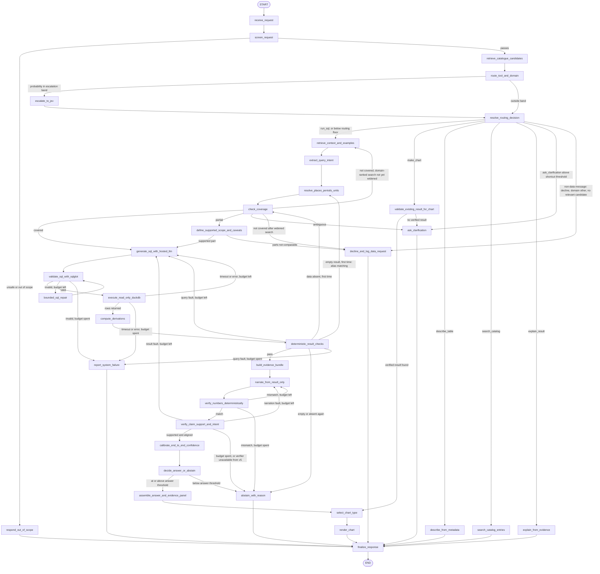
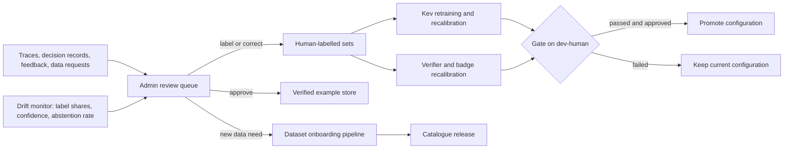

# Agent graph specification, version 0.3

Status: version 0.3, 2026-11-05. Input to Milestone 3 (architecture). This document is the
implementation contract for the LangGraph agent in `src/analyst/agents/`. Choices marked
**[Proposed]** are open for team review (Section 16); all numeric limits are initial values
to be set on the dev set, not results. Version 0.3 closes the second review of 5 November
2026 (change table after Section 2).

## 1. Scope

The graph turns one user message into one of ten outcomes (the `Outcome` values of Section
3): a verified answer, a chart of a verified result, a catalogue description, a catalogue
search result, an explanation of an earlier answer, a clarifying question, a decline with a
logged data request, an abstention, a reported failure, or the fixed out-of-scope reply. It
is a fixed graph, not an open-ended agent loop. Every branch ends at `finalize_response`.

Fixed rules:

1. From v4, decision models make the control decisions (tool, domain, coverage,
   verification); in v0-v3 the hosted LLM makes them (Section 4). In every version the
   hosted LLM (Gemini on Google Cloud Vertex AI) writes text: the query intent (a structured
   plan), SQL, clarifying questions and narration.
2. No figure reaches the user unless the query passed validation, every derived value was
   computed in code, and the result passed the deterministic checks and the statistical
   checks. From v5 it must also pass the number check and the claim-support check; in v0-v4,
   which have no verifier, answers carry the badge level "not verified" (Section 4).
3. The query intent is extracted by the hosted LLM as structured output whose values are
   restricted to the retrieved catalogue entries; code then validates and resolves every
   field. Code never guesses an indicator from free text, and the LLM never invents a code,
   period or value.
4. A requested place, period or indicator is never replaced by a nearby one. Spelling and
   alias corrections are allowed and disclosed; any other substitution is a clarification or
   an abstention.
5. A data limitation (abstention) and a system error (failure) are separate outcomes with
   separate causes. Neither is reported as the other.
6. Every loop has a limit stored in the state, and every run has a wall-clock deadline and
   an LLM-call budget. No edge depends on the LangGraph recursion limit for termination.
7. The catalogue (`data/processed/catalogue.json`) and the reference tables
   (`configs/reference/`, `dim_period`) are the source of truth for coverage, places,
   periods, units and clarification options. Prompts do not restate them by hand.
8. A decision model's output can narrow what the agent looks at only when the narrowing can
   be undone. A domain label ranks retrieval results; it never removes a table before
   coverage is decided (Section 6, Phase C). A data request is declined only by
   `check_coverage`, never by the router alone (Section 6, routing rule 2).
9. The agent queries the contract tables `obs_<d>` (one row per value, a quality flag on
   every value, explicit period start and end). The wide agent tables `<d>.parquet` remain
   for the Milestone 2 reference queries only. Decided 2026-11-05 (Section 16, item 7).

## 2. Graph



Run-limit rule (not drawn, applies to every conditional edge): before an edge leaves a node,
the edge helper checks two limits, once, in one place, not in each node.

1. Deadline. If the elapsed time exceeds `run_deadline_s` before `decide_answer_or_abstain`
   has accepted an answer, the run goes to `abstain_with_reason` with cause
   `deadline_exceeded`. After an answer has been accepted, the run goes straight to
   `finalize_response`: the answer is sent with chart type "table only" and the skipped
   chart step is recorded in the trace. An accepted answer is never withdrawn for time.
2. LLM-call budget. A hosted LLM call that would exceed `max_llm_calls` is not made; the run
   goes to `report_system_failure` with cause `budget_exhausted`. The counter is incremented
   by the LLM client wrapper, so no node can bypass it.

Changes in version 0.3, for reviewers:

| Change | Reason |
| --- | --- |
| New `extract_query_intent` (hosted LLM, structured output restricted to retrieved catalogue values) before resolution | Indicator choice, place and period mentions, derivations and follow-up changes cannot be read from free text by deterministic code (Section 6, Phase C) |
| Router decline ends the run only for a non-data message: `decline_not_covered` above the shortcut threshold, domain `other`, and no catalogue candidate above `candidate_min_score` | With a top-k catalogue, "not shown" is not "not in the catalogue"; every data request now reaches `check_coverage` and the widened search |
| Empty-result retry limited to spelling and alias matching; no nearest-value substitution | Replacing a requested period or place with a nearby one breaks fixed rule 4 |
| Verification, calibration and the answer threshold are pass-through nodes in versions without them (v0-v4); answers labelled "not verified" | v0-v4 would otherwise abstain on every question with `verifier_unavailable`, which voids the version comparison (O7) |
| `DerivedValue.status` and a derivation check | Suppressed inputs, zero denominators and base-year mismatches had no failure path |
| Run-limit rule covers an accepted answer and the LLM-call budget | Both cases were undefined |
| Postgres `agent` role may update its conversation-memory rows | Storing and clearing `pending_clarification` needs UPDATE |
| CPI and Census 2011 rows marked as planned; per-capita requests `not_covered` until a population table is onboarded | Neither is in the five-table catalogue |
| Embedding model and retrieval fallback specified | `retrieve_catalogue_candidates` needed a named model and a fallback |
| Phase-1 routing described as two parallel calls (Jev for tool, Kev for domain) | It was described as one batched call |
| Sampling-difference threshold labelled as a heuristic | The NFHS-5 factsheets publish no standard errors |
| Section 1 lists ten outcomes; fixed rule 1 holds from v4 | Consistency with Sections 3 and 4 |

Changes in version 0.2:

| Change | Reason |
| --- | --- |
| New `retrieve_catalogue_candidates` before routing; the router state holds the top-k catalogue entries | The full catalogue does not fit the router's state limit once it exceeds about six tables (Section 6, Phase A) |
| Domain ranks retrieval instead of filtering it; a `not_covered` result is re-checked once with the domain ranking removed | A wrong domain label would otherwise hide the right table and cause a false decline (O4) |
| New `compute_derivations` after execution | Growth rates, shares, per-capita values and inflation from an index are computed by tested code, not by generated SQL or by the narrator (Section 10) |
| New statistical checks in Phase E | Comparisons within sampling error, trends driven by registration, and index-versus-rate confusions are blocked or caveated (grounding in statistics) |
| Run deadline `run_deadline_s` and cause `deadline_exceeded` | The worst-case path exceeded the p95 latency target (O5) without a bound |
| Each retry states what changes (Section 5.1) | Deterministic nodes re-run with identical input would repeat the same output |
| Follow-up context: `prior_plan` and `prior_sql` in the state | "Do the same for Odisha" needs the previous plan, not only the previous result |
| New `explain_from_evidence` branch for the seventh routing label `explain_result` | "Where does this number come from?" is answered from the stored evidence bundle by template |
| Decline lists related catalogue tables as pointers | A user is told what is available without presenting it as the answer |
| Section 11, isolation, permissions and guardrails | Consolidates the controls that make the agent fail closed |
| Section 13, offline procedures | Feedback, review, retraining, recalibration and onboarding were not drawn |
| `RunConfig` records model versions, temperatures and prompt hashes | Every answer must be reproducible from its trace |
| Routing phase 1: domain on Kev, tool selection on Jev (Section 4) | Phased Kev adoption, decided 2026-11-05 |

Changes from the first draft (`Langgraph diagram.md`) to version 0.1 are kept in the
Section 17 change log.

## 3. State

`AnalystState` is a Pydantic model. Fields written by more than one node use the reducer
given; all other fields are overwritten by the node that owns them.

| Field | Type | Written by | Notes |
| --- | --- | --- | --- |
| `run_id` | `str` | `receive_request` | One per user message; trace identifier |
| `conversation_id` | `str` | `receive_request` | Key for conversation memory in Postgres |
| `question` | `str` | `receive_request` | User text as received |
| `started_at` | `datetime` | `receive_request` | Start of the run, for the deadline rule |
| `pending_clarification` | `Clarification \| None` | `receive_request`, `ask_clarification` | Open question from the previous turn, if any |
| `prior_result_ref` | `str \| None` | `receive_request` | Evidence bundle ID of the last verified result in the conversation |
| `prior_plan` | `InterpretationPlan \| None` | `receive_request` | Plan of that result; slots not changed by the new message are inherited |
| `prior_sql` | `str \| None` | `receive_request` | Validated SQL of that result, given to SQL generation as a reference |
| `config` | `RunConfig` | `receive_request` | Version, backends, model versions, temperatures, prompt hashes (Section 4); read-only afterwards |
| `screen` | `ScreenResult` | `screen_request` | `passes`, `reason` |
| `catalogue_candidates` | `CatalogueCandidate` list | `retrieve_catalogue_candidates` | Top-k table entries with scores; rendered into the router state |
| `routing` | `RoutingDecision` | `route_tool_and_domain`, `escalate_to_jev`, `resolve_routing_decision` | Per decision: label, probabilities, backend, escalated flag |
| `retrieved` | `RetrievedContext` | `retrieve_context_and_examples` | Catalogue entries, guidance cards, verified examples, with scores; `domain_ranked` flag |
| `intent` | `QueryIntent` | `extract_query_intent` | Chosen dataset and indicator (from the retrieved list), place and period mentions as written, categories, derivations as typed operations, slots changed relative to `prior_plan` |
| `plan` | `InterpretationPlan` | `resolve_places_periods_units` | Resolved place, period, unit, filters, derivations, defaults applied, alias corrections, unresolved slots |
| `coverage` | `CoverageResult` | `check_coverage`, `define_supported_scope_and_caveats` | `status`, `probability`, `decided_by`, missing parts, supported scope |
| `sql` | `SqlAttempt` list | SQL nodes (append) | Each attempt: text, plan, validation outcome, error |
| `result` | `QueryResult \| None` | `execute_read_only_duckdb` | Rows (capped at `MAX_ROWS`), schema, data version, timing |
| `derived` | `DerivedValue` list | `compute_derivations` | Each value: operation, inputs (cell references), output, unit, rounding, `status` (`ok`, `input_unreported`, `undefined`, `incompatible_inputs`) |
| `checks` | `CheckReport` | `deterministic_result_checks` | Outcome per check (Section 6, Phase E) |
| `retry_hints` | `RetryHint` list | checks and verifiers (append) | What the next attempt must change (Section 5.1) |
| `evidence` | `EvidenceBundle \| None` | `build_evidence_bundle` | Section 7 |
| `narration` | `Narration` list | `narrate_from_result_only` (append) | Text and extracted claims per attempt |
| `verification` | `VerificationResult` | the two verify nodes | Number check, claim support, intent alignment, verifier score |
| `confidence` | `ConfidenceResult` | `calibrate_end_to_end_confidence` | Calibrated probability, badge level, inputs used |
| `chart` | `ChartSpec \| None` | `select_chart_type`, `render_chart` | Chart type, decided by rule or model, rendered spec |
| `outcome` | `Outcome` | the terminal node reached | `answered`, `charted`, `described`, `searched`, `explained`, `clarifying`, `declined`, `abstained`, `failed`, `out_of_scope` |
| `outcome_cause` | `Cause \| None` | terminal nodes | Section 8 |
| `counters` | `Counters` | any node that loops | Section 5 |
| `events` | `Event` list | every node (append) | Stream events (Section 9) |
| `decision_log` | `DecisionRecord` list | every decision node (append) | Section 9 |

## 4. Configuration

`RunConfig` is fixed at the start of the run and selects the system version and the
backend for each decision. All versions run on the same graph; a version changes which
backend or retrieval source a node uses, not the edges. `RunConfig` also records, for
reproducibility: the hosted LLM model identifier and version, its temperature (0 for SQL),
the Kev checkpoint revision and fitted temperature, the Jev model identifier, the hash of
every prompt template, the catalogue `contract_version` and the configuration file hashes.

| Version | Routing (tool, domain) | Retrieval | SQL prompt | Verification and badge |
| --- | --- | --- | --- | --- |
| v0 | Hosted LLM | Catalogue titles only | Base prompt | None (no badge); deterministic checks still run |
| v1 | Hosted LLM | Catalogue descriptions, guidance cards, reranking | Base prompt | None |
| v2 | Hosted LLM | v1 plus retrieved verified examples | Base prompt | None |
| v3 | Hosted LLM | v2 | Optimised prompt (run manually) | None |
| v4 | Domain: Kev (phase 1). Tool: Jev, moving to Kev after phase 2 if the gate is passed | v2 | v3 | None |
| v5 | As v4 | v2 | v3 | Jev verifier, calibration, badge |
| v6 | As v5, recalibrated | v2 | Re-optimised after drift | As v5, recalibrated |

Nodes by version. In v0-v4, which have no verifier, `verify_claim_support_and_intent`,
`calibrate_end_to_end_confidence` and `decide_answer_or_abstain` are pass-through nodes:
they record "skipped (version)" in the trace, emit no abstention, and the answer carries the
badge level "not verified". `verify_numbers_deterministically` runs in every version,
because it needs no model. `verifier_unavailable` applies only from v5, where a verifier is
configured. Evaluation of v0-v4 therefore measures the answers as produced, and the v5 row
measures what verification adds.

Kev adoption is phased (decided 2026-11-05). Phase 1 fine-tunes and calibrates Kev-0.8B on
the domain decision and takes it through serving, the cascade and the evaluation harness.
Phase 2 retrains Kev jointly on tool selection and domain from the released checkpoint
(`--init_from`), once the routing label set and the catalogue are frozen, and moves tool
selection to Kev only if the gate (accuracy within the fixed margin of Jev on human labels
and ECE at most 0.10 after calibration) is passed. Every other decision stays on Jev.

Backends per decision: `domain` (Kev, with escalation to Jev); `tool` (Jev in phase 1;
Kev or Jev after phase 2); `coverage` (rules, then Jev); `verification` (Jev; fallback in
Section 12). The hosted LLM is Gemini on Vertex AI, billed to the project's Google Cloud
credit; two Gemini tiers are compared on the dev set (E2) and the chosen version is pinned in
`configs/model.yaml`. The reference row "Jev for every decision" is a configuration, not a
separate graph.

## 5. Limits and thresholds

Initial values; each is set on the dev set and recorded in `configs/` before the test run.

| Name | Initial value | Used by |
| --- | --- | --- |
| `run_deadline_s` | 30 s (estimate) | Deadline rule on every conditional edge |
| `max_sql_generations` | 3 per run (first attempt included) | All edges into `generate_sql_with_hosted_llm` |
| `max_sql_repairs` | 2 per generation | `bounded_sql_repair` |
| `max_narrations` | 2 per run | Number-check and claim-support loops |
| `max_resolution_retries` | 1 | Empty result back to resolution |
| `max_coverage_rechecks` | 1 | Absent data back to coverage |
| `max_widened_searches` | 1 | `not_covered` back to retrieval without domain ranking |
| `max_clarifications` | 2 per original question | `ask_clarification`; after the limit, defaults apply or the request is declined |
| `max_llm_calls` | 8 per run | Every hosted LLM call, counted by the client wrapper; the run-limit rule ends the run with `budget_exhausted` |
| `catalogue_top_k` | 4 tables | `retrieve_catalogue_candidates`; fits `STATE_CHAR_LIMIT` |
| `candidate_min_score` | Set on the dev set | Below it, no catalogue table is relevant; one of the three conditions for the router decline shortcut |
| Escalation band | Set on the dev set per decision | `route_tool_and_domain` |
| `routing_floor` | Set on the dev set | Below it, `resolve_routing_decision` takes the full retrieval path |
| `shortcut_threshold` | Set on the dev set, at least the escalation band's upper edge | Router decline or clarify without retrieval |
| `answer_threshold` | Chosen on the dev set for O4 | `decide_answer_or_abstain` |
| Timeouts | Kev 2 s, Jev 5 s, hosted LLM 15 s, DuckDB 10 s (estimates) | Backend calls; DuckDB value is `TIMEOUT_S` in `sql_runner.py` |

### 5.1 What each retry changes

A retry is allowed only when its input differs from the failed attempt. The difference is
recorded in `retry_hints`.

| Retry | Input that changes |
| --- | --- |
| SQL repair after validation failure | The sanitised validation error and the schema of the referenced tables |
| SQL regeneration after execution error or timeout | The error class; for a timeout, the instruction to aggregate earlier or narrow the filters |
| SQL regeneration after a query fault | The failed check, the expected and observed values, and the previous SQL |
| Resolution after an empty result | The filter values that matched no rows; resolution switches from exact matching to the alias table and case- and spacing-insensitive matching of the same name (for example `Orissa` for Odisha, or a category value spelled differently in the source). Each correction is disclosed. A different period, place or indicator is never substituted (fixed rule 4): if no alias matches, the run abstains with `no_rows`, or asks for clarification when the catalogue lists valid alternatives for the slot |
| Coverage after absent data | The indicator, period or place shown absent by the result; coverage is decided again with that evidence and normally returns `not_covered` or `partial` |
| Retrieval after `not_covered` | The domain ranking is removed and `top_k` is doubled |
| Narration after a number or claim fault | The list of unsupported numbers or claims, with the cells they should have cited |
| SQL regeneration after a result fault from the verifier | The misaligned slots (measure, place, period, population) |

## 6. Nodes

### Phase A: intake and routing

| Node | Purpose | Decided by | Next |
| --- | --- | --- | --- |
| `receive_request` | Assign `run_id` and `started_at`; load conversation memory, `prior_result_ref`, `prior_plan`, `prior_sql` and any `pending_clarification`; if one is pending, merge the reply into the original question; build `RunConfig`; emit the first stream event. | Code | `screen_request` |
| `screen_request` | Reject unsafe content, prompt-injection patterns aimed at the system, and inputs over the length limit (Section 11). Ordinary non-data messages pass; the router labels them `decline_not_covered` with domain `other`. | Rules | `respond_out_of_scope` or `retrieve_catalogue_candidates` |
| `retrieve_catalogue_candidates` | Rank catalogue tables against the question (BM25 lexical score plus embedding similarity over title, description and indicator names) and keep `catalogue_top_k` with their scores. When a prior result exists, its table is always included. Embeddings: a small open embedding model run on CPU in the API container (for example BAAI `bge-small-en-v1.5`, chosen on the dev set and pinned by revision) **[Proposed]**; catalogue embeddings are computed at each catalogue release and stored in pgvector. Deterministic for a given model and catalogue; no LLM. | Retrieval | `route_tool_and_domain` |
| `route_tool_and_domain` | Ask the routing questions defined in `src/analyst/decisions/kev_questions.py`. The input is the question, the context line from `render_context`, and the catalogue candidates within `STATE_CHAR_LIMIT`. Each decision goes to its configured backend (Section 4); a decision that has not passed its gate is sent to Jev directly. Decisions on the same backend are batched in one call; decisions on different backends are sent in parallel. In phase 1 this is two parallel calls (tool on Jev, domain on Kev), so the routing latency is the slower of the two. | Kev or Jev, per decision | `escalate_to_jev` or `resolve_routing_decision` |
| `escalate_to_jev` | Re-ask Jev only the decisions whose calibrated Kev probability falls in the band. Record that the decision was escalated. | Jev | `resolve_routing_decision` |
| `resolve_routing_decision` | Apply the routing rules below and select the branch. | Code | Seven branches |

The router state is built from the same top-k procedure at training time and at serving
time, so Kev is trained on the input it will see. Training records therefore vary the shown
catalogue: the same message appears with and without the relevant table, with the label
that follows from what is shown. A routing label describes the shown candidates only. A
`decline_not_covered` label on a data request therefore means "no shown table covers it",
not "the catalogue lacks it"; the graph, not the label, decides a decline (routing rule 2).

Routing rules in `resolve_routing_decision`:

1. If the final tool probability is below `routing_floor` (after escalation), take the
   full retrieval path whatever the label. Coverage then decides with catalogue evidence.
2. `decline_not_covered` ends the run without retrieval only when all three hold: the tool
   probability is above `shortcut_threshold`, the domain label is `other`, and no catalogue
   candidate scores above `candidate_min_score`. This admits greetings, questions about
   the agent and requests far outside the catalogue; any other `decline_not_covered` takes
   the full retrieval path, where `check_coverage` and the widened search decide.
   `ask_clarification` ends the run without retrieval only above `shortcut_threshold` and
   only when the table it concerns is among the candidates; the clarification options are
   read from that table's catalogue entry.
3. `make_chart`, `describe_table`, `search_catalog` and `explain_result` go to their
   branches. `explain_result` without a prior result is treated as `search_catalog`.
4. Domain labels: `labour`, `agriculture`, `rainfall`, `prices_economy`, `health`, `other`,
   `multiple`, `unspecified`. A single domain boosts the ranking of that domain's tables in
   retrieval; it does not exclude other tables. `multiple` boosts each listed domain;
   `unspecified` applies no boost.
5. The domain set is the five named domains plus a narrow `other`: a measure or topic
   outside the five domains (crime, education, transport, elections), or a message that is
   not a data request. `other` is not used for an unidentifiable measure (`unspecified`) or
   for several domains (`multiple`). `other` never implies a decline: when a shown table
   covers the topic (for example the NCRB tables), the tool rules apply as for any covered
   table. Labelling-guide rules R15 and H9 change accordingly: outside the five domains *and*
   not in the shown catalogue is `decline_not_covered`. Their wording "not shown" is kept
   and refers to the top-k candidates; the guide adds a note that this label does not decline
   a data request on its own (routing rule 2). Market and retail commodity prices (Mandi) are
   `prices_economy`; minimum support prices and crop production are `agriculture`. These two
   rules are added to the labelling guide before its freeze.

Labels follow `docs/specs/labelling_guide_v1.md`, including its precedence (Section 2.2) and
defaults (Section 4).

### Phase B: non-query branches

| Node | Purpose | Decided by | Next |
| --- | --- | --- | --- |
| `validate_existing_result_for_chart` | Find `prior_result_ref`. It must point to an evidence bundle that passed Phases E and G, and its `dataset_version` must still be the live version. A chart is never drawn from new, unchecked figures. | Code | `select_chart_type` or `ask_clarification` (no verified result) |
| `describe_from_metadata` | Describe a table from its catalogue entry: title, publisher, coverage dates, geography levels, units, categories, caveats. Filled from a template; no free text from an LLM. | Code | `finalize_response` |
| `search_catalog_entries` | Rank catalogue entries against the question and list matches from a template. If nothing matches, say so and log a data request. | Retrieval and code | `finalize_response` |
| `explain_from_evidence` | For "where does this number come from?", "show the query" or "how was this calculated?": render the stored evidence bundle of `prior_result_ref` (source, SQL, derivations, assumptions, caveats) from a template. No new figures and no LLM text. | Code | `finalize_response` |

Because the metadata and explanation branches use templates, they need no claim-support
check. If the team prefers LLM-written descriptions, they must pass
`verify_claim_support_and_intent` before `finalize_response`.

### Phase C: retrieval, resolution and coverage

| Node | Purpose | Decided by | Next |
| --- | --- | --- | --- |
| `retrieve_context_and_examples` | From Postgres and pgvector: catalogue entries, indicator descriptions, valid category values, guidance cards and verified question/SQL examples. The domain label boosts ranking; on the widened retry the boost is removed and `top_k` doubled. What is retrieved depends on the version (Section 4). | Retrieval | `extract_query_intent` |
| `extract_query_intent` | Read the question into a `QueryIntent` with one hosted LLM call using structured output validated against a Pydantic schema. Enumerated fields are restricted to the retrieved values: `dataset_id` and `indicator_id` from the retrieved entries (or `none_fit`), categories from their codelists, derivations from the operations of Section 10. Place and period mentions are copied as written, not resolved. For a follow-up, the intent lists only the slots the new message changes; the rest are inherited from `prior_plan` by code. A parse failure is retried once and then fails with `backend_error`. Temperature 0. Counts towards `max_llm_calls`. | Hosted LLM | `resolve_places_periods_units` |
| `resolve_places_periods_units` | Build the `InterpretationPlan` from the intent with deterministic code: places through `configs/reference/` (aliases, sub-division mapping, vintage); periods through `dim_period` and the table's `period_types` and `period_conventions`; units from `indicator_units`; categories from the catalogue; the derivations named in the intent, checked against the operations of Section 10. For a follow-up, start from `prior_plan` and replace only the slots the intent marks as changed. A mention that matches no valid value exactly or through an alias is listed as unresolved, never mapped to the nearest value (fixed rule 4). An intent with `indicator_id = none_fit` goes to coverage as a missing indicator. Apply defaults D1-D8 of the labelling guide and record each one as an assumption to disclose. List any slot that cannot be resolved. | Code (date and place functions, Section 10) | `check_coverage` |
| `check_coverage` | Compare the plan with the catalogue: indicator, period range, geography level, population, required detail, and the inputs each derivation needs (a per-capita value needs a population table; none is in the catalogue as of 2026-11-05, so per-capita requests are `not_covered` until one is onboarded). Rules first; Jev only when rules cannot decide (for example, whether a named measure matches an indicator). Output `covered`, `partial`, `ambiguous` or `not_covered` with the missing parts. | Rules, then Jev | Five branches |
| `define_supported_scope_and_caveats` | For `partial`: restrict the plan to the supported part and record what is left out. If the parts are not comparable (different populations, periods or geography vintages), decline the joint analysis instead. | Rules | `generate_sql_with_hosted_llm` or `decline_and_log_data_request` |

The plan is inspectable before any SQL is written. Example of its shape (illustrative,
not a query result; codes are read from the catalogue at run time):

```json
{
  "dataset_id": "plfs_state_ur_usual_status",
  "geography": {"requested": "Kerala", "level": "state", "code": "<from states.csv>"},
  "period": {"requested": "2021", "type": "survey_year", "label": "2021-22",
             "start": "2021-07-01", "end": "2022-06-30", "default_applied": "D7"},
  "unit": "percent",
  "filters": {"status": "usual (ps+ss)", "age_group": "15+"},
  "derivations": [{"op": "change_pp", "from_period": "2017-18", "to_period": "2021-22"}],
  "assumptions": ["D3", "D4", "D7"],
  "unresolved": []
}
```

Conventions the resolution and result checks must handle:

| Table | Convention | Required behaviour |
| --- | --- | --- |
| IMD rainfall | Sub-divisions are not States; seasons and the annual total are published values | Map a State to its sub-division(s) and state the mapping (D6); never average sub-divisions into a State figure; use the published season column (D5). |
| PLFS | July-June survey years; usual status; ages 15 and above | Map a bare year to the survey year starting in it and state it (D7); clarify an explicit January-December request (R14). |
| NFHS-5 | Suppressed and low-sample estimates; district boundaries of 2019-21 | Keep `quality_flag`; a suppressed value is reported as suppressed, not as missing data; disclose low-sample estimates. |
| Mandi | One-day snapshot; implausible prices flagged | State the snapshot date; exclude or disclose `implausible` and `inconsistent` rows. |
| NCRB | Registered cases; IPC to BNS transition | Name the measure (count or rate); state that registration changes can drive the trend. |
| CPI (planned; not in the catalogue) | Index values, base year stated | An inflation rate is derived in code from two index values and labelled as derived; never present an index as a rate. |
| Census 2011 denominators (planned; not in the catalogue) | 2011 population | Any per-capita or rate computed with it states the 2011 vintage. |

The catalogue holds five tables as of 2026-11-05: IMD rainfall, Mandi prices, NCRB crime,
NFHS-5 indicators and PLFS unemployment. Rows marked planned apply once the table is
onboarded (Section 13, step 5); until then, `check_coverage` returns `not_covered` for them.
| Any table with `has_total_rows` | "All India" and similar rows | Never add a total row to its components (`is_total_row`). |

### Phase D: SQL

| Node | Purpose | Decided by | Next |
| --- | --- | --- | --- |
| `generate_sql_with_hosted_llm` | Write one query from: the question, the plan, the allowed `obs_<d>` tables and their schemas, retrieved definitions and examples, `prior_sql` for a follow-up, the retry hints (on retry), and the rules (one SELECT; registered tables only; respect `quality_flag` and `is_total_row`; return the rows the derivations need rather than computing growth, shares or rates in SQL). Output SQL plus a one-line statement of what it computes, as structured output validated against a Pydantic schema. Temperature 0. Increment `sql_generations`. | Hosted LLM | `validate_sql_with_sqlglot` |
| `validate_sql_with_sqlglot` | `check_sql` in `src/analyst/tools/sql_runner.py`: one statement; SELECT, set operation or CTE only; registered tables only; table functions rejected; no DDL, DML or external access. Then check that the referenced columns exist. | Code | Execute, repair or failure |
| `bounded_sql_repair` | Pass the sanitised validation error and schema back to the hosted LLM; the repaired SQL is validated again from the start. Increment `sql_repairs`. | Hosted LLM | `validate_sql_with_sqlglot` |
| `execute_read_only_duckdb` | `ReadOnlyDatabase.run` over versioned Parquet: in memory, external access disabled, configuration locked, memory and thread limits, 10 s timeout, at most `MAX_ROWS` rows. Record SQL, data version, schema, row count and time. | Code | `compute_derivations`, retry or failure |
| `compute_derivations` | Apply each typed derivation in the plan with the calculation library (Section 10): percentage change, change in percentage points, CAGR, share, per-capita value, inflation rate from two index values, rank, weighted or unweighted mean. Each output keeps references to the input cells, its unit and its rounding rule. A derivation that cannot be computed is not an exception: it is recorded with a status (`input_unreported` when an input is suppressed or missing in the source; `undefined` for a zero denominator or a base of zero; `incompatible_inputs` for index values with different base years or mismatched units) and classed by the checks. | Code | `deterministic_result_checks` |

### Phase E: deterministic result checks

`deterministic_result_checks` runs these in code. Each failure is classed so that the
right edge is taken.

| Check | What is validated | Failure class |
| --- | --- | --- |
| Shape | Expected columns, types and row count | Query fault |
| Empty result | Rows returned for the plan's filters | Empty result |
| Data absent | The indicator, period or place is not in the table after all | Data absent |
| Value quality | `quality_flag` of every returned value; suppressed, missing, low-sample and implausible values are carried as caveats | Passes with caveats |
| Units | Returned unit equals the planned unit; any conversion is in code and recorded | Query fault |
| Arithmetic | Totals, differences, rankings and percentages recomputed from the rows; derived values recomputed independently | Query fault |
| Derivation status | `input_unreported`: the answer states that the value cannot be computed because the publisher did not report an input. `undefined`: the answer states that the measure is not defined for these values. `incompatible_inputs`: the inputs cannot be combined | Passes with caveats (`input_unreported`, `undefined`); data absent (`incompatible_inputs`) |
| Geography | No total row added to its parts; no State built from averaged sub-divisions | Query fault |
| Period | Filters match the plan's start and end dates and period type | Query fault |
| Comparability | A comparison spans comparable periods, populations and vintages | Data absent (coverage is rechecked) |
| Traceability | Every figure maps to source rows and a `dataset_version` | Query fault |

Statistical checks, in the same node:

| Check | Rule | Effect |
| --- | --- | --- |
| Sampling uncertainty | A comparison or rank between survey estimates where either value is `low_sample_estimate`, or the difference is below a threshold set per table. The threshold is a heuristic, not a significance test: the NFHS-5 factsheets publish no standard errors. It is reported as a heuristic in the evaluation and in the answer's caveat | The comparison is reported as "not clearly different"; a rank is not stated as a finding |
| Small groups | A rank or "highest/lowest" over fewer than three units, or with ties | Stated as a list, not a ranking |
| Registration effects | A trend in registered counts (NCRB) | Caveat that registration practice can drive the change |
| Index versus rate | An index value requested as a rate, or a rate computed from indices with different base years | Derived in code if the base years match; otherwise data absent |
| Denominator vintage | A per-capita value or rate using Census 2011 population for a later year | Caveat naming the vintage |
| Causal wording | The plan or question asks why a figure changed | The answer states the figures and that the data does not establish a cause |

A result in which every requested value is suppressed or missing in the source passes:
the answer states that the publisher did not report the value. This is an answer, not an
abstention.

### Phase F: evidence bundle

`build_evidence_bundle` assembles the `EvidenceBundle` (Section 7) and stores it with an
ID, so a later chart or explanation request can refer to it.

### Phase G: narration and verification

| Node | Purpose | Decided by | Next |
| --- | --- | --- | --- |
| `narrate_from_result_only` | Write the answer from the evidence bundle only: the figure, unit, period, place, assumptions, caveats and statistical qualifiers. No outside figures, no causal claims, numbers formatted by the formatting library (Section 10). On retry, the list of faults from the verifiers is included. Extract the material claims with the numbers they cite. Increment `narrations`. | Hosted LLM | `verify_numbers_deterministically` |
| `verify_numbers_deterministically` | Match every number in the narration to a result cell or a derived value (with rounding rules and lakh/crore formatting); check units, signs and directions of change. | Code | Claim check, narration retry or abstention |
| `verify_claim_support_and_intent` | Jev, given the question, plan, evidence bundle, result and claims, returns typed judgments: `claims_supported`, `unsupported_claims`, `intent_aligned`, `misaligned_slots`, and a score. An unsupported claim is a narration fault; a misaligned measure, place, period or population is a result fault. Pass-through in v0-v4 (Section 4). | Jev, calibrated on human labels | Calibration, narration retry, SQL retry or abstention |
| `calibrate_end_to_end_confidence` | Pass-through in v0-v4. From v5, combine verifier score, coverage probability, routing confidence and check outcomes in a logistic or isotonic model fitted on human-labelled end-to-end correctness (L7). Inputs not produced in the run are passed with an indicator; coverage decided by rules enters as 1 with `coverage_by_rules = 1`. | Calibration model | `decide_answer_or_abstain` |
| `decide_answer_or_abstain` | In v0-v4, accept the answer with the badge level "not verified". From v5, compare the calibrated probability with `answer_threshold`. Until the calibration meets ECE at most 0.10 on the dev set, the badge is a level (verified, with caveats) without a number, and the threshold is not applied. | Code | Answer or abstention |

### Phase H: output

| Node | Purpose | Decided by | Next |
| --- | --- | --- | --- |
| `assemble_answer_and_evidence_panel` | Combine narration, badge and evidence panel. | Code | `select_chart_type` |
| `select_chart_type` | Rules over result shape (time series, ranking, single value, map-like); a user-named chart type is honoured if it suits the data; a decision model is consulted only on a tie. The output may be "table only". | Rules, then Jev on a tie | `render_chart` |
| `render_chart` | Produce a Vega-Lite specification from the stored result with the chart library (Section 10). No new figures. | Code | `finalize_response` |
| `ask_clarification` | One focused question, with the valid options read from the catalogue (for example, the survey years available). Store it as `pending_clarification`. After `max_clarifications`, apply the defaults or decline. | Hosted LLM, options from code | `finalize_response` |
| `decline_and_log_data_request` | State what is missing (indicator, period, geography, granularity, population or definition), list up to three related catalogue tables as pointers ("available instead: ..."), clearly separated from the answer, and write a row to the data-request log. Never present a nearby statistic as if it answered the question. | Code and template | `finalize_response` |
| `abstain_with_reason` | Explain that the agent could not give a verified answer and why (Section 8). Show the evidence gathered so far. | Code and template | `finalize_response` |
| `report_system_failure` | Report a system error with the first failing stage. Do not present it as missing data. | Code and template | `finalize_response` |
| `respond_out_of_scope` | Short fixed reply for screened messages. | Template | `finalize_response` |
| `finalize_response` | Emit the final event, write the trace and decision log, save conversation memory (including the plan and SQL of a verified result), and attach the feedback control to the response. | Code | END |

## 7. Evidence bundle

`EvidenceBundle` fields, grouped. The evidence panel shows all of them; a reader must be
able to reproduce the figure from the panel.

- Request: question, `InterpretationPlan`, assumptions and defaults applied, clarifications
  answered.
- Source: `dataset_id`, title, publisher, `source_table`, licence, retrieval date,
  `dataset_version`, `raw_sha256` (all from the catalogue entry).
- Query: validated SQL, statement of what it computes, row count, result schema, result
  rows (capped).
- Derivations: each derived value with its operation, input cells, unit and rounding.
- Quality: `quality_flag` counts in the result, `rule_ids`, caveats from the catalogue
  entry, comparability limits, outcome of each deterministic and statistical check.
- Trace: `run_id`, catalogue `contract_version`, `RunConfig` (version, backends, model
  versions, prompt hashes).

## 8. Outcome causes

| Outcome | Cause | Meaning |
| --- | --- | --- |
| declined | `not_covered` | The catalogue lacks the data, after the widened search |
| declined | `not_comparable` | Parts are covered but cannot be combined |
| abstained | `no_rows` | The query is correct but the data has no rows for the request, after re-resolution |
| abstained | `unverified` | Number or claim checks failed within the retry limits |
| abstained | `low_confidence` | Calibrated probability below `answer_threshold` |
| abstained | `verifier_unavailable` | No verifier backend responded (Section 12) |
| abstained | `deadline_exceeded` | `run_deadline_s` passed before a verified answer existed |
| failed | `sql_invalid` | No valid query within the repair limit |
| failed | `execution_error` | Timeouts or execution errors beyond the retry limit |
| failed | `result_check_failed` | Query faults beyond the generation limit |
| failed | `budget_exhausted` | `max_llm_calls` reached |
| failed | `backend_error` | Any other backend or system error |

Abstention precision (O4) is computed over `declined` and `abstained`. `failed` is
reported separately as a system error rate. `deadline_exceeded` is also reported on its
own, because it reflects latency rather than data.

## 9. Streaming and logging

Streaming. Events are Pydantic models sent over SSE. `receive_request` emits
`run_started` at once, which meets the 1.5 s first-event target (O5) independently of
model latency. Each node emits a `stage` event on entry. Answer text is sent only after
`decide_answer_or_abstain`, so unverified text is never shown. Other event types:
`clarification`, `decline`, `abstention`, `failure`, `answer`, `evidence`, `explanation`,
`chart`, `done`.

Logging. Every decision node appends a `DecisionRecord`: `run_id`, decision name,
backend, label, probabilities, escalated flag, latency, cost estimate. `finalize_response`
writes the records to Postgres and the trace to Langfuse. These records give the share
of decisions handled by Kev, LLM calls per answer, latency and cost, and they supply the
examples for the human-approved retraining procedure (Section 13). Data requests and user
feedback are written to their own tables for the admin view.

LLM and decision-model calls per answered question (estimate): one or two parallel routing
calls, at most one escalation, at most one coverage call, one intent extraction, one to
three SQL generations plus repairs, one or two narrations, and one verifier call per
narration. The common case is five to seven calls, of which three are hosted LLM calls
(intent, SQL, narration); the p95 latency target is 20 s, and `run_deadline_s` bounds the
worst case.

## 10. Internal tools (typed functions called by nodes)

The seven routing labels are user intents. The work inside the graph is done by
typed functions with Pydantic inputs and outputs, each unit-tested and called by a node.
The hosted LLM never chooses or calls these functions; the plan names the operations and
code runs them. This keeps every figure reproducible and checkable.

| Group | Functions | Module | Status |
| --- | --- | --- | --- |
| Intent | `extract_intent(question, retrieved, prior_plan)` returning `QueryIntent` | `inference/intent.py` | To build |
| Catalogue and retrieval | `catalogue_candidates(question, k)`, `search_catalogue(query)`, `describe_table(id)`, `retrieve_examples(question, domain)` | `retrieval/`, `data/catalogue.py` | Catalogue loader built; retrieval to build |
| Places | `resolve_place(name, level, vintage)`, `map_state_to_subdivisions(state)`, `alias_lookup(name)` | `tools/places.py` | Reference tables built; functions to build |
| Dates and periods | `resolve_period(text, table)`, `to_survey_year`, `to_fiscal_year`, `to_agri_year`, `latest_complete_period(table)`, `months_in_window(start, end)`, `quarter_bounds` | `tools/periods.py` (from `data/periods.py`, `dim_period`) | Period logic built for the pipeline; agent wrappers to build |
| Units and formatting | `convert_unit(value, from, to)` (quintal, tonne, kg; lakh, crore), `format_indian(value, unit, decimals)`, `round_for_display` | `tools/units.py` | To build |
| Calculations | `pct_change`, `change_pp`, `cagr`, `share`, `per_capita`, `inflation_from_index`, `rank`, `mean(weighted)`, `difference_is_clear(a, b, flags, threshold)` | `tools/calc.py` | To build |
| Result manipulation | `filter_rows`, `sort_rows`, `top_k`, `pivot`, `join_denominator(rows, population_table)`, `cap_rows` | `tools/frames.py` | To build |
| SQL | `check_sql`, `ReadOnlyDatabase.run`, `describe` | `tools/sql_runner.py` | Built and tested |
| Checks | `run_result_checks(plan, result, derived)`, `run_statistical_checks(...)`, `verify_numbers(narration, evidence)` | `tools/checks.py` | To build |
| Charts | `select_chart(result_shape, user_request)`, `vega_lite_spec(result, chart_type)` | `tools/charts.py` | To build |
| Decisions | `DecisionClient.decide(questions, state)` over Kev, Jev and the hosted LLM | `decisions/` | Kev questions and System One client built |
| Logging and memory | `log_decision`, `log_data_request`, `log_feedback`, `memory_get`, `memory_put` | `utils/`, `app/api` | To build |

Generated SQL selects and aggregates rows; it does not compute growth, shares, per-capita
values or inflation rates. These are computed by `tools/calc.py` and recomputed by the
checks, so a wrong formula in a generated query cannot reach the user.

## 11. Isolation, permissions and guardrails

| Layer | Control | Status |
| --- | --- | --- |
| SQL statement | sqlglot parse; one statement; SELECT, set operation or CTE only; registered tables only; table functions (`read_csv`, `read_parquet`, `glob` and similar) rejected; no DDL, DML, `COPY`, `ATTACH`, `PRAGMA`, `SET` | Built (`check_sql`, `tests/test_tools_sql.py`) |
| SQL engine | In-memory DuckDB; tables loaded before `enable_external_access = false`; `lock_configuration = true`; 10 s timeout; `MAX_ROWS` 1,000 | Built |
| SQL engine | `memory_limit` (1 GB) and `threads` (1) set before the configuration lock, so a runaway query fails with an error instead of exhausting the VM | In scope; to add |
| Data | Agent reads only published `obs_<d>` tables; data files mounted read-only in the container | To configure |
| Database roles | Postgres role `agent`: SELECT on catalogue, guidance cards and verified examples; INSERT only on traces, decision records, data requests and feedback; SELECT, INSERT and UPDATE on `conversation_memory` (holds `pending_clarification` and the prior plan, SQL and result reference), restricted by row-level security to the current conversation; no DELETE or DDL; no UPDATE elsewhere. Role `admin` for the admin app (approves verified examples, runs migrations). The database itself enforces that only approved examples enter the example store | In scope; to build |
| Containers | Project images (api, ui, admin) run as a non-root user; only Caddy publishes ports; API, agent and Postgres on an internal Docker network | In scope; to configure |
| Containers | Read-only root filesystem | Out of scope; listed as further hardening |
| Network egress | Allowlist of outbound hosts (Vertex AI, TypeSafe/OpenRouter, Kev endpoint, Langfuse) through an egress proxy | Out of scope; stated as a limitation. Lower risk here because the LLM never runs code and the SQL engine has no network or file access |
| Secrets | API keys from environment variables populated from Google Secret Manager on the VM; never in images, configs, logs or the repository; `.env.example` lists names only | In scope; wiring to build |
| Input | Length limit; rules for prompt-injection patterns aimed at the system; user text is data in every prompt and is placed in a delimited field | To build |
| Model outputs | Every LLM and decision-model output is parsed into a Pydantic schema; a parse failure is a retryable fault, never passed through as text | In scope; to build |
| Retrieved content | Guidance cards and verified examples enter the store only after admin approval; user messages never enter the example store directly | Policy fixed |
| Answers | No figure without the verification chain; no forecasts, causal claims, legal or medical advice; fixed out-of-scope reply | Specified (Sections 1, 6) |
| Cost | `max_llm_calls` per run; per-session rate limit at the API; Google Cloud budget alerts on the project | In scope; to build |
| Privacy | Traces keep the question and outputs for evaluation; no account data is collected; IP addresses are not stored in traces; retention period stated in the README | Policy to confirm |
| Admin | Admin app behind a login at Caddy; HTTPS for all endpoints | In scope; to configure |
| Models and dependencies | Kev checkpoint pinned by revision hash; hosted model version pinned; dependencies locked (`uv.lock`) | In scope; partly built |
| Retraining | No automatic deployment: a retrained or recalibrated model is promoted only after the gate is passed and an admin approves (Section 13) | Policy fixed |

## 12. Backend failure

| Backend down or timed out | Behaviour |
| --- | --- |
| Kev | Send the decision to Jev; log the fallback. |
| Jev (routing or coverage) | Use Kev's label if available; otherwise the hosted LLM. Below `routing_floor`, take the full retrieval path. |
| Jev (verification) | Use the fallback verifier (a Gemini judge calibrated on the same labels; proposed in the plan, not yet confirmed). If none is available, abstain with `verifier_unavailable`. |
| Hosted LLM | Fail with `backend_error`. |
| DuckDB | Fail with `execution_error`. |
| Postgres (retrieval) | Retrieval falls back to the catalogue file with BM25 ranking only; verified examples are skipped and the trace records it. |
| Embedding model | Ranking uses BM25 only; the trace records it. |
| Langfuse | Traces are buffered and written later; the answer is not delayed. |

## 13. Offline procedures (outside the request graph)

These run as scheduled or manual jobs, never inside a user request.



1. Feedback. Each answer carries a control to mark it correct, wrong or unclear, with an
   optional note; rows go to the feedback table.
2. Review. The admin app lists wrong or unclear answers, low-confidence answers, escalated
   decisions and data requests. A reviewer labels or corrects them; approved question/SQL
   pairs enter the verified example store.
3. Retraining and recalibration (v6). Kev is retrained or recalibrated on the accumulated
   human labels; the verifier calibration and the badge model are refitted. Promotion
   requires the gate and an admin's approval. This is the human-approved retraining
   procedure; nothing is promoted automatically.
4. Drift. A weekly job compares label shares, confidence distributions and abstention rates
   with the dev-set reference and opens review items when they move beyond set bounds.
5. Onboarding. A new table goes through the configuration-driven data pipeline (Milestone 2,
   Section 6A), then a catalogue release, a regeneration of the routing data affected and
   re-validation of the question sets.

## 14. Clarification across turns

`ask_clarification` ends the turn and stores `pending_clarification` (original question,
missing slot, options offered, count) in conversation memory. On the next message,
`receive_request` merges the reply into the original question and the run starts again
from `screen_request`. The graph does not hold a paused run between turns. This is simpler
to serve over SSE than LangGraph `interrupt()` with a checkpointer, and it lets the router
see the merged question.

## 15. Build order

1. `AnalystState`, `RunConfig`, events and outcome causes as Pydantic models in
   `src/analyst/agents/state.py`.
2. The full graph with stub nodes that return fixed outputs, and a test for each edge, each
   loop limit and the deadline rule. The shape is fixed before node logic is written.
3. Nodes with existing code: `validate_sql_with_sqlglot` and `execute_read_only_duckdb`
   (`sql_runner.py`), `route_tool_and_domain` (`decisions/`).
4. Internal tools of Section 10 with unit tests: periods, places, units, calculations,
   checks.
5. `extract_query_intent` with its schema, then resolution and coverage rules against
   `catalogue.json` and `configs/reference/`.
6. SQL generation, derivations, deterministic checks and the v0 configuration end to end.
7. Narration, verification, calibration and the remaining branches.
8. Guardrail configuration of Section 11 in the Compose stack.

Nodes are thin: each calls a module in `src/analyst/tools/`, `decisions/` or `retrieval/`,
so the logic is testable without the graph.

## 16. Decisions

| # | Decision | Status |
| --- | --- | --- |
| 1 | Clarification resumes by a new run with the merged question, not `interrupt()` | Accepted |
| 2 | `screen_request` is rules only; non-data messages are labelled by the router | Accepted |
| 3 | Catalogue description, search and explanation answers come from templates, not LLM text | Accepted for v1; revisit if answers read poorly |
| 4 | Router decline and clarify short-cut only above `shortcut_threshold` | Accepted; threshold set on the dev set |
| 5 | Missing calibration inputs are passed with indicator features | Accepted |
| 6 | Without a verifier, abstain rather than answer unverified | Accepted |
| 7 | Agent reads the contract tables `obs_<d>` | Decided 2026-11-05: one schema for all tables (period start and end, quality flag per value) simplifies generation, period checks and traceability; the reference pairs are rewritten for `obs_<d>` when the test set is rewritten |
| 8 | Every answer goes through `select_chart_type` (may return "table only") | Accepted; needed to measure O8 |
| 9 | Domain ranks retrieval and never filters it; one widened search before a decline | Accepted |
| 10 | Top-k catalogue in the router state, built identically for training and serving | Accepted; `catalogue_top_k` set on the dev set |
| 11 | Seventh routing label `explain_result` | Decided 2026-11-05; added to `kev_questions.py` and the labelling guide when the routing data is regenerated |
| 12 | Five domains plus a narrow `other` (no separate crime domain); `other` with a covered table follows the normal tool rules; Mandi prices are `prices_economy` | Decided 2026-11-05; added to the labelling guide and `kev_questions.py` at regeneration |
| 13 | Derived values computed in code, not in generated SQL | Accepted |
| 14 | Hosted LLM is Gemini on Vertex AI, two tiers compared on the dev set | Decided 2026-11-05 |
| 15 | Kev phase 1 on the domain decision; tool selection on Jev until phase 2 | Decided 2026-11-05 |
| 16 | Query intent extracted by the hosted LLM with structured output restricted to retrieved values; code resolves and validates | Accepted |
| 17 | Router decline ends the run only for non-data messages (three conditions, routing rule 2); every data request reaches `check_coverage` | Accepted; `candidate_min_score` set on the dev set |
| 18 | No nearest-value substitution for place, period or indicator; alias and spelling corrections only, disclosed | Accepted |
| 19 | Verification, calibration and the answer threshold are pass-through in v0-v4; answers labelled "not verified" | Accepted |
| 20 | Small open embedding model on CPU for catalogue ranking; BM25 fallback | **[Proposed]**; model chosen on the dev set |

## 17. Change log

| Version | Date | Change |
| --- | --- | --- |
| 0.1 | 2026-11-05 | First specification from `Langgraph diagram.md`: repair-loop exit, number-check branch, narration and result faults separated, `abstain_with_reason` split from `report_system_failure`, `decide_answer_or_abstain`, shortcut threshold, resolution before coverage, result-check edges, `accept_kev_decision` removed, duplicate decline and clarification nodes merged, chart nodes added, out-of-scope reply routed through `finalize_response`, domain passed to retrieval |
| 0.2 | 2026-11-05 | Guardrail scope fixed (Section 11); five domains plus a narrow `other`; `explain_result` decided. Review findings closed: catalogue candidates before routing; domain as ranking with a widened search; `compute_derivations`; statistical checks; run deadline and LLM-call budget; retry inputs; follow-up context; `explain_result` branch; decline pointers; internal tools; isolation, permissions and guardrails; offline procedures; reproducibility fields; `obs_<d>` decided; Gemini on Vertex AI; phased Kev adoption |
| 0.3 | 2026-11-05 | Second review closed: `extract_query_intent`; router decline limited to non-data messages; no nearest-value substitution; pass-through verification in v0-v4; derivation status; run-limit rule for accepted answers and the LLM-call budget; memory UPDATE grant; planned tables marked; embedding model and fallback; parallel phase-1 routing; heuristic threshold labelled; ten outcomes |
